# Arquitetura e Modelagem do Sistema — Callisto DFE

> **Documento:** Modelagem Arquitetural, Diagramas Estruturais e Diagramas Comportamentais
> **Projeto:** Callisto DFE (Documentos Fiscais Eletrônicos)
> **Versão da Aplicação:** 1.0.0-alpha
> **Stack Tecnológica:** C++17, Qt 6 (Core, Gui, Widgets, Sql, Network, Concurrent), PostgreSQL, Zafra (XML Parser)

---

## Sumário Geral

1. [Visão Geral da Arquitetura do Sistema](#1-visão-geral-da-arquitetura-do-sistema)
2. [Módulo 1: Inicialização, Configuração e Gestão de Empresas](#2-módulo-1-inicialização-configuração-e-gestão-de-empresas)
   - [2.1. Diagrama Estrutural Simplificado (Camadas Participantes)](#21-diagrama-estrutural-simplificado)
   - [2.2. Diagrama Estrutural Detalhado (Classes, Contratos e Tabelas)](#22-diagrama-estrutural-detalhado)
   - [2.3. Diagramas Comportamentais Simplificados (Inter-Camadas)](#23-diagramas-comportamentais-simplificados)
     - [2.3.1. Sub-fluxo A: Bootstrapping e Verificação de Empresa Inicial](#231-sub-fluxo-a-bootstrapping-e-verificação-de-empresa-inicial-simplificado)
     - [2.3.2. Sub-fluxo B: Gestão e Cadastro de Empresa com Consulta de CNPJ](#232-sub-fluxo-b-gestão-e-cadastro-de-empresa-com-consulta-de-cnpj-simplificado)
   - [2.4. Diagramas Comportamentais Detalhados (Sequência Técnica)](#24-diagramas-comportamentais-detalhados)
     - [2.4.1. Sub-fluxo A: Ciclo de Vida da Inicialização (Bootstrapping Técnico)](#241-sub-fluxo-a-ciclo-de-vida-da-inicialização-técnico)
     - [2.4.2. Sub-fluxo B: Cadastro de Empresa com Consulta CNPJ e Validações](#242-sub-fluxo-b-cadastro-de-empresa-com-consulta-cnpj-e-validações-técnico)
   - [2.5. Matriz de Rastreabilidade do Módulo 1](#25-matriz-de-rastreabilidade-do-módulo-1)
3. [Módulo 2: Gestão de Pessoas e Participantes (Clientes, Fornecedores, Contabilistas)](#3-módulo-2-gestão-de-pessoas-e-participantes)
   - [3.1. Diagrama Estrutural Simplificado (Camadas Participantes)](#31-diagrama-estrutural-simplificado)
   - [3.2. Diagrama Estrutural Detalhado (Classes, Contratos e Tabelas)](#32-diagrama-estrutural-detalhado)
   - [3.3. Diagrama Comportamental Simplificado (Inter-Camadas)](#33-diagrama-comportamental-simplificado)
   - [3.4. Diagrama Comportamental Detalhado (Sequência Técnica)](#34-diagrama-comportamental-detalhado)
   - [3.5. Matriz de Rastreabilidade do Módulo 2](#35-matriz-de-rastreabilidade-do-módulo-2)
4. [Módulo 3: Gestão de Produtos, Unidades de Medida e NCM](#4-módulo-3-gestão-de-produtos-unidades-de-medida-e-ncm)
   - [4.1. Diagrama Estrutural Simplificado (Camadas Participantes)](#41-diagrama-estrutural-simplificado)
   - [4.2. Diagrama Estrutural Detalhado (Classes, Contratos e Tabelas)](#42-diagrama-estrutural-detalhado)
   - [4.3. Diagrama Comportamental Simplificado (Inter-Camadas)](#43-diagrama-comportamental-simplificado)
   - [4.4. Diagrama Comportamental Detalhado (Sequência Técnica)](#44-diagrama-comportamental-detalhado)
   - [4.5. Matriz de Rastreabilidade do Módulo 3](#45-matriz-de-rastreabilidade-do-módulo-3)
5. [Módulo 4: Importação e Processamento de XMLs de Documentos Fiscais](#5-módulo-4-importação-e-processamento-de-xmls-de-documentos-fiscais)
   - [5.1. Diagrama Estrutural Simplificado (Camadas Participantes)](#51-diagrama-estrutural-simplificado)
   - [5.2. Diagrama Estrutural Detalhado (Classes, Contratos e Tabelas)](#52-diagrama-estrutural-detalhado)
   - [5.3. Diagrama Comportamental Simplificado (Inter-Camadas)](#53-diagrama-comportamental-simplificado)
   - [5.4. Diagrama Comportamental Detalhado (Sequência Técnica)](#54-diagrama-comportamental-detalhado)
   - [5.5. Matriz de Rastreabilidade do Módulo 4](#55-matriz-de-rastreabilidade-do-módulo-4)
6. [Módulo 5: Associação e Vínculo de Produtos de Terceiros (De-Para)](#6-módulo-5-associação-e-vínculo-de-produtos-de-terceiros-de-para)
   - [6.1. Diagrama Estrutural Simplificado (Camadas Participantes)](#61-diagrama-estrutural-simplificado)
   - [6.2. Diagrama Estrutural Detalhado (Classes, Contratos e Tabelas)](#62-diagrama-estrutural-detalhado)
   - [6.3. Diagrama Comportamental Simplificado (Inter-Camadas)](#63-diagrama-comportamental-simplificado)
   - [6.4. Diagrama Comportamental Detalhado (Sequência Técnica)](#64-diagrama-comportamental-detalhado)
   - [6.5. Matriz de Rastreabilidade do Módulo 5](#65-matriz-de-rastreabilidade-do-módulo-5)
7. [Módulo 6: Arquitetura de Plugins e Padronização Visual](#7-módulo-6-arquitetura-de-plugins-e-padronização-visual)
   - [7.1. Diagrama Estrutural Simplificado (Camadas Participantes)](#71-diagrama-estrutural-simplificado)
   - [7.2. Diagrama Estrutural Detalhado (Classes, Contratos e Tabelas)](#72-diagrama-estrutural-detalhado)
   - [7.3. Diagrama Comportamental Simplificado (Inter-Camadas)](#73-diagrama-comportamental-simplificado)
   - [7.4. Diagrama Comportamental Detalhado (Sequência Técnica)](#74-diagrama-comportamental-detalhado)
   - [7.5. Matriz de Rastreabilidade do Módulo 6](#75-matriz-de-rastreabilidade-do-módulo-6)
8. [Módulo 7: Geração do Arquivo SPED Fiscal (EFD ICMS/IPI)](#8-módulo-7-geração-do-arquivo-sped-fiscal-efd-icmsipi)
   - [8.1. Diagrama Estrutural Simplificado (Camadas Participantes)](#81-diagrama-estrutural-simplificado)
   - [8.2. Diagrama Estrutural Detalhado (Classes, Contratos e Tabelas)](#82-diagrama-estrutural-detalhado)
   - [8.3. Diagrama Comportamental Simplificado (Inter-Camadas)](#83-diagrama-comportamental-simplificado)
   - [8.4. Diagrama Comportamental Detalhado (Sequência Técnica)](#84-diagrama-comportamental-detalhado)
   - [8.5. Matriz de Rastreabilidade do Módulo 7](#85-matriz-de-rastreabilidade-do-módulo-7)

---

## 1. Visão Geral da Arquitetura do Sistema

O **Callisto DFE** foi concebido sob as diretrizes da **Clean Architecture** (Arquitetura Limpa / Hexagonal) orientada a eventos e componentes com o ecossistema **C++17 e Qt 6**.

O sistema é estritamente particionado em cinco camadas concêntricas e hierárquicas:

```
[1. Camada de Apresentação (UI / Qt Widgets)]
                  │
                  ▼
[2. Casos de Uso & Sistema de Plugins (Application & Plugins)]
                  │
                  ▼
[3. Camada de Domínio / Core (Entidades, Interfaces e Estado Global)]
                  ▲
                  │  (Inversão de Dependência - DIP)
[4. Camada de Infraestrutura (PostgreSQL, Repositórios SQL, Serviços)]
                  │
                  ▼
[5. Sistemas e Recursos Externos (PostgreSQL, Zafra Parser, APIs Web, PVA)]
```

- **Camada de Apresentação (`src/presentation`):** Responsável pela interação direta com o usuário através de interface desktop baseada em Qt Widgets. Centralizada na `MainWindow` (com suporte a abas dinâmicas / TDI), formulários CRUD padronizados (`FormListagemBase`, `FormDetalheBase`) e componentes customizados (`InputBase`, `InputLookup`, `InputMasked`, `ToastNotification`).
- **Camada de Aplicação (`src/application`):** Encapsula a orquestração dos casos de uso de negócio do sistema (ex.: `ProcessFile`), coordenando tarefas assíncronas em threads secundárias (`QThreadPool`), controle de concorrência com mutex (`ChaveEmProcessamentoGuard`) e mediação entre camadas.
- **Camada de Domínio / Core (`src/core`):** O núcleo conceitual estável. Define entidades puras (`Empresa`, `Pessoa`, `Produto`, `DocumentoFiscal`), projeções de leitura (`virtual/NotaTerceiroResumo`), contratos abstratos de repositório e serviços (`IEmpresaRepository`, `ICnpjService`, `IRepositoryFactory`), o provedor desacoplado de repositórios (`RepositoryProvider`), o estado global da aplicação (`GlobalState`) e dicionário centralizado de mensagens (`Mensagens`).
- **Camada de Infraestrutura (`src/infrastructure`):** Implementações concretas de acesso a recursos externos: fábrica SQL de repositórios (`SqlRepositoryFactory`), persistência no PostgreSQL via `QSqlDatabase` (`EmpresaRepository`, etc.), migrador de schema (`MigrationRunner`), cliente HTTP REST assíncrono (`CnpjService`), gerenciador de arquivo de configuração (`ConfigManager`) e hospedeiro de carregamento dinâmico de extensões via `QPluginLoader` (`PluginManager`).
- **Plugins Externos (`external_plugins`):** Módulos dinâmicos compilados à parte (`.so` / `.dll`), isolados do banco de dados por meio da injeção de dependência via contratos de interface (`IPluginContext` e `IUIPluginContext`).

---

## 2. Módulo 1: Inicialização, Configuração e Gestão de Empresas

O **Módulo 1** é responsável por preparar o ambiente de execução da aplicação (bootstrapping, validação de conectividade, execução de migrações no banco de dados e injeção de dependências) e gerenciar os dados da **Empresa Contratante**, impondo como regra fundacional do sistema a obrigatoriedade da existência de uma empresa ativa selecionada no estado global (`GlobalState`).

---

### 2.1. Diagrama Estrutural Simplificado

O diagrama a seguir exibe as camadas e os macro-componentes do sistema que participam diretamente do ciclo de inicialização e da gestão cadastral de empresas, organizados em uma estrutura estritamente empilhada de cima para baixo (*top-down*) com leitura horizontal interna:

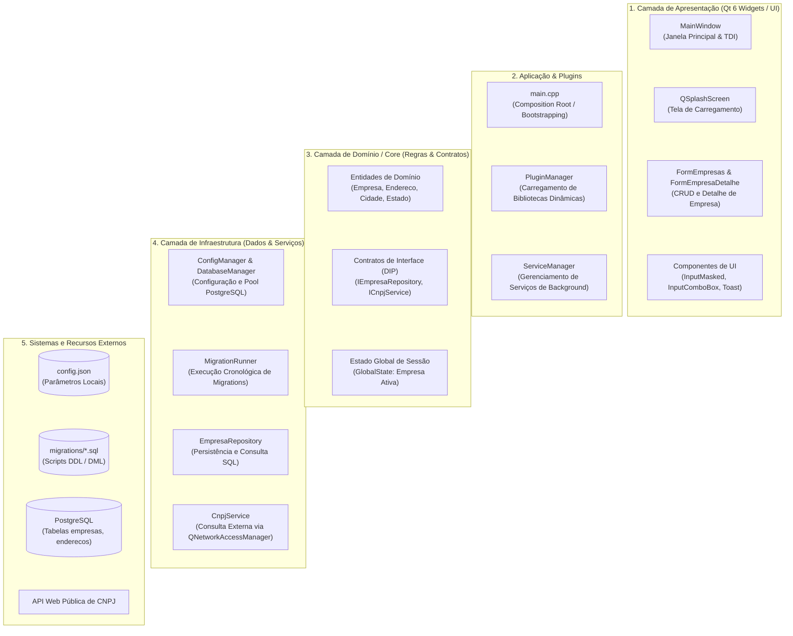

---

### 2.2. Diagrama Estrutural Detalhado

O diagrama detalhado a seguir mapeia as classes concretas, interfaces abstratas, heranças, injeção de dependência e as tabelas correspondentes do banco de dados PostgreSQL:

```mermaid
flowchart TB
    subgraph Presentation ["Camada de Apresentação"]
        SplashComp["QSplashScreen"]
        MainApp["MainWindow"]
        FormListEmp["FormEmpresas<br/>(Herda FormListagemBase)"]
        FormDetEmp["FormEmpresaDetalhe<br/>(Herda FormDetalheBase)"]
        ToastComp["ToastNotification"]

        MainApp --> FormListEmp
        MainApp --> FormDetEmp
        FormListEmp --> FormDetEmp
        FormDetEmp --> ToastComp
    end

    subgraph CompositionRoot ["Ponto de Entrada e Bootstrapping"]
        MainBoot["main.cpp<br/>• Leitura config.json<br/>• Inicializa DB & Migrations<br/>• Registra ICnpjService::setFactory<br/>• Carga de Plugins"]
        MainBoot --> SplashComp
        MainBoot --> MainApp
    end

    subgraph CoreLayer ["Camada de Domínio / Core"]
        subgraph EntitiesCore ["Entidades"]
            ModelEmpresa["Empresa<br/>+id: optional&lt;int&gt;<br/>+cnpjCpf: QString<br/>+razaoSocial: QString<br/>+nomeFantasia: QString<br/>+inscricaoEstadual: QString<br/>+endereco: Endereco"]
            ModelEndereco["Endereco<br/>+logradouro: QString<br/>+numero: QString<br/>+complemento: QString<br/>+bairro: QString<br/>+cep: QString<br/>+idCidade: int"]
            ModelCnpjResult["CnpjResult (DTO)<br/>+cnpj: QString<br/>+razaoSocial: QString<br/>+logradouro, cep, ibgeCidade: int"]
        end

        subgraph ContractsCore ["Interfaces e Contratos (DIP)"]
            IEmpresaRepository["&laquo;interface&raquo;<br/>IEmpresaRepository<br/>+salvar(Empresa&): void<br/>+buscarPorId(int): optional&lt;Empresa&gt;<br/>+listarTodas(): QList&lt;Empresa&gt;<br/>+deletar(int): bool"]
            ICnpjService["&laquo;interface&raquo;<br/>ICnpjService (QObject)<br/>+consultarCNPJ(QString): void<br/>[Signals]:<br/>• consultaFinalizada(CnpjResult)<br/>• erroConsulta(QString)<br/>[Static]:<br/>• setFactory(Factory)<br/>• create(parent): ICnpjService*"]
        end

        GlobalStateInst["GlobalState (Singleton)<br/>+empresaAtual(): optional&lt;Empresa&gt;<br/>+setEmpresaAtual(Empresa): void<br/>+clearEmpresaAtual(): void<br/>[Signal]: empresaAtualChanged"]
    end

    subgraph InfrastructureLayer ["Camada de Infraestrutura"]
        ConfigManager["ConfigManager (Singleton)<br/>+load(caminho): bool<br/>+dbHost(), dbPort(), dbUser()..."]
        DatabaseManager["DatabaseManager (Singleton)<br/>+connectToDatabase(...): bool<br/>+database(): QSqlDatabase"]
        MigrationRunner["MigrationRunner<br/>+runPendingMigrations(pasta): bool"]
        EmpresaRepositoryImpl["EmpresaRepository<br/>+salvar(Empresa&): void<br/>+listarTodas(): QList&lt;Empresa&gt;"]
        CnpjServiceImpl["CnpjService (QObject)<br/>+consultarCNPJ(QString): void<br/>-m_networkManager: QNetworkAccessManager"]
    end

    subgraph ExternalStorage ["Sistemas Externos & PostgreSQL"]
        FileConfig[("config.json")]
        SqlMigrations[("migrations/20260818082600_create_empresas_table.sql<br/>20260818082500_create_enderecos_table.sql")]
        TableEmpresas[("Tabela empresas<br/>PK id<br/>FK id_endereco<br/>cnpj_cpf, razao_social")]
        TableEnderecos[("Tabela enderecos<br/>PK id<br/>FK id_cidade<br/>logradouro, cep, bairro")]
        WebCnpjApi["API Web REST<br/>https://publica.cnpj.ws/cnpj/"]
    end

    %% Relacionamentos do Bootstrapping
    MainBoot --> ConfigManager
    MainBoot --> DatabaseManager
    MainBoot --> MigrationRunner
    MainBoot -->|Registra Factory| ICnpjService

    ConfigManager --> FileConfig
    DatabaseManager --> TableEmpresas
    MigrationRunner --> SqlMigrations
    MigrationRunner --> TableEmpresas

    %% Realizações de Interfaces (DIP)
    EmpresaRepositoryImpl -.->|Implementa| IEmpresaRepository
    CnpjServiceImpl -.->|Implementa| ICnpjService

    %% Relacionamentos de Apresentação com Core e Infra
    MainApp --> GlobalStateInst
    MainApp --> EmpresaRepositoryImpl
    FormListEmp --> IEmpresaRepository
    FormDetEmp --> ModelEmpresa
    FormDetEmp --> ICnpjService
    FormDetEmp --> EmpresaRepositoryImpl

    %% Infraestrutura e Entidades
    EmpresaRepositoryImpl --> ModelEmpresa
    EmpresaRepositoryImpl --> ModelEndereco
    EmpresaRepositoryImpl --> TableEmpresas
    EmpresaRepositoryImpl --> TableEnderecos
    CnpjServiceImpl --> ModelCnpjResult
    CnpjServiceImpl --> WebCnpjApi
```

---

### 2.3. Diagramas Comportamentais Simplificados

#### 2.3.1. Sub-fluxo A: Bootstrapping e Verificação de Empresa Inicial (Simplificado)

Destaca a comunicação estrita entre as fronteiras das camadas durante a inicialização:

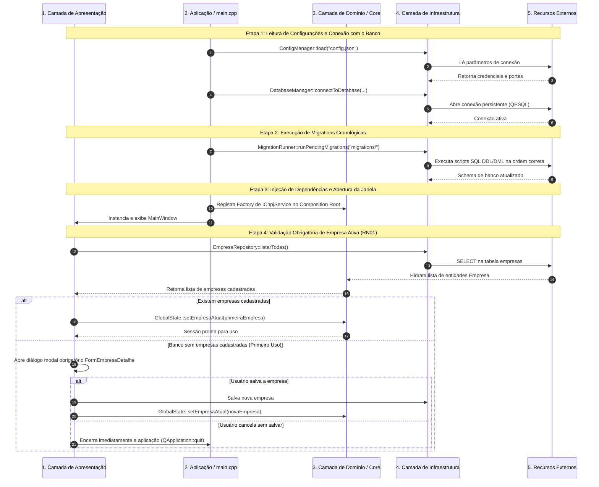

#### 2.3.2. Sub-fluxo B: Gestão e Cadastro de Empresa com Consulta de CNPJ (Simplificado)

Evidencia a consulta assíncrona de dados cadastrais e o fluxo de persistência de empresa:

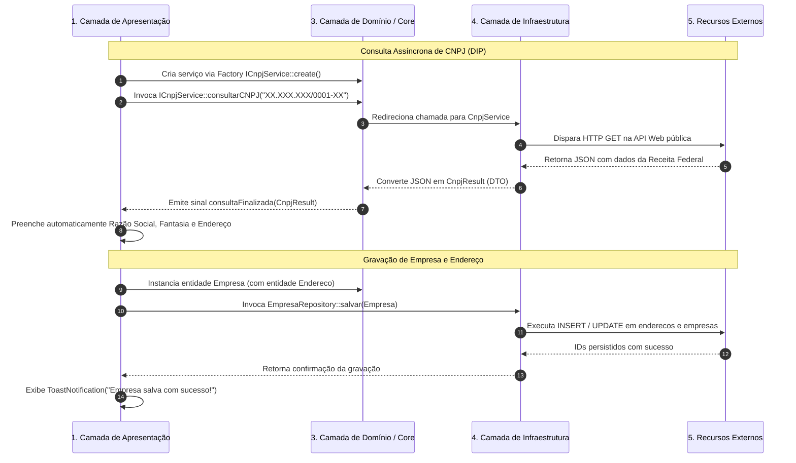

---

### 2.4. Diagramas Comportamentais Detalhados

#### 2.4.1. Sub-fluxo A: Ciclo de Vida da Inicialização (Técnico)

Mapeia as chamadas concretas, componentes gráficos, tratamento de falhas e checagens de regras de negócio:

```mermaid
sequenceDiagram
    autonumber
    actor Usuario as Usuário do Sistema
    participant Main as main.cpp
    participant Splash as QSplashScreen
    participant Config as ConfigManager
    participant DB as DatabaseManager
    participant Migrations as MigrationRunner
    participant Plugins as PluginManager
    participant Win as MainWindow
    participant Global as GlobalState
    participant RepoEmpresa as EmpresaRepository

    Usuario->>Main: Executa binário ./callisto
    Main->>Splash: show() & processEvents()
    Splash-->>Usuario: Exibe imagem de splash com mensagem de status

    Main->>Splash: showMessage("Carregando configurações.")
    Main->>Config: load(applicationDirPath() + "/config.json")
    alt Falha ao abrir ou interpretar config.json
        Config-->>Main: false
        Main-->>Usuario: Registra log crítico e encerra aplicação (-1)
    end
    Config-->>Main: true

    Main->>Splash: showMessage("Estabelecendo a comunicação com o banco de dados.")
    Main->>DB: connectToDatabase(host, port, dbName, user, pwd)
    alt Falha de conexão PostgreSQL
        DB-->>Main: false
        Main-->>Usuario: Registra log crítico e encerra aplicação (-1)
    end
    DB-->>Main: true

    Main->>Splash: showMessage("Verificando versão do banco de dados.")
    Main->>Migrations: runPendingMigrations(migrationsPath)
    Note over Migrations,DB: Executa migrations na ordem estrita do prefixo numérico (RN04)
    alt Erro na execução de alguma migration SQL
        Migrations-->>Main: false
        Main-->>Usuario: Registra log crítico e encerra aplicação (-1)
    end
    Migrations-->>Main: true

    Main->>Splash: showMessage("Carregando plugins.")
    Main->>Plugins: loadPlugins(applicationDirPath() + "/bin/plugins")
    Plugins-->>Main: Concluído

    Main->>Splash: showMessage("Inicializando serviços")
    Note over Main: Registra Factory de ICnpjService no Composition Root
    Main->>Main: ICnpjService::setFactory([](parent) { return new CnpjService(parent); })

    Main->>Win: Instancia MainWindow()
    Main->>Win: show()
    Main->>Splash: finish(&Win)

    Note over Win: QTimer::singleShot(0, verificarEmpresaInicial)
    Win->>RepoEmpresa: listarTodas()
    alt Existem empresas cadastradas
        RepoEmpresa-->>Win: [Empresa1, Empresa2, ...]
        Win->>Global: setEmpresaAtual(Empresa1)
    else Nenhuma empresa cadastrada no banco (Primeiro Acesso)
        RepoEmpresa-->>Win: []
        Win->>Usuario: Exibe QMessageBox Informativo de Boas-vindas
        Win->>Win: Instancia QDialog modal com FormEmpresaDetalhe
        Win->>Usuario: dialog.exec()

        alt Usuário preenche e salva a empresa
            Usuario->>Win: Clica em "Salvar" no formulário
            Win->>Global: setEmpresaAtual(NovaEmpresa)
            Win->>Usuario: ToastNotification("Empresa cadastrada com sucesso!")
        else Usuário fecha ou cancela o diálogo modal (RN01)
            Win->>Win: close()
            Win->>Main: QApplication::quit()
        end
    end
```

#### 2.4.2. Sub-fluxo B: Cadastro de Empresa com Consulta CNPJ e Validações (Técnico)

Mapeia em detalhes a digitação no input mascarado, a consulta HTTP e o salvamento relacional:

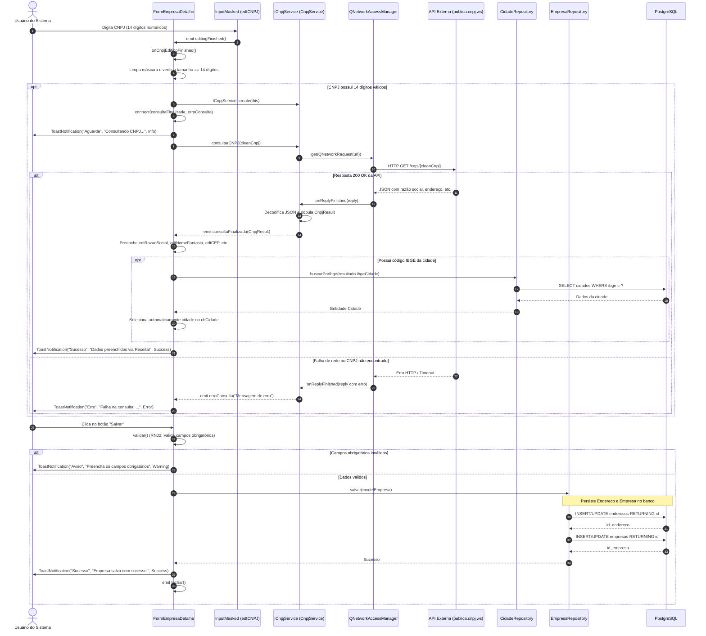

---

### 2.5. Matriz de Rastreabilidade do Módulo 1

| Requisito / Regra | Tipo | Descrição Sumária | Componente Responsável | Diagrama Associado |
| :--- | :--- | :--- | :--- | :--- |
| **RF01** | Funcional | Inicialização com Splash Screen e Migrations automáticas | `main.cpp`, `QSplashScreen`, `MigrationRunner` | Estrutural (2.1, 2.2), Sequência (2.3.1, 2.4.1) |
| **RF02** | Funcional | Obrigatoriedade de Empresa Inicial no primeiro uso | `MainWindow::verificarEmpresaInicial`, `GlobalState` | Sequência (2.3.1, 2.4.1) |
| **RF03** | Funcional | CRUD cadastral de empresas com endereço completo | `FormEmpresas`, `FormEmpresaDetalhe`, `EmpresaRepository` | Estrutural (2.2), Sequência (2.3.2, 2.4.2) |
| **RF04** | Funcional | Preenchimento automático de dados via consulta de CNPJ | `ICnpjService`, `CnpjService`, `FormEmpresaDetalhe` | Estrutural (2.2), Sequência (2.3.2, 2.4.2) |
| **RN01** | Regra de Negócio | Bloqueio de uso e encerramento se não houver empresa ativa | `MainWindow::verificarEmpresaInicial`, `GlobalState` | Sequência (2.3.1, 2.4.1) |
| **RN02** | Regra de Negócio | Validação de campos obrigatórios (CNPJ e Razão Social) | `FormEmpresaDetalhe::validar`, `Mensagens` | Sequência (2.4.2) |
| **RN03** | Regra de Negócio | Alternância dinâmica de máscaras CPF/CNPJ | `FormEmpresaDetalhe::onPessoaChange`, `InputMasked` | Sequência (2.4.2) |
| **RN04** | Regra de Negócio | Execução estritamente cronológica de migrations SQL | `MigrationRunner::runPendingMigrations` | Sequência (2.3.1, 2.4.1) |

---

## 3. Módulo 2: Gestão de Pessoas e Participantes (Clientes, Fornecedores, Contabilistas)

O **Módulo de Gestão de Pessoas e Participantes** é o núcleo de identificação relacional do sistema. Ele gerencia o ciclo de vida completo dos atores envolvidos nas operações comerciais e fiscais: clientes, fornecedores, transportadoras e contabilistas.

Neste módulo, o cadastro é centralizado em uma única entidade de domínio (`Pessoa`), que atua como modelo unificado diferenciado por papéis através de marcadores booleanos (`fornecedor: S/N` e `contabilista: S/N`). Adicionalmente, quando o papel de contabilista é ativado, o modelo expande os dados com uma extensão 1:1 (`PessoaContabilista`) para armazenamento de dados específicos exigidos pelo SPED Fiscal (CRC e CPF).

O módulo integra consulta remota assíncrona de CNPJ via [`ICnpjService`](file:///home/lamb/dev/castorsoft/dfe/src/core/interfaces/ICnpjService.h), resolução automática de município via código IBGE através do [`CidadeRepository`](file:///home/lamb/dev/castorsoft/dfe/src/infrastructure/database/repositories/CidadeRepository.h), e persistência relacional em cascata coordenada pelo [`PessoaRepository`](file:///home/lamb/dev/castorsoft/dfe/src/infrastructure/database/repositories/PessoaRepository.h).

---

### 3.1. Diagrama Estrutural Simplificado (Camadas Participantes)

Visão top-down com empilhamento vertical estrito de camadas macroscópicas, posicionando componentes lado a lado sem conexões cruzadas:

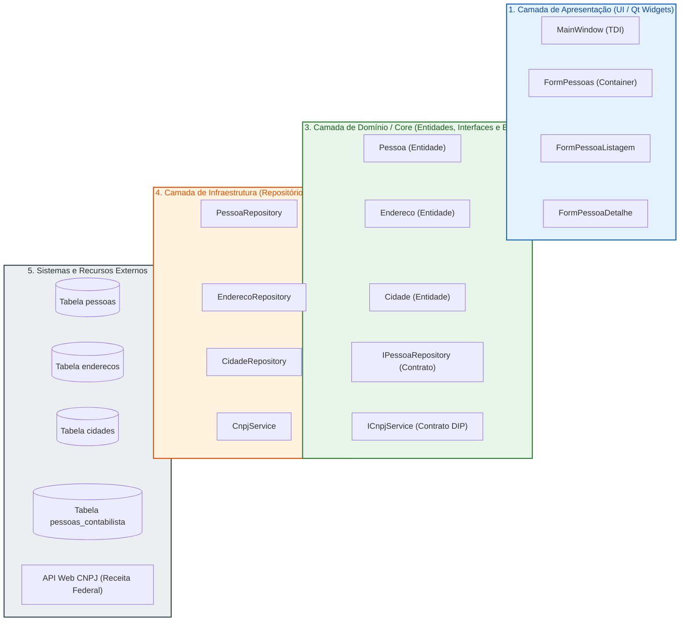

---

### 3.2. Diagrama Estrutural Detalhado (Classes, Contratos e Tabelas)

Mapeamento completo das classes concretas, interfaces, dependências e tabelas relacionais do Módulo 2. Destaca o papel de fornecedor e contabilista como atributos de estado (`S`/`N`) na entidade [`Pessoa`](file:///home/lamb/dev/castorsoft/dfe/src/core/entities/Pessoa.h) e a persistência em cascata com a tabela `enderecos`:

```mermaid
flowchart TB
    %% ---------------- CAMADA DE APRESENTAÇÃO ----------------
    subgraph Presentation ["1. Camada de Apresentação (src/presentation)"]
        FormPessoasClass["<b>FormPessoas</b><br/>+ criarFormDetalhe(): FormDetalheBase*<br/>+ onEditarRegistro(row: int)<br/>+ onDeletarRegistro(row: int)"]
        FormPessoaListClass["<b>FormPessoaListagem</b><br/>+ aplicarLayoutGrid()<br/>+ filtroTermo(): QString"]
        FormPessoaDetClass["<b>FormPessoaDetalhe</b><br/>- ui: Ui::FormPessoaDetalhe*<br/>- m_cnpjService: ICnpjService*<br/>- m_PessoaAtual: optional&lt;Pessoa&gt;<br/>+ onSalvar()<br/>+ onCnpjEditingFinished()<br/>+ onCnpjRetornado(res: CnpjResult)<br/>+ atualizarVisibilidadeAbas()<br/>+ validar(): bool"]
        PessoaProviderClass["<b>PessoaListProvider</b><br/>- repo: IPessoaRepository*<br/>+ buscarDados(): QList&lt;Pessoa&gt;"]
    end

    %% ---------------- CAMADA DE DOMÍNIO / CORE ----------------
    subgraph Core ["3. Camada de Domínio / Core (src/core)"]
        EntityPessoa["<b>Pessoa</b><br/>- m_id: optional&lt;int&gt;<br/>- m_idEmpresa: int<br/>- m_cnpjCpf: QString<br/>- m_razaoSocial: QString<br/>- m_nomeFantasia: optional&lt;QString&gt;<br/>- m_inscricaoEstadual: optional&lt;QString&gt;<br/>- m_fornecedor: QString ('S'/'N')<br/>- m_contabilista: QString ('S'/'N')<br/>- m_endereco: optional&lt;Endereco&gt;<br/>- m_pessoaContabilista: optional&lt;PessoaContabilista&gt;"]
        EntityEndereco["<b>Endereco</b><br/>- m_id: optional&lt;int&gt;<br/>- m_logradouro: QString<br/>- m_numero: QString<br/>- m_bairro: QString<br/>- m_cep: QString<br/>- m_idCidade: int"]
        EntityCidade["<b>Cidade</b><br/>- m_id: int<br/>- m_codigoIbge: QString<br/>- m_nome: QString<br/>- m_uf: QString"]
        EntityContabilista["<b>PessoaContabilista</b><br/>- m_id: optional&lt;int&gt;<br/>- m_idPessoa: int<br/>- m_cpf: QString<br/>- m_crc: QString"]

        RepoPessoaInterface["&lt;&lt;interface&gt;&gt;<br/><b>IPessoaRepository</b><br/>+ salvar(Pessoa&): bool<br/>+ buscarPorId(id: int): optional&lt;Pessoa&gt;<br/>+ buscarPorCnpjCpf(doc: QString): optional&lt;Pessoa&gt;<br/>+ listarTodas(): QList&lt;Pessoa&gt;<br/>+ deletar(id: int): bool"]
        RepoCidadeInterface["&lt;&lt;interface&gt;&gt;<br/><b>ICidadeRepository</b><br/>+ buscarPorId(id: int): optional&lt;Cidade&gt;<br/>+ buscarPorIbge(ibge: QString): optional&lt;Cidade&gt;<br/>+ listarPorUf(uf: QString): QList&lt;Cidade&gt;"]
        RepoEnderecoInterface["&lt;&lt;interface&gt;&gt;<br/><b>IEnderecoRepository</b><br/>+ salvar(Endereco&): bool<br/>+ buscarPorId(id: int): optional&lt;Endereco&gt;"]
        CnpjServiceInterface["&lt;&lt;interface&gt;&gt;<br/><b>ICnpjService</b><br/>+ consultarCNPJ(cnpj: QString)*<br/>+ consultaFinalizada(CnpjResult)<br/>+ erroConsulta(QString)<br/>+ create(parent): ICnpjService*"]
    end

    %% ---------------- CAMADA DE INFRAESTRUTURA ----------------
    subgraph Infra ["4. Camada de Infraestrutura (src/infrastructure)"]
        RepoPessoaImpl["<b>PessoaRepository</b><br/>+ salvar(Pessoa&): bool<br/>+ buscarPorId(int): optional&lt;Pessoa&gt;<br/>+ buscarPorCnpjCpf(QString): optional&lt;Pessoa&gt;<br/>+ deletar(int): bool<br/>- mapToEntity(query: QSqlQuery&): optional&lt;Pessoa&gt;"]
        RepoCidadeImpl["<b>CidadeRepository</b><br/>+ buscarPorIbge(QString): optional&lt;Cidade&gt;<br/>+ listarPorUf(QString): QList&lt;Cidade&gt;"]
        RepoEnderecoImpl["<b>EnderecoRepository</b><br/>+ salvar(Endereco&): bool<br/>+ buscarPorId(int): optional&lt;Endereco&gt;"]
        CnpjServiceImpl["<b>CnpjService</b><br/>- m_netManager: QNetworkAccessManager*<br/>+ consultarCNPJ(cnpj: QString)<br/>- onReplyFinished(reply: QNetworkReply*)"]
    end

    %% ---------------- RECURSOS EXTERNOS ----------------
    subgraph External ["5. Sistemas e Recursos Externos"]
        TablePessoas[("<b>pessoas</b><br/>id: SERIAL (PK)<br/>id_empresa: INT (FK)<br/>cnpj_cpf: VARCHAR<br/>razao_social: VARCHAR<br/>fornecedor: CHAR(1)<br/>contabilista: CHAR(1)<br/>id_endereco: INT (FK)")]
        TableEnderecos[("<b>enderecos</b><br/>id: SERIAL (PK)<br/>logradouro: VARCHAR<br/>numero: VARCHAR<br/>cep: VARCHAR<br/>id_cidade: INT (FK)")]
        TableCidades[("<b>cidades</b><br/>id: INT (PK)<br/>codigo_ibge: VARCHAR<br/>nome: VARCHAR<br/>uf: CHAR(2)")]
        TablePessoasContab[("<b>pessoas_contabilista</b><br/>id: SERIAL (PK)<br/>id_pessoa: INT (FK)<br/>cpf: VARCHAR<br/>crc: VARCHAR")]
        WebCnpjApi["<b>API Web CNPJ</b><br/>GET /cnpj/{cnpj}"]
    end

    %% Relações Presentation -> UI
    FormPessoasClass --> FormPessoaListClass
    FormPessoasClass --> FormPessoaDetClass
    FormPessoaListClass --> PessoaProviderClass

    %% Relações Presentation -> Core / Infra
    PessoaProviderClass --> RepoPessoaInterface
    FormPessoaDetClass --> EntityPessoa
    FormPessoaDetClass --> CnpjServiceInterface
    FormPessoaDetClass --> RepoPessoaInterface
    FormPessoaDetClass --> RepoCidadeInterface

    %% Relações Core (Entidades)
    EntityPessoa *-- EntityEndereco : compõe
    EntityPessoa o-- EntityContabilista : agrega opcional (se contabilista == 'S')
    EntityEndereco --> EntityCidade : referencia idCidade

    %% Realizações de Interfaces (DIP)
    RepoPessoaImpl ..|> RepoPessoaInterface
    RepoCidadeImpl ..|> RepoCidadeInterface
    RepoEnderecoImpl ..|> RepoEnderecoInterface
    CnpjServiceImpl ..|> CnpjServiceInterface

    %% Relações Infra -> Core / Banco
    RepoPessoaImpl --> RepoEnderecoImpl : salva endereco em cascata
    RepoPessoaImpl --> TablePessoas
    RepoPessoaImpl --> TablePessoasContab
    RepoEnderecoImpl --> TableEnderecos
    RepoCidadeImpl --> TableCidades
    CnpjServiceImpl --> WebCnpjApi
```

---

### 3.3. Diagrama Comportamental Simplificado (Inter-Camadas)

Ilustra o fluxo de dados entre as fronteiras das camadas em dois momentos cruciais: a consulta automática de dados cadastrais e a posterior persistência relacional do participante:

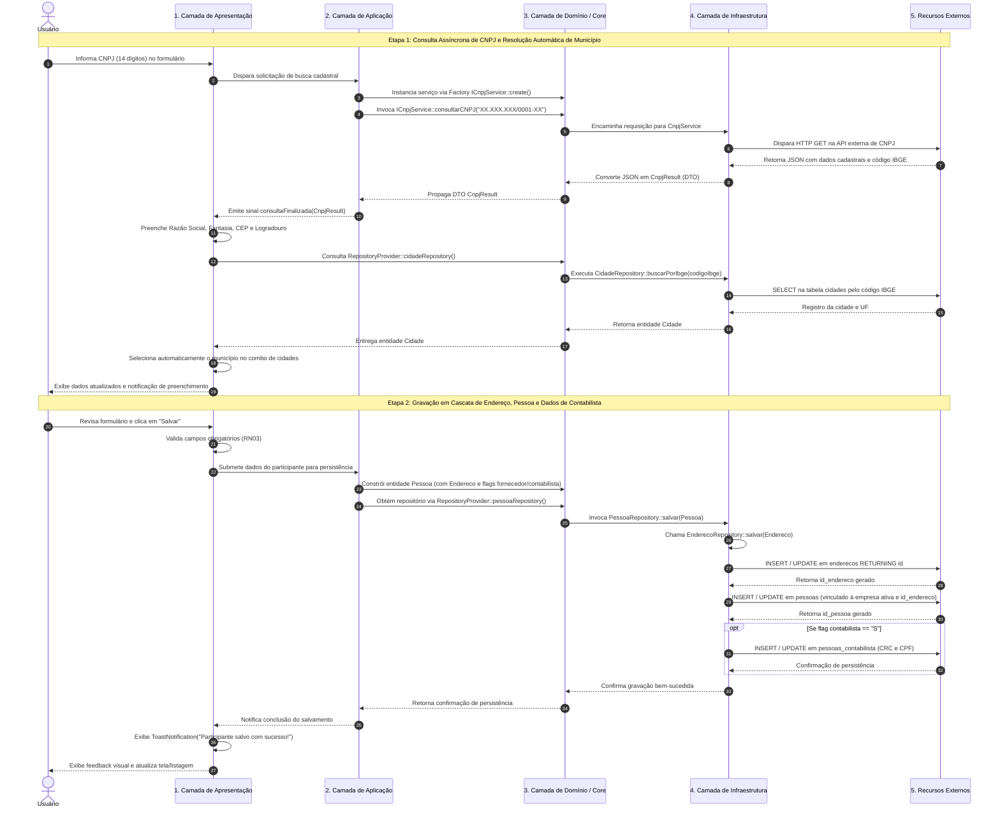

---

### 3.4. Diagrama Comportamental Detalhado (Sequência Técnica)

Mapeia as chamadas concretas de métodos, sinais e slots do Qt, tratamento de eventos do formulário, validações de regras de negócio e controle relacional de banco:

```mermaid
sequenceDiagram
    autonumber
    actor Usuario as Usuário do Sistema
    participant Form as FormPessoaDetalhe
    participant MaskedCnpj as InputMasked (edtCNPJ)
    participant ChkContab as InputCheckBox (chkContabilista)
    participant CnpjSvc as ICnpjService (CnpjService)
    participant NetMgr as QNetworkAccessManager
    participant ApiExt as API Externa (publica.cnpj.ws)
    participant CidRepo as CidadeRepository
    participant PessoaRepo as PessoaRepository
    participant EndRepo as EnderecoRepository
    participant DB as PostgreSQL

    Note over Usuario,DB: 1. Preenchimento do Documento e Consulta Web (RF08, RN03)
    Usuario->>MaskedCnpj: Digita CNPJ (14 dígitos)
    MaskedCnpj->>Form: emit editingFinished()
    Form->>Form: onCnpjEditingFinished()
    Form->>Form: Extrai dígitos limpos e valida tamanho == 14

    opt CNPJ com 14 dígitos numéricos válidos
        Form->>CnpjSvc: ICnpjService::create(this)
        Form->>Form: connect(consultaFinalizada, erroConsulta)
        Form->>Usuario: ToastNotification("Aguarde", "Consultando CNPJ...", Info)
        Form->>CnpjSvc: consultarCNPJ(cleanCnpj)
        CnpjSvc->>NetMgr: get(QNetworkRequest(url))
        NetMgr->>ApiExt: HTTP GET /cnpj/{cleanCnpj}

        alt Resposta 200 OK da API
            ApiExt-->>NetMgr: JSON com razão social, logradouro, CEP, IBGE
            NetMgr->>CnpjSvc: onReplyFinished(reply)
            CnpjSvc->>CnpjSvc: Parse do JSON para CnpjResult
            CnpjSvc-->>Form: emit consultaFinalizada(CnpjResult)
            Form->>Form: onCnpjRetornado(resultado)
            Form->>Form: Preenche edtRazaoSocial, edtNomeFantasia, edtCEP, edtLogradouro, etc.

            opt Código IBGE presente no resultado
                Form->>CidRepo: buscarPorIbge(resultado.ibgeCidade)
                CidRepo->>DB: SELECT * FROM cidades WHERE codigo_ibge = ?
                DB-->>CidRepo: Registro da cidade
                CidRepo-->>Form: optional&lt;Cidade&gt;
                Form->>Form: Posiciona cbUF e cbCidade no índice correto
            end
            Form->>Usuario: ToastNotification("Sucesso", "Dados preenchidos via Receita!", Success)
        else Falha HTTP ou Timeout
            ApiExt-->>NetMgr: Resposta de erro / NetworkError
            NetMgr->>CnpjSvc: onReplyFinished(reply com erro)
            CnpjSvc-->>Form: emit erroConsulta("Falha ao consultar CNPJ")
            Form->>Form: onCnpjErro(erro)
            Form->>Usuario: ToastNotification("Erro", "Falha na consulta do CNPJ", Error)
        end
    end

    Note over Usuario,DB: 2. Seleção de Papel de Contabilista (RF06, RF07, RN06)
    Usuario->>ChkContab: Marca checkbox "Contabilista"
    ChkContab->>Form: emit stateChanged()
    Form->>Form: atualizarVisibilidadeAbas()
    Form->>Form: tabWidget->setTabVisible(indexContabilista, true)
    Usuario->>Form: Preenche CRC e CPF do Contador na aba específica

    Note over Usuario,DB: 3. Validação e Persistência em Cascata (RF05, RN05)
    Usuario->>Form: Clica no botão "Salvar"
    Form->>Form: validar()
    alt Falha de validação (CNPJ ou Razão Social vazios)
        Form->>Usuario: ToastNotification("Aviso", "Preencha os campos obrigatórios", Warning)
    else Validação com Sucesso
        Form->>Form: Coleta dados e injeta id_empresa via GlobalState::empresaAtual().id() (RN05)
        Form->>PessoaRepo: salvar(modelPessoa)

        Note over PessoaRepo,EndRepo: Persistência do Endereço em Primeiro Lugar
        PessoaRepo->>EndRepo: salvar(modelPessoa.endereco())
        EndRepo->>DB: INSERT/UPDATE INTO enderecos (...) RETURNING id
        DB-->>EndRepo: id_endereco gerado
        EndRepo-->>PessoaRepo: Endereco atualizado com ID

        Note over PessoaRepo,DB: Persistência da Pessoa
        PessoaRepo->>PessoaRepo: modelPessoa.setIdEndereco(id_endereco)
        PessoaRepo->>DB: INSERT/UPDATE INTO pessoas (id_empresa, cnpj_cpf, razao_social, ..., fornecedor, contabilista, id_endereco) RETURNING id, uuid
        DB-->>PessoaRepo: id_pessoa, uuid

        opt Se contabilista == "S" e possui dados de PessoaContabilista (RF07)
            PessoaRepo->>DB: SELECT id FROM pessoas_contabilista WHERE id_pessoa = :idPessoa
            alt Registro já existente
                PessoaRepo->>DB: UPDATE pessoas_contabilista SET cpf = :cpf, crc = :crc WHERE id = :id
            else Novo registro
                PessoaRepo->>DB: INSERT INTO pessoas_contabilista (id_pessoa, cpf, crc) VALUES (...)
            end
            DB-->>PessoaRepo: Confirmação de gravação
        end

        PessoaRepo-->>Form: true (sucesso)
        Form->>Usuario: ToastNotification("Sucesso", "Participante salvo com sucesso!", Success)
        Form->>Form: emit fechar()
    end
```

---

### 3.5. Matriz de Rastreabilidade do Módulo 2

| Requisito / Regra | Tipo | Descrição Sumária | Componente Responsável | Diagrama Associado |
| :--- | :--- | :--- | :--- | :--- |
| **RF05** | Funcional | CRUD cadastral de pessoas com endereço vinculado a Cidades (IBGE) | `FormPessoas`, `FormPessoaDetalhe`, `PessoaRepository`, `EnderecoRepository` | Estrutural (3.1, 3.2), Sequência (3.3, 3.4) |
| **RF06** | Funcional | Classificação de papéis (Fornecedor e Contabilista) | `Pessoa` (`m_fornecedor`, `m_contabilista`), `FormPessoaDetalhe` | Estrutural (3.2), Sequência (3.4) |
| **RF07** | Funcional | Dados específicos de Contabilista (CRC e CPF) em aba condicional | `PessoaContabilista`, `FormPessoaDetalhe`, `pessoas_contabilista` | Estrutural (3.2), Sequência (3.4) |
| **RF08** | Funcional | Consulta automática de CNPJ ao sair do campo com 14 dígitos | `ICnpjService`, `CnpjService`, `FormPessoaDetalhe::onCnpjEditingFinished` | Estrutural (3.1, 3.2), Sequência (3.3, 3.4) |
| **RN05** | Regra de Negócio | Vínculo obrigatório da Pessoa com a empresa ativa | `GlobalState::empresaAtual`, `FormPessoaDetalhe`, `Pessoa::m_idEmpresa` | Sequência (3.4) |
| **RN06** | Regra de Negócio | Visibilidade condicional de abas para papéis específicos | `FormPessoaDetalhe::atualizarVisibilidadeAbas` | Sequência (3.4) |
| **RN07** | Regra de Negócio | Unicidade de documento e verificação prévia no cadastro automático | `IPessoaRepository::buscarPorCnpjCpf` | Estrutural (3.2) |
| **RN08** | Regra de Negócio | Marcação automática de fornecedor em notas de terceiros | `ImportacaoXmlUseCase`, `Pessoa::setFornecedor("S")` | Estrutural (3.2) |
| **US03** | História de Usuário | Cadastro e classificação de participantes (Fornecedores e Contabilistas) | `FormPessoas`, `FormPessoaDetalhe`, `FormPessoaListagem` | Estrutural (3.1, 3.2), Sequência (3.3, 3.4) |

---

## 4. Módulo 3: Gestão de Produtos, Unidades de Medida e NCM

O **Módulo de Produtos, Unidades de Medida e NCM** é responsável pelo catálogo de itens comercializados ou consumidos pela empresa ativa. Ele estabelece as definições fiscais fundamentais (Nomenclatura Comum do Mercosul - NCM, Unidades de Medida de Comercialização e Inventário e Tipo de Item SPED) necessárias para a emissão de notas fiscais e para a correta geração do Registro `0200` da EFD ICMS/IPI.

O módulo destaca-se pela experiência ergonômica de pesquisa baseada no componente [`InputLookup`](file:///home/lamb/dev/castorsoft/dfe/src/presentation/components/inputs/InputLookup.h), que implementa o padrão *search-as-you-type* com controle refinado de eventos (*event filtering*) para assegurar que a renderização do popup de sugestões não roube o foco de digitação do usuário ([RN09](file:///home/lamb/dev/castorsoft/dfe/docs/ESPECIFICACAO_REQUISITOS.md#L160)).

---

### 4.1. Diagrama Estrutural Simplificado (Camadas Participantes)

Visão top-down com empilhamento horizontal de componentes dentro de cada camada macroscópica:

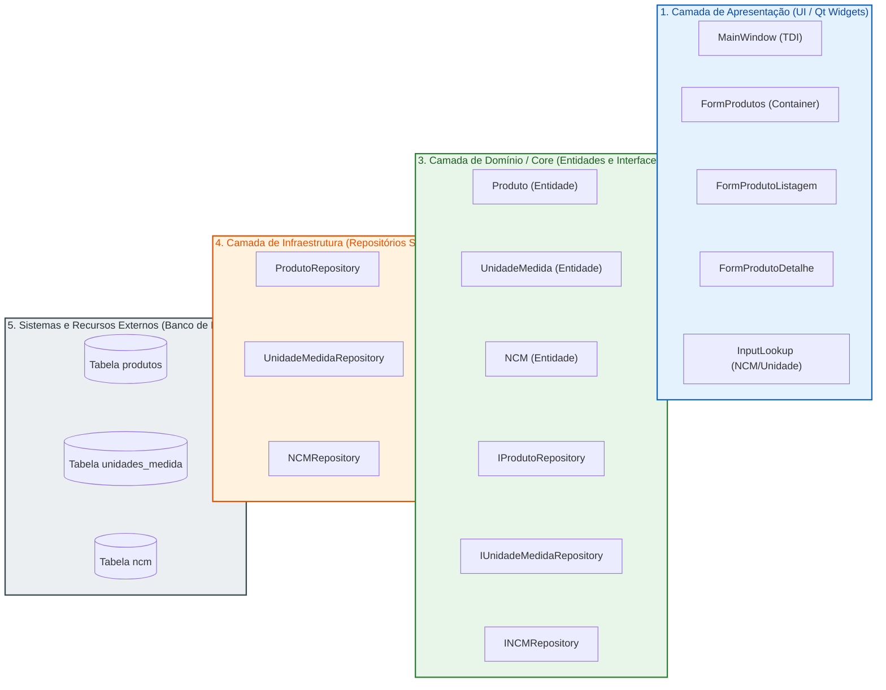

---

### 4.2. Diagrama Estrutural Detalhado (Classes, Contratos e Tabelas)

Mapeamento técnico da estrutura de classes, propriedades, contratos de repositórios e esquemas relacionais no PostgreSQL:

```mermaid
flowchart TB
    %% ---------------- CAMADA DE APRESENTAÇÃO ----------------
    subgraph Presentation ["1. Camada de Apresentação (src/presentation)"]
        FormProdutosClass["<b>FormProdutos</b><br/>+ criarFormDetalhe(): FormDetalheBase*<br/>+ onEditarRegistro(row: int)<br/>+ onDeletarRegistro(row: int)"]
        FormProdListClass["<b>FormProdutoListagem</b><br/>+ aplicarLayoutGrid()<br/>+ filtroTermo(): QString"]
        FormProdDetClass["<b>FormProdutoDetalhe</b><br/>- ui: Ui::FormProdutoDetalhe*<br/>- m_produtoAtual: optional&lt;Produto&gt;<br/>+ preencherAPartirDeNota(det: ItemDocFiscal)<br/>+ onSalvar()<br/>+ validar(): bool"]
        InputLookupClass["<b>InputLookup</b><br/>- m_lineEdit: QLineEdit*<br/>- m_listWidget: QListWidget*<br/>- m_debounceTimer: QTimer*<br/>+ triggerSearch(termo: QString)<br/>+ eventFilter(watched, event): bool<br/>+ setResults(items: QList&lt;Pair&gt;)"]
        ProdProviderClass["<b>ProdutoListProvider</b><br/>- repo: IProdutoRepository*<br/>+ buscarDados(): QList&lt;Produto&gt;"]
    end

    %% ---------------- CAMADA DE DOMÍNIO / CORE ----------------
    subgraph Core ["3. Camada de Domínio / Core (src/core)"]
        EntityProduto["<b>Produto</b><br/>- m_id: optional&lt;int&gt;<br/>- m_idEmpresa: int<br/>- m_descricao: QString<br/>- m_codigoInterno: optional&lt;QString&gt;<br/>- m_codigoBarra: optional&lt;QString&gt;<br/>- m_idUnidadeMedida: int<br/>- m_idNcm: int<br/>- m_tipoAtividade: QString ('00' a '99')<br/>- m_unidadeMedida: optional&lt;UnidadeMedida&gt;<br/>- m_ncm: optional&lt;NCM&gt;"]
        EntityUnidade["<b>UnidadeMedida</b><br/>- m_id: optional&lt;int&gt;<br/>- m_sigla: QString<br/>- m_descricao: QString"]
        EntityNCM["<b>NCM</b><br/>- m_id: optional&lt;int&gt;<br/>- m_codigo: QString (8 dígitos)<br/>- m_descricao: QString"]

        IProdRepoClass["&lt;&lt;interface&gt;&gt;<br/><b>IProdutoRepository</b><br/>+ salvar(Produto&): bool<br/>+ buscarPorId(id: int): optional&lt;Produto&gt;<br/>+ buscarPorCodigoBarra(ean: QString): optional&lt;Produto&gt;<br/>+ listarTodas(): QList&lt;Produto&gt;<br/>+ deletar(id: int): bool"]
        IUnidRepoClass["&lt;&lt;interface&gt;&gt;<br/><b>IUnidadeMedidaRepository</b><br/>+ salvar(UnidadeMedida&): bool<br/>+ buscarPorSigla(sigla: QString): optional&lt;UnidadeMedida&gt;<br/>+ listarTodas(): QList&lt;UnidadeMedida&gt;"]
        INcmRepoClass["&lt;&lt;interface&gt;&gt;<br/><b>INCMRepository</b><br/>+ buscarPorId(id: int): optional&lt;NCM&gt;<br/>+ buscarPorTermo(termo: QString): QList&lt;NCM&gt;<br/>+ buscarPorCodigo(codigo: QString): optional&lt;NCM&gt;"]
    end

    %% ---------------- CAMADA DE INFRAESTRUTURA ----------------
    subgraph Infra ["4. Camada de Infraestrutura (src/infrastructure)"]
        ProdRepoImpl["<b>ProdutoRepository</b><br/>+ salvar(Produto&): bool<br/>+ buscarPorId(int): optional&lt;Produto&gt;<br/>+ buscarPorCodigoBarra(QString): optional&lt;Produto&gt;<br/>- mapToEntity(query: QSqlQuery&): optional&lt;Produto&gt;"]
        UnidRepoImpl["<b>UnidadeMedidaRepository</b><br/>+ buscarPorSigla(QString): optional&lt;UnidadeMedida&gt;<br/>+ listarTodas(): QList&lt;UnidadeMedida&gt;"]
        NcmRepoImpl["<b>NCMRepository</b><br/>+ buscarPorTermo(QString): QList&lt;NCM&gt;<br/>+ buscarPorCodigo(QString): optional&lt;NCM&gt;"]
    end

    %% ---------------- RECURSOS EXTERNOS ----------------
    subgraph External ["5. Sistemas e Recursos Externos"]
        TableProdutos[("<b>produtos</b><br/>id: SERIAL (PK)<br/>id_empresa: INT (FK)<br/>descricao: VARCHAR(255)<br/>codigo_interno: VARCHAR(60)<br/>codigo_barra: VARCHAR(14)<br/>id_unidade_medida: INT (FK)<br/>id_ncm: INT (FK)<br/>tipo_atividade: VARCHAR(2)")]
        TableUnidades[("<b>unidades_medida</b><br/>id: SERIAL (PK)<br/>sigla: VARCHAR(6)<br/>descricao: VARCHAR(100)")]
        TableNCM[("<b>ncm</b><br/>id: SERIAL (PK)<br/>codigo: VARCHAR(8)<br/>descricao: TEXT")]
    end

    %% Relações Presentation
    FormProdutosClass --> FormProdListClass
    FormProdutosClass --> FormProdDetClass
    FormProdListClass --> ProdProviderClass
    FormProdDetClass --> InputLookupClass
    FormProdDetClass --> IProdRepoClass
    FormProdDetClass --> IUnidRepoClass
    FormProdDetClass --> INcmRepoClass

    %% Relações Core (Entidades)
    EntityProduto --> EntityUnidade : referencia idUnidadeMedida
    EntityProduto --> EntityNCM : referencia idNcm

    %% Realizações de Interfaces (DIP)
    ProdRepoImpl ..|> IProdRepoClass
    UnidRepoImpl ..|> IUnidRepoClass
    NcmRepoImpl ..|> INcmRepoClass

    %% Relações Infra -> Banco
    ProdRepoImpl --> TableProdutos
    UnidRepoImpl --> TableUnidades
    NcmRepoImpl --> TableNCM
```

---

### 4.3. Diagrama Comportamental Simplificado (Inter-Camadas)

Exibe as trocas de mensagens entre as camadas para pesquisa em tempo real e persistência cadastral:

```mermaid
sequenceDiagram
    autonumber
    participant L1 as 1. Camada de Apresentação (Form/InputLookup)
    participant L3 as 3. Camada de Domínio / Core (Interfaces)
    participant L4 as 4. Camada de Infraestrutura (Repositórios)
    participant L5 as 5. Recursos Externos (PostgreSQL)

    Note over L1,L5: Etapa 1: Busca Dinâmica de NCM / Unidade (Search-As-You-Type)
    L1->>L1: Usuário digita no QLineEdit do InputLookup
    L1->>L1: Timer de debounce expira (300ms) sem perda de foco (RN09)
    L1->>L3: Invoca INCMRepository::buscarPorTermo(termo)
    L3->>L4: Executa NCMRepository::buscarPorTermo(termo)
    L4->>L5: SELECT codigo, descricao FROM ncm WHERE termo ILIKE %...% LIMIT 20
    L5-->>L4: Retorna lista de registros correspondentes
    L4-->>L3: Hidrata lista QList&lt;NCM&gt;
    L3-->>L1: Popula popup flutuante de sugestões
    L1->>L1: Usuário navega com Seta para Baixo e seleciona item com Enter

    Note over L1,L5: Etapa 2: Validação e Gravação do Produto
    L1->>L1: Valida campos obrigatórios (RN10) e higieniza "SEM GTIN" (RN11)
    L1->>L3: Monta modelo de entidade Produto com FKs e tipo de atividade padrão "00" (RN12)
    L1->>L4: Invoca ProdutoRepository::salvar(Produto)
    L4->>L5: INSERT / UPDATE INTO produtos RETURNING id, uuid
    L5-->>L4: Confirmação e ID persistido
    L4-->>L1: Retorna verdadeiro (sucesso)
    L1->>L1: Exibe ToastNotification("Produto salvo com sucesso!")
```

---

### 4.4. Diagrama Comportamental Detalhado (Sequência Técnica)

Mapeia a prevenção de roubo de foco com `eventFilter` no `InputLookup` ([RN09](file:///home/lamb/dev/castorsoft/dfe/docs/ESPECIFICACAO_REQUISITOS.md#L160)) e a persistência relacional do produto:

```mermaid
sequenceDiagram
    autonumber
    actor Usuario as Usuário do Sistema
    participant LineEdit as QLineEdit (m_lineEdit)
    participant Lookup as InputLookup
    participant ListWidget as QListWidget (m_listWidget)
    participant Form as FormProdutoDetalhe
    participant NcmRepo as NCMRepository
    participant ProdRepo as ProdutoRepository
    participant DB as PostgreSQL

    Note over Usuario,DB: 1. Interação Search-As-You-Type com Foco Preservado (RN09, US04)
    Usuario->>LineEdit: Digita "0402" (termo de busca)
    LineEdit->>Lookup: emit textEdited("0402")
    Lookup->>Lookup: m_debounceTimer->start(300ms)

    Note over Lookup: 300ms decorridos sem novas teclas
    Lookup->>Lookup: onSearchTimeout()
    Lookup->>NcmRepo: buscarPorTermo("0402")
    NcmRepo->>DB: SELECT id, codigo, descricao FROM ncm WHERE codigo ILIKE '0402%' OR descricao ILIKE '%0402%' LIMIT 30
    DB-->>NcmRepo: Conjunto de tuplas SQL
    NcmRepo-->>Lookup: QList&lt;NCM&gt;
    Lookup->>ListWidget: clear() e adiciona itens formatados ("0402.10.00 - Leite em pó...")
    Lookup->>ListWidget: showPopup() (posicionado abaixo do QLineEdit)
    Note over LineEdit,ListWidget: RN09: Foco permanece obrigatoriamente no QLineEdit! O popup não ativa TabFocus.

    Usuario->>LineEdit: Pressiona tecla Qt::Key_Down
    LineEdit->>Lookup: eventFilter(m_lineEdit, QKeyEvent::KeyPress)
    Lookup->>Lookup: Intercepta Key_Down
    Lookup->>ListWidget: setFocus(Qt::TabFocusReason)
    Lookup->>ListWidget: setCurrentRow(0)

    Usuario->>ListWidget: Pressiona Qt::Key_Return (Enter)
    ListWidget->>Lookup: onItemClicked(itemSelecionado)
    Lookup->>Lookup: setCurrentData(item.id, item.codigoEDescricao)
    Lookup->>ListWidget: hide()
    Lookup->>LineEdit: setText("0402.10.00 - Leite...")
    Lookup->>LineEdit: setFocus()

    Note over Usuario,DB: 2. Gravação do Produto com Validações (RN10, RN11, RN12, US05)
    Usuario->>Form: Clica no botão "Salvar"
    Form->>Form: validar()

    Note over Form: Higienização de GTIN (RN11)
    opt edtCodigoBarras.text().trimmed().toUpper() == "SEM GTIN"
        Form->>Form: edtCodigoBarras->setText("") (grava vazio)
    end

    alt Algum campo obrigatório ausente (Descrição, Unidade, NCM ou Tipo)
        Form->>Usuario: ToastNotification("Aviso", "Preencha todos os campos obrigatórios", Warning)
    else Validação Satisfeita (RN10)
        Form->>Form: Injeta idEmpresa ativa via GlobalState
        opt tipoAtividade não selecionado
            Form->>Form: Aplica padrão "00 - Mercadoria para Revenda" (RN12)
        end

        Form->>ProdRepo: salvar(modelProduto)
        alt Novo Produto (id == -1)
            ProdRepo->>DB: INSERT INTO produtos (id_empresa, descricao, codigo_interno, codigo_barra, id_unidade_medida, id_ncm, tipo_atividade) VALUES (...) RETURNING id, uuid
        else Produto Existente
            ProdRepo->>DB: UPDATE produtos SET descricao = :desc, codigo_interno = :cod, codigo_barra = :ean, id_unidade_medida = :unid, id_ncm = :ncm, tipo_atividade = :tipo WHERE id = :id
        end
        DB-->>ProdRepo: Retorna ID gerado e timestamp
        ProdRepo-->>Form: true (sucesso)
        Form->>Usuario: ToastNotification("Sucesso", "Produto cadastrado com sucesso!", Success)
        Form->>Form: emit fechar()
    end
```

---

### 4.5. Matriz de Rastreabilidade do Módulo 3

| Requisito / Regra | Tipo | Descrição Sumária | Componente Responsável | Diagrama Associado |
| :--- | :--- | :--- | :--- | :--- |
| **RF09** | Funcional | CRUD cadastral de produtos completo com código interno e tipo de item | `FormProdutos`, `FormProdutoDetalhe`, `ProdutoRepository` | Estrutural (4.1, 4.2), Sequência (4.3, 4.4) |
| **RF10** | Funcional | Busca interativa em tempo real com popup flutuante | `InputLookup`, `NCMRepository`, `UnidadeMedidaRepository` | Estrutural (4.2), Sequência (4.3, 4.4) |
| **RF11** | Funcional | Pré-preenchimento a partir de item de nota de terceiros | `FormProdutoDetalhe::preencherAPartirDeNota` | Estrutural (4.2) |
| **RN09** | Regra de Negócio | Permanência estrita de foco no `QLineEdit` durante busca no `InputLookup` | `InputLookup::eventFilter`, `InputLookup::triggerSearch` | Sequência (4.4) |
| **RN10** | Regra de Negócio | Campos obrigatórios de produto (Descrição, Unidade, NCM e Tipo) | `FormProdutoDetalhe::validar`, `Mensagens` | Sequência (4.4) |
| **RN11** | Regra de Negócio | Higienização de `"SEM GTIN"` para string vazia | `FormProdutoDetalhe::validar`, `ProcessFile` | Sequência (4.4) |
| **RN12** | Regra de Negócio | Sugestão padrão de Tipo de Item `00 – Mercadoria para Revenda` | `FormProdutoDetalhe`, `Produto::m_tipoAtividade` | Sequência (4.4) |
| **US04** | História de Usuário | Seleção ágil de NCM e Unidade com foco contínuo | `InputLookup` | Sequência (4.3, 4.4) |
| **US05** | História de Usuário | Cadastro completo de produtos para o Registro 0200 do SPED | `FormProdutos`, `FormProdutoDetalhe`, `Produto` | Estrutural (4.1, 4.2), Sequência (4.3, 4.4) |

---

## 5. Módulo 4: Importação e Processamento de XMLs de Documentos Fiscais

O **Módulo de Importação e Processamento de XMLs** é o motor de ingestão de dados fiscais do Callisto DFE. Projetado para suportar altos volumes de notas fiscais eletrônicas (NF-e, Modelo 55), ele executa a varredura de diretórios locais (recursiva ou plana), faz o parsing sintático e semântico dos arquivos através do motor C++ [`Zafra`](file:///home/lamb/dev/castorsoft/dfe/src/application/use_cases/ProcessFile.h), e persiste a estrutura completa do documento: cabeçalho, participantes, itens mercantis, detalhamento tributário (ICMS, PIS, COFINS, IPI) e o conteúdo XML original integral ([RF16](file:///home/lamb/dev/castorsoft/dfe/docs/ESPECIFICACAO_REQUISITOS.md#L195)).

Para garantir máximo desempenho e ergonomia, o módulo opera com arquitetura multithread baseada em [`QThreadPool`](file:///home/lamb/dev/castorsoft/dfe/src/presentation/views/documentos_fiscais/FormProcessarXml.cpp), conexões de banco de dados isoladas por thread ([RNF01](file:///home/lamb/dev/castorsoft/dfe/docs/ESPECIFICACAO_REQUISITOS.md#L348)), proteção estrita contra concorrência e duplicidade via mutex de chaves de acesso ([RN14](file:///home/lamb/dev/castorsoft/dfe/docs/ESPECIFICACAO_REQUISITOS.md#L199), [RNF02](file:///home/lamb/dev/castorsoft/dfe/docs/ESPECIFICACAO_REQUISITOS.md#L349)), e garantia absoluta de imutabilidade dos arquivos originais em disco ([RN13](file:///home/lamb/dev/castorsoft/dfe/docs/ESPECIFICACAO_REQUISITOS.md#L198)).

---

### 5.1. Diagrama Estrutural Simplificado (Camadas Participantes)

Visão macroscópica em camadas verticais concêntricas evidenciando o caso de uso [`ProcessFile`](file:///home/lamb/dev/castorsoft/dfe/src/application/use_cases/ProcessFile.h) na Camada de Aplicação:

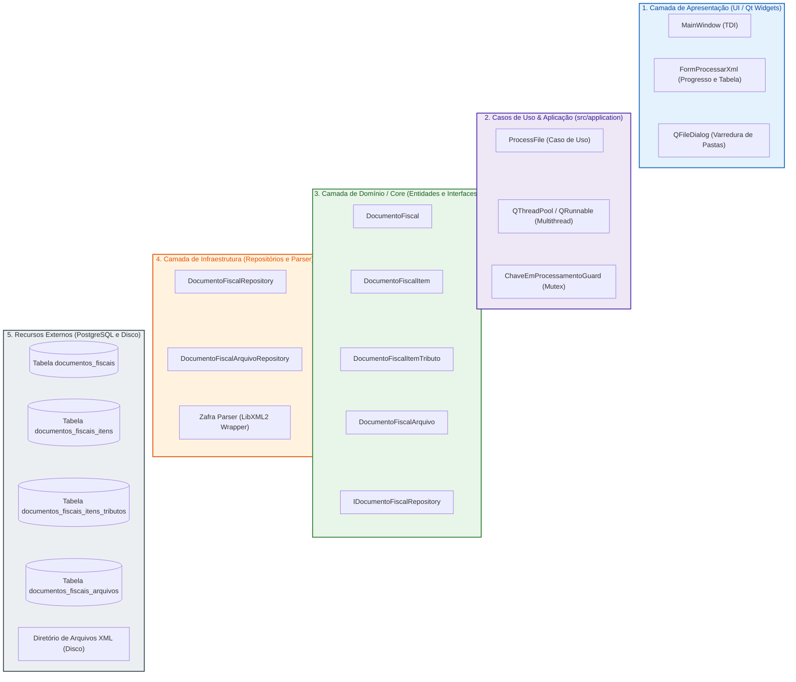

---

### 5.2. Diagrama Estrutural Detalhado (Classes, Contratos e Tabelas)

Mapeia a arquitetura técnica de ingestão, parsing, controle de concorrência e persistência relacional:

```mermaid
flowchart TB
    %% ---------------- CAMADA DE APRESENTAÇÃO ----------------
    subgraph Presentation ["1. Camada de Apresentação (src/presentation)"]
        FormProcXmlClass["<b>FormProcessarXml</b><br/>- ui: Ui::FormProcessarXml*<br/>- m_threadPool: QThreadPool*<br/>+ onIniciarProcessamento()<br/>+ onCancelarProcessamento()<br/>+ onArquivoProcessado(ResultadoProcessamento)<br/>+ atualizarContadores()"]
    end

    %% ---------------- CAMADA DE APLICAÇÃO ----------------
    subgraph Application ["2. Casos de Uso & Aplicação (src/application)"]
        ProcessFileClass["<b>ProcessFile</b><br/>- m_repos: ProcessFileRepositories<br/>+ processarArquivo(caminho: QString): ResultadoProcessamento<br/>+ processarXml(conteudo: QString): ResultadoProcessamento<br/>- processarNFe(doc: NFeDocument): ResultadoProcessamento<br/>- carregarOuCriarPessoa(doc, tipoEmissao): int<br/>- carregarOuCriarProduto(det): int"]
        ChaveGuardClass["<b>ChaveEmProcessamentoGuard</b><br/>- s_mutex: QMutex<br/>- s_chavesEmProcessamento: QSet&lt;QString&gt;<br/>+ tentarBloquear(chave: QString): bool<br/>+ liberar(chave: QString)"]
        StructResultado["<b>ResultadoProcessamento</b><br/>+ status: Status (Sucesso/JaImportado/Erro)<br/>+ chaveAcesso: QString<br/>+ modelo: QString<br/>+ mensagem: QString<br/>+ idDocumentoFiscal: int"]
    end

    %% ---------------- CAMADA DE DOMÍNIO / CORE ----------------
    subgraph Core ["3. Camada de Domínio / Core (src/core)"]
        EntityDocFiscal["<b>DocumentoFiscal</b><br/>- m_id: optional&lt;int&gt;<br/>- m_idEmpresa: int<br/>- m_idPessoa: int<br/>- m_chaveAcesso: QString<br/>- m_modelo: QString ('55')<br/>- m_serie: QString<br/>- m_numero: QString<br/>- m_dataEmissao: QDateTime<br/>- m_tipoEmissao: QString ('propria'/'terceiro')<br/>- m_tipoOperacao: QString ('entrada'/'saida')<br/>- m_valorTotal: double"]
        EntityDocItem["<b>DocumentoFiscalItem</b><br/>- m_id: optional&lt;int&gt;<br/>- m_idDocumentoFiscal: int<br/>- m_numeroItem: int<br/>- m_codigoProduto: QString<br/>- m_descricao: QString<br/>- m_codigoBarras: QString<br/>- m_ncm: QString<br/>- m_cfop: QString<br/>- m_quantidade: double<br/>- m_valorUnitario: double<br/>- m_valorTotal: double"]
        EntityDocTributo["<b>DocumentoFiscalItemTributo</b><br/>- m_id: optional&lt;int&gt;<br/>- m_idDocumentoFiscalItem: int<br/>- m_tributo: QString ('ICMS'/'PIS'/'COFINS'/'IPI')<br/>- m_cst: QString<br/>- m_baseCalculo: double<br/>- m_aliquota: double<br/>- m_valor: double"]
        EntityDocArquivo["<b>DocumentoFiscalArquivo</b><br/>- m_id: optional&lt;int&gt;<br/>- m_idDocumentoFiscal: int<br/>- m_tipoArquivo: QString ('DOCUMENTO_FISCAL')<br/>- m_conteudoXml: QString"]

        IDocRepoClass["&lt;&lt;interface&gt;&gt;<br/><b>IDocumentoFiscalRepository</b><br/>+ salvar(DocumentoFiscal&): bool<br/>+ buscarPorChave(chave: QString): optional&lt;DocumentoFiscal&gt;<br/>+ existeDocumento(chave: QString): bool"]
        IDocArqRepoClass["&lt;&lt;interface&gt;&gt;<br/><b>IDocumentoFiscalArquivoRepository</b><br/>+ salvar(DocumentoFiscalArquivo&): bool<br/>+ buscarPorDocumentoFiscalId(id: int): optional&lt;DocArquivo&gt;"]
    end

    %% ---------------- CAMADA DE INFRAESTRUTURA ----------------
    subgraph Infra ["4. Camada de Infraestrutura (src/infrastructure)"]
        DocRepoImpl["<b>DocumentoFiscalRepository</b><br/>+ salvar(DocumentoFiscal&): bool<br/>+ existeDocumento(QString): bool<br/>- salvarItensETributos(idDoc: int, itens: QList)"]
        DocArqRepoImpl["<b>DocumentoFiscalArquivoRepository</b><br/>+ salvar(DocumentoFiscalArquivo&): bool"]
        ZafraParser["<b>Zafra::NFeDocument</b><br/>+ parseXml(xmlContent: string)<br/>+ chaveAcesso(): string<br/>+ emitente(): NFeEmit<br/>+ destinatario(): NFeDest<br/>+ itens(): vector&lt;NFeDocumentDet&gt;"]
    end

    %% ---------------- RECURSOS EXTERNOS ----------------
    subgraph External ["5. Sistemas e Recursos Externos"]
        TableDocFiscais[("<b>documentos_fiscais</b><br/>id: SERIAL (PK)<br/>id_empresa: INT (FK)<br/>id_pessoa: INT (FK)<br/>chave_acesso: VARCHAR(44) (UNIQUE)<br/>modelo: VARCHAR(2)<br/>serie: VARCHAR(3)<br/>numero: VARCHAR(9)<br/>tipo_emissao: VARCHAR(10)")]
        TableDocItens[("<b>documentos_fiscais_itens</b><br/>id: SERIAL (PK)<br/>id_documento_fiscal: INT (FK)<br/>numero_item: INT<br/>codigo_produto: VARCHAR(60)<br/>descricao: VARCHAR(255)<br/>codigo_barras: VARCHAR(14)")]
        TableDocTributos[("<b>documentos_fiscais_itens_tributos</b><br/>id: SERIAL (PK)<br/>id_documento_fiscal_item: INT (FK)<br/>tributo: VARCHAR(10)<br/>cst: VARCHAR(4)<br/>valor: NUMERIC(15,2)")]
        TableDocArquivos[("<b>documentos_fiscais_arquivos</b><br/>id: SERIAL (PK)<br/>id_documento_fiscal: INT (FK)<br/>conteudo_xml: TEXT")]
        DiskFiles["<b>Arquivos XML no Disco</b><br/>(Acesso estritamente somente-leitura)"]
    end

    %% Relações Presentation -> Application
    FormProcXmlClass --> ProcessFileClass
    FormProcXmlClass --> StructResultado

    %% Relações Application
    ProcessFileClass --> ChaveGuardClass
    ProcessFileClass --> ZafraParser
    ProcessFileClass --> IDocRepoClass
    ProcessFileClass --> IDocArqRepoClass
    ProcessFileClass --> StructResultado

    %% Relações Core
    EntityDocFiscal *-- EntityDocItem : possui 1..N
    EntityDocItem *-- EntityDocTributo : possui 1..N
    EntityDocFiscal *-- EntityDocArquivo : possui 1

    %% Realizações DIP
    DocRepoImpl ..|> IDocRepoClass
    DocArqRepoImpl ..|> IDocArqRepoClass

    %% Relações Infra -> Banco / Disco
    DocRepoImpl --> TableDocFiscais
    DocRepoImpl --> TableDocItens
    DocRepoImpl --> TableDocTributos
    DocArqRepoImpl --> TableDocArquivos
    ProcessFileClass --> DiskFiles : lê sem alterar (RN13)
```

---

### 5.3. Diagrama Comportamental Simplificado (Inter-Camadas)

Ilustra a orquestração assíncrona entre camadas durante a importação em lote com proteção de duplicidade:

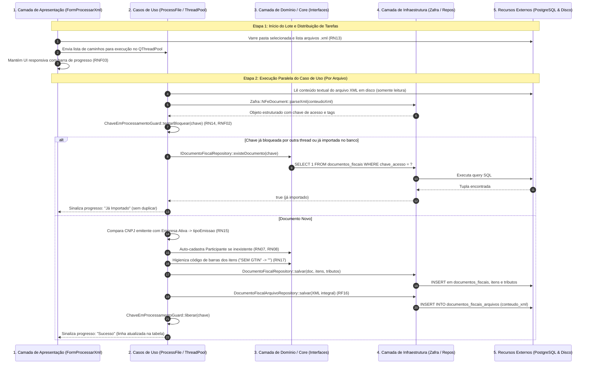

---

### 5.4. Diagrama Comportamental Detalhado (Sequência Técnica)

Detalhamento rigoroso da execução em background com controle de concorrência e integridade relacional:

```mermaid
sequenceDiagram
    autonumber
    actor Usuario as Usuário do Sistema
    participant Form as FormProcessarXml
    participant Pool as QThreadPool
    participant Worker as WorkerRunnable
    participant Guard as ChaveEmProcessamentoGuard
    participant Case as ProcessFile
    participant Zafra as Zafra::NFeDocument
    participant RepoDoc as DocumentoFiscalRepository
    participant RepoArq as DocumentoFiscalArquivoRepository
    participant DB as PostgreSQL

    Usuario->>Form: Seleciona diretório e clica em "Iniciar Processamento"
    Form->>Form: QDir::entryInfoList(QDir::Files, "*.xml")
    Form->>Form: Inicializa contadores (Total, Processados = 0)

    loop Para cada arquivo XML encontrado na lista
        Form->>Worker: Instancia WorkerRunnable(caminhoArquivo)
        Form->>Pool: start(worker)
    end

    Note over Worker,DB: Execução paralela em thread secundária (RNF01)
    Worker->>Case: processarArquivo(caminhoArquivo)
    Case->>Case: QFile::open(ReadOnly) -> lê conteudoXml (RN13)
    Case->>Zafra: parseXml(conteudoXml)
    Zafra-->>Case: Retorna dados da NF-e

    Case->>Guard: tentarBloquear(chaveAcesso)
    alt Bloqueio recusado (chave já em processamento concorrente)
        Guard-->>Case: false
        Case-->>Worker: ResultadoProcessamento { Status::JaImportado }
    else Bloqueio adquirido com sucesso
        Guard-->>Case: true
        Case->>RepoDoc: existeDocumento(chaveAcesso)
        RepoDoc->>DB: SELECT 1 FROM documentos_fiscais WHERE chave_acesso = :chave LIMIT 1
        DB-->>RepoDoc: Retorna resultado

        alt Documento já consta no banco de dados (RN14)
            RepoDoc-->>Case: true
            Case->>Guard: liberar(chaveAcesso)
            Case-->>Worker: ResultadoProcessamento { Status::JaImportado }
        else Documento Inédito
            RepoDoc-->>Case: false

            Note over Case: Classificação de Emissão (RN15)
            alt doc.emitente().cnpj == GlobalState::empresaAtual().cnpj()
                Case->>Case: tipoEmissao = "propria"; participante = doc.destinatario()
            else
                Case->>Case: tipoEmissao = "terceiro"; participante = doc.emitente()
            end

            Case->>Case: carregarOuCriarPessoa(participante, tipoEmissao)

            loop Para cada det em doc.itens()
                Note over Case: Higienização de EAN (RN17)
                opt det.cEAN.trimmed().toUpper() == "SEM GTIN" || det.cEAN.empty()
                    Case->>Case: det.cEAN = ""
                end
                opt tipoEmissao == "propria" (RN16)
                    Case->>Case: carregarOuCriarProduto(det)
                    Case->>Case: carregarOuCriarUnidadeMedida(det.uCom)
                    Case->>Case: carregarOuCriarNCM(det.NCM)
                end
            end

            Note over Case,DB: Persistência do Cabeçalho e Itens
            Case->>RepoDoc: salvar(documentoFiscal)
            RepoDoc->>DB: INSERT INTO documentos_fiscais (...) RETURNING id
            DB-->>RepoDoc: idDocumentoFiscal
            RepoDoc->>DB: INSERT INTO documentos_fiscais_itens (...)
            RepoDoc->>DB: INSERT INTO documentos_fiscais_itens_tributos (...)

            Note over Case,DB: Persistência do XML Integral (RF16)
            Case->>RepoArq: salvar(DocumentoFiscalArquivo(idDoc, "DOCUMENTO_FISCAL", conteudoXml))
            RepoArq->>DB: INSERT INTO documentos_fiscais_arquivos (id_documento_fiscal, conteudo_xml) VALUES (...)
            DB-->>RepoArq: OK

            Case->>Guard: liberar(chaveAcesso)
            Case-->>Worker: ResultadoProcessamento { Status::Sucesso, idDoc }
        end
    end

    Worker-->>Form: emit arquivoProcessado(resultado)
    Form->>Form: onArquivoProcessado(resultado) (Executado na Thread Principal UI)
    Form->>Form: Atualiza linha na tabela (ícone, status, chave)
    Form->>Form: Incrementa progressBar e label de resumo
```

---

### 5.5. Matriz de Rastreabilidade do Módulo 4

| Requisito / Regra | Tipo | Descrição Sumária | Componente Responsável | Diagrama Associado |
| :--- | :--- | :--- | :--- | :--- |
| **RF12** | Funcional | Seleção e varredura recursiva ou plana de pastas com XMLs | `FormProcessarXml`, `QFileDialog`, `QDir` | Estrutural (5.1, 5.2), Sequência (5.3, 5.4) |
| **RF13** | Funcional | Processamento assíncrono em lote com cancelamento seguro | `FormProcessarXml`, `QThreadPool`, `QRunnable` | Estrutural (5.1, 5.2), Sequência (5.3, 5.4) |
| **RF14** | Funcional | Acompanhamento em tempo real de status individual e resumo | `FormProcessarXml::onArquivoProcessado`, `QProgressBar` | Sequência (5.3, 5.4) |
| **RF15** | Funcional | Extração completa de cabeçalho, itens, tributos e participantes | `ProcessFile`, `Zafra::NFeDocument` | Estrutural (5.2), Sequência (5.4) |
| **RF16** | Funcional | Persistência íntegra do XML original no banco | `DocumentoFiscalArquivoRepository`, `documentos_fiscais_arquivos` | Estrutural (5.1, 5.2), Sequência (5.3, 5.4) |
| **RN13** | Regra de Negócio | Preservação estrita dos arquivos em disco (somente leitura) | `ProcessFile::processarArquivo`, `QFile::ReadOnly` | Sequência (5.3, 5.4) |
| **RN14** | Regra de Negócio | Prevenção de duplicidade por chave de acesso em concorrência | `ChaveEmProcessamentoGuard`, `IDocumentoFiscalRepository::existeDocumento` | Estrutural (5.2), Sequência (5.3, 5.4) |
| **RN15** | Regra de Negócio | Classificação automática de emissão própria vs. terceiro | `ProcessFile::processarNFe`, `GlobalState::empresaAtual` | Sequência (5.3, 5.4) |
| **RN16** | Regra de Negócio | Auto-cadastro de produtos/unidades em notas de emissão própria | `ProcessFile::carregarOuCriarProduto`, `IProdutoRepository` | Sequência (5.4) |
| **RN17** | Regra de Negócio | Higienização de `<cEAN>` com `"SEM GTIN"` para string vazia | `ProcessFile::processarNFe` | Sequência (5.4) |
| **US06** | História de Usuário | Importação em lote de XMLs com feedback responsivo | `FormProcessarXml`, `ProcessFile` | Estrutural (5.1), Sequência (5.3, 5.4) |

---

## 6. Módulo 5: Associação e Vínculo de Produtos de Terceiros (De-Para)

O **Módulo de Vínculo de Produtos de Terceiros (De-Para)** resolve o desacoplamento semântico entre as codificações mercantis adotadas pelos fornecedores externos e o catálogo interno de produtos da empresa compradora. Ele garante que os itens recebidos em notas fiscais eletrônicas de terceiros (com seus respectivos `cProd`, `xProd`, `cEAN` e `uCom`) sejam mapeados para os produtos internos da empresa com seus respectivos fatores multiplicadores de conversão de unidade ([RF18](file:///home/lamb/dev/castorsoft/dfe/docs/ESPECIFICACAO_REQUISITOS.md#L226)).

O módulo implementa uma **hierarquia de associação automática** inteligente durante a importação ([RN19](file:///home/lamb/dev/castorsoft/dfe/docs/ESPECIFICACAO_REQUISITOS.md#L234)), persistência desacoplada na tabela `produtos_fornecedores` sem jamais alterar os dados originais da nota ([RN18](file:///home/lamb/dev/castorsoft/dfe/docs/ESPECIFICACAO_REQUISITOS.md#L233)), reaproveitamento retroativo e futuro para o mesmo fornecedor ([RN20](file:///home/lamb/dev/castorsoft/dfe/docs/ESPECIFICACAO_REQUISITOS.md#L238)) e uma interface mestre-detalhe ergonômica com suporte a vínculo manual ([RF19](file:///home/lamb/dev/castorsoft/dfe/docs/ESPECIFICACAO_REQUISITOS.md#L229)) e cadastro rápido integrado ([RF20](file:///home/lamb/dev/castorsoft/dfe/docs/ESPECIFICACAO_REQUISITOS.md#L230)).

---

### 6.1. Diagrama Estrutural Simplificado (Camadas Participantes)

Visão macroscópica em camadas com componentes dispostos lado a lado:

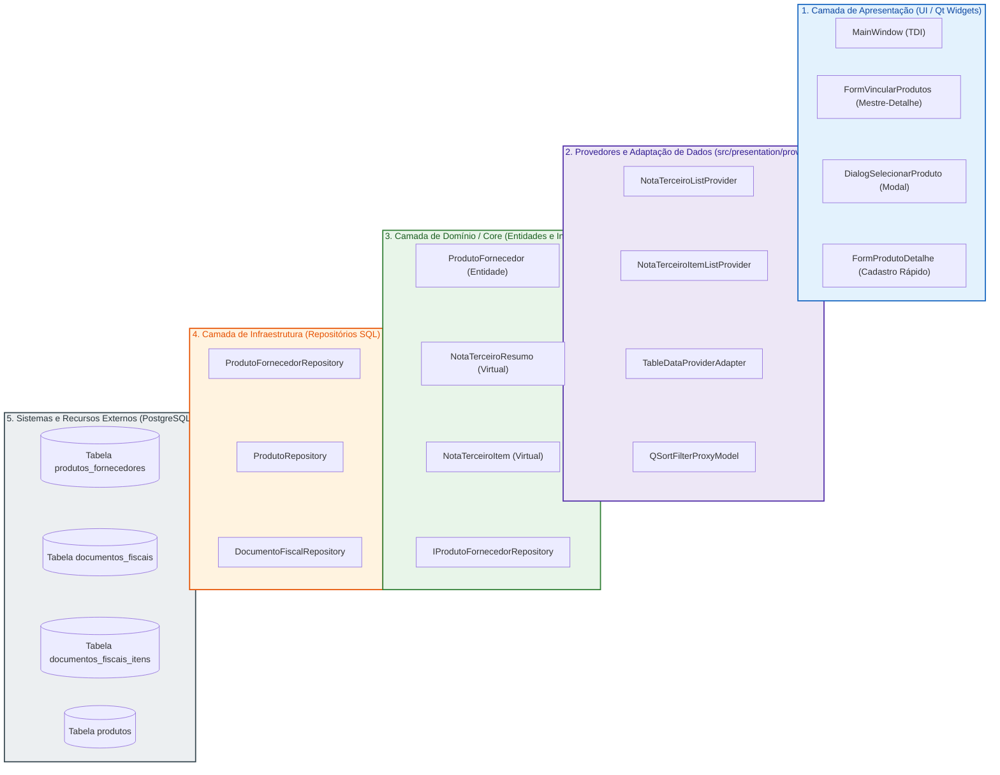

---

### 6.2. Diagrama Estrutural Detalhado (Classes, Contratos e Tabelas)

Mapeamento minucioso do painel mestre-detalhe, entidades virtuais de projeção ([RNF07](file:///home/lamb/dev/castorsoft/dfe/docs/ESPECIFICACAO_REQUISITOS.md#L354)), repositórios e chave única `(id_fornecedor, codigo_fornecedor)` ([RN18](file:///home/lamb/dev/castorsoft/dfe/docs/ESPECIFICACAO_REQUISITOS.md#L233)):

```mermaid
flowchart TB
    %% ---------------- CAMADA DE APRESENTAÇÃO ----------------
    subgraph Presentation ["1. Camada de Apresentação (src/presentation)"]
        FormVincularClass["<b>FormVincularProdutos</b><br/>- ui: Ui::FormVincularProdutos*<br/>- m_notasProvider: shared_ptr&lt;NotaTerceiroListProvider&gt;<br/>- m_itensProvider: shared_ptr&lt;NotaTerceiroItemListProvider&gt;<br/>+ onNotaSelectionChanged()<br/>+ onItemSelectionChanged()<br/>+ onVincularExistenteClicked()<br/>+ onNovoProdutoClicked()<br/>+ onDesvincularClicked()"]
        DialogSelClass["<b>DialogSelecionarProduto</b><br/>- ui: Ui::DialogSelecionarProduto*<br/>- m_itemInfo: NotaTerceiroItem<br/>+ idProdutoSelecionado(): int<br/>+ multiplicador(): double<br/>+ idUnidadeMedida(): int"]
        FormProdDetClass["<b>FormProdutoDetalhe</b><br/>+ preencherAPartirDeNota(item: NotaTerceiroItem)"]
    end

    %% ---------------- PROVEDORES E ADAPTADORES ----------------
    subgraph Providers ["2. Provedores de Visualização (src/presentation/providers)"]
        NotaProvClass["<b>NotaTerceiroListProvider</b><br/>- m_repo: IDocumentoFiscalRepository*<br/>+ buscarDados(): QList&lt;NotaTerceiroResumo&gt;"]
        ItemProvClass["<b>NotaTerceiroItemListProvider</b><br/>- m_repo: IDocumentoFiscalRepository*<br/>+ carregarPorNota(idNota: int): QList&lt;NotaTerceiroItem&gt;"]
        AdapterClass["<b>TableDataProviderAdapter</b><br/>(Conecta provedores a QTableView)"]
    end

    %% ---------------- CAMADA DE DOMÍNIO / CORE ----------------
    subgraph Core ["3. Camada de Domínio / Core (src/core)"]
        EntityProdForn["<b>ProdutoFornecedor</b><br/>- m_id: optional&lt;int&gt;<br/>- m_idEmpresa: int<br/>- m_idFornecedor: int<br/>- m_idProduto: int<br/>- m_codigoFornecedor: QString<br/>- m_idUnidadeMedida: int<br/>- m_multiplicador: double"]
        VirtualNotaResumo["<b>NotaTerceiroResumo</b> (src/core/entities/virtual)<br/>+ idNota: int<br/>+ idFornecedor: int<br/>+ nomeFornecedor: QString<br/>+ numeroNota: QString<br/>+ totalItens: int<br/>+ itensPendentes: int<br/>+ fromRecord(QSqlRecord&): NotaTerceiroResumo"]
        VirtualNotaItem["<b>NotaTerceiroItem</b> (src/core/entities/virtual)<br/>+ idItem: int<br/>+ idNota: int<br/>+ cProd: QString<br/>+ xProd: QString<br/>+ cEAN: QString<br/>+ uCom: QString<br/>+ statusVinculo: QString ('Vinculado'/'Pendente')<br/>+ idProdutoInterno: optional&lt;int&gt;<br/>+ fromRecord(QSqlRecord&): NotaTerceiroItem"]

        IProdFornRepoClass["&lt;&lt;interface&gt;&gt;<br/><b>IProdutoFornecedorRepository</b><br/>+ salvar(ProdutoFornecedor&): bool<br/>+ buscarPorFornecedorECodigo(idForn: int, cod: QString): optional&lt;ProdutoFornecedor&gt;<br/>+ desvincular(idFornecedor: int, cod: QString): bool"]
    end

    %% ---------------- CAMADA DE INFRAESTRUTURA ----------------
    subgraph Infra ["4. Camada de Infraestrutura (src/infrastructure)"]
        ProdFornRepoImpl["<b>ProdutoFornecedorRepository</b><br/>+ salvar(ProdutoFornecedor&): bool<br/>+ buscarPorFornecedorECodigo(int, QString): optional&lt;ProdutoFornecedor&gt;<br/>+ desvincular(int, QString): bool"]
    end

    %% ---------------- RECURSOS EXTERNOS ----------------
    subgraph External ["5. Sistemas e Recursos Externos"]
        TableProdForn[("<b>produtos_fornecedores</b><br/>id: SERIAL (PK)<br/>id_empresa: INT (FK)<br/>id_fornecedor: INT (FK)<br/>id_produto: INT (FK)<br/>codigo_fornecedor: VARCHAR(60)<br/>id_unidade_medida: INT (FK)<br/>multiplicador: NUMERIC(10,4)<br/><b>UNIQUE(id_fornecedor, codigo_fornecedor)</b>")]
        TableDocFiscais[("<b>documentos_fiscais</b><br/>id: SERIAL (PK)<br/>tipo_emissao = 'terceiro'")]
        TableDocItens[("<b>documentos_fiscais_itens</b><br/>codigo_produto, cEAN")]
        TableProdutos[("<b>produtos</b><br/>id, codigo_barra")]
    end

    %% Conexões Presentation
    FormVincularClass --> NotaProvClass
    FormVincularClass --> ItemProvClass
    FormVincularClass --> AdapterClass
    FormVincularClass --> DialogSelClass
    FormVincularClass --> FormProdDetClass

    %% Conexões Providers -> Virtuals & Repos
    NotaProvClass --> VirtualNotaResumo
    ItemProvClass --> VirtualNotaItem
    DialogSelClass --> VirtualNotaItem

    %% Conexões Core / Infra
    FormVincularClass --> IProdFornRepoClass
    DialogSelClass --> IProdFornRepoClass
    ProdFornRepoImpl ..|> IProdFornRepoClass
    ProdFornRepoImpl --> TableProdForn
    TableProdForn --> TableProdutos
```

---

### 6.3. Diagrama Comportamental Simplificado (Inter-Camadas)

Exibe as duas vias de associação: automática durante a importação e manual através da tela mestre-detalhe:

```mermaid
sequenceDiagram
    autonumber
    participant L1 as 1. Camada de Apresentação (FormVincular)
    participant L2 as 2. Casos de Uso / Provedores
    participant L3 as 3. Camada de Domínio / Core (Interfaces)
    participant L4 as 4. Camada de Infraestrutura (Repositórios)
    participant L5 as 5. Recursos Externos (PostgreSQL)

    Note over L1,L5: Via 1: Associação Automática na Importação (RN19, US07)
    L2->>L4: Consulta ProdutoFornecedorRepository::buscarPorFornecedorECodigo(idForn, cProd)
    alt Vínculo já cadastrado previamente
        L4-->>L2: Retorna ProdutoFornecedor existente (item considerado Vinculado)
    else Vínculo Inexistente
        opt Item possui cEAN válido (diferente de "SEM GTIN")
            L2->>L4: Consulta ProdutoRepository::buscarPorCodigoBarra(cEAN)
            L4->>L5: SELECT id FROM produtos WHERE codigo_barra = :ean
            L5-->>L4: Produto encontrado!
            L4-->>L2: Retorna entidade Produto
            L2->>L4: ProdutoFornecedorRepository::salvar(vínculo automático, mult = 1.0)
            L4->>L5: INSERT INTO produtos_fornecedores VALUES (...)
        end
    end

    Note over L1,L5: Via 2: Vínculo Manual pelo Painel Mestre-Detalhe (RF19, RF20, US08)
    L1->>L2: Seleciona nota na grade superior -> carregarItensDaNota(idNota)
    L2->>L4: Busca itens pendentes e vinculados via SQL
    L4-->>L1: Exibe itens na grade inferior com indicador visual
    L1->>L1: Usuário seleciona item pendente e clica em "Vincular Produto Existente"
    L1->>L1: Abre DialogSelecionarProduto, escolhe produto e define multiplicador
    L1->>L3: Constrói entidade ProdutoFornecedor com (idForn, cProd, idProd, mult)
    L1->>L4: ProdutoFornecedorRepository::salvar(ProdutoFornecedor) (RN18)
    L4->>L5: INSERT INTO produtos_fornecedores VALUES (...)
    L5-->>L4: OK
    L4-->>L1: Sucesso
    L1->>L1: Atualiza status do item para "Vinculado" e habilita botão "Desvincular"
```

---

### 6.4. Diagrama Comportamental Detalhado (Sequência Técnica)

Mapeamento do fluxo de conciliação manual mestre-detalhe, cadastro rápido de novo produto via diálogo modal e gravação atômica do vínculo:

```mermaid
sequenceDiagram
    autonumber
    actor Usuario as Usuário do Sistema
    participant Form as FormVincularProdutos
    participant NotasAdapter as TableDataProviderAdapter (Notas)
    participant ItensAdapter as TableDataProviderAdapter (Itens)
    participant DialogSel as DialogSelecionarProduto
    participant FormDet as FormProdutoDetalhe
    participant RepoForn as ProdutoFornecedorRepository
    participant RepoProd as ProdutoRepository
    participant DB as PostgreSQL

    Usuario->>Form: Abre tela de Vínculo de Produtos
    Form->>Form: carregarNotas()
    Form->>NotasAdapter: atualizar()
    NotasAdapter->>DB: SELECT notas de terceiros com contadores de itens pendentes
    DB-->>NotasAdapter: Lista de NotaTerceiroResumo
    NotasAdapter-->>Form: Renderiza tabela superior

    Usuario->>Form: Clica em uma nota na tabela superior
    Form->>Form: onNotaSelectionChanged()
    Form->>Form: m_idNotaSelecionada = nota.idNota; m_idFornecedor = nota.idFornecedor
    Form->>ItensAdapter: carregarItensDaNota(m_idNotaSelecionada)
    ItensAdapter->>DB: SELECT itens da nota com LEFT JOIN produtos_fornecedores
    DB-->>ItensAdapter: Lista de NotaTerceiroItem (com status 'Vinculado' ou 'Pendente')
    ItensAdapter-->>Form: Renderiza tabela inferior

    Usuario->>Form: Clica em um item com status "Pendente"
    Form->>Form: onItemSelectionChanged() -> Habilita botões "Vincular" e "Novo Produto"

    alt Cenário A: Usuário opta por vincular a Produto Existente (RF19, US08)
        Usuario->>Form: Clica no botão "Vincular Produto Existente"
        Form->>DialogSel: Instancia DialogSelecionarProduto(m_idFornecedor, itemSelecionado)
        DialogSel->>RepoProd: carregarProdutos()
        RepoProd-->>DialogSel: Catálogo interno de produtos
        DialogSel-->>Usuario: Exibe modal com busca e campo de multiplicador

        Usuario->>DialogSel: Seleciona produto interno, ajusta multiplicador (ex: 12.0) e clica em "Confirmar"
        DialogSel-->>Form: QDialog::Accepted (idProduto, multiplicador, idUnidade)
        Form->>RepoForn: salvar(ProdutoFornecedor(idEmpresa, idFornecedor, cProd, idProduto, idUnidade, mult))
        RepoForn->>DB: INSERT INTO produtos_fornecedores (id_empresa, id_fornecedor, codigo_fornecedor, id_produto, multiplicador) VALUES (...) ON CONFLICT DO UPDATE
        DB-->>RepoForn: OK
        RepoForn-->>Form: true (sucesso)
        Form->>Form: carregarItensDaNotaSelecionada() (Atualiza status para 'Vinculado')

    else Cenário B: Usuário opta por Cadastrar Novo Produto (RF20, US08)
        Usuario->>Form: Clica no botão "Cadastrar Novo Produto"
        Form->>FormDet: Instancia FormProdutoDetalhe em modo diálogo modal
        Form->>FormDet: preencherAPartirDeNota(itemSelecionado)
        Note over FormDet: Pré-popula Descrição (xProd), EAN (cEAN), Unidade (uCom) e NCM
        FormDet-->>Usuario: dialog.exec()

        Usuario->>FormDet: Complementa campos e clica em "Salvar"
        FormDet->>RepoProd: salvar(novoProduto)
        RepoProd->>DB: INSERT INTO produtos (...) RETURNING id
        DB-->>RepoProd: idNovoProduto
        RepoProd-->>FormDet: OK
        FormDet-->>Form: QDialog::Accepted

        Note over Form,DB: Criação automática do vínculo imediato em produtos_fornecedores (RF20)
        Form->>RepoForn: salvar(ProdutoFornecedor(idEmpresa, idFornecedor, cProd, idNovoProduto, 1.0))
        RepoForn->>DB: INSERT INTO produtos_fornecedores VALUES (...)
        DB-->>RepoForn: OK
        Form->>Form: carregarItensDaNotaSelecionada()
        Form->>Usuario: ToastNotification("Sucesso", "Produto cadastrado e vinculado com sucesso!", Success)
    end
```

---

### 6.5. Matriz de Rastreabilidade do Módulo 5

| Requisito / Regra | Tipo | Descrição Sumária | Componente Responsável | Diagrama Associado |
| :--- | :--- | :--- | :--- | :--- |
| **RF17** | Funcional | Associação automática de itens na importação de notas de compra | `ProcessFile`, `IProdutoFornecedorRepository` | Sequência (6.3) |
| **RF18** | Funcional | Painel Mestre-Detalhe de conciliação com filtros e indicadores | `FormVincularProdutos`, `NotaTerceiroListProvider`, `NotaTerceiroItemListProvider` | Estrutural (6.1, 6.2), Sequência (6.3, 6.4) |
| **RF19** | Funcional | Diálogo de vínculo manual com produto existente e multiplicador | `DialogSelecionarProduto`, `FormVincularProdutos` | Estrutural (6.2), Sequência (6.4) |
| **RF20** | Funcional | Cadastro rápido de novo produto com criação imediata do vínculo | `FormProdutoDetalhe::preencherAPartirDeNota`, `FormVincularProdutos` | Estrutural (6.2), Sequência (6.4) |
| **RN18** | Regra de Negócio | Chave única `(id_fornecedor, codigo_fornecedor)` em `produtos_fornecedores` sem alterar a nota | `ProdutoFornecedorRepository`, `produtos_fornecedores` | Estrutural (6.2), Sequência (6.4) |
| **RN19** | Regra de Negócio | Hierarquia de associação automática: cadastro prévio -> código de barras -> pendente | `ProcessFile::processarNFe`, `IProdutoRepository` | Sequência (6.3) |
| **RN20** | Regra de Negócio | Reaproveitamento retroativo e futuro do mesmo código de fornecedor | `ProdutoFornecedorRepository::buscarPorFornecedorECodigo` | Estrutural (6.2), Sequência (6.3) |
| **US07** | História de Usuário | Associação automática de itens de terceiros pelo código de barras | `ProcessFile`, `ProdutoFornecedorRepository` | Sequência (6.3) |
| **US08** | História de Usuário | Vínculo manual no painel mestre-detalhe ou cadastro na hora | `FormVincularProdutos`, `DialogSelecionarProduto` | Estrutural (6.1, 6.2), Sequência (6.3, 6.4) |

---

## 7. Módulo 6: Arquitetura de Plugins e Padronização Visual

O **Módulo de Arquitetura de Plugins e Padronização Visual** define o ecossistema de extensibilidade desacoplada e a identidade visual do Callisto DFE. Através de bibliotecas dinâmicas compiladas separadamente (`.so` no Linux / `.dll` no Windows) e carregadas em tempo de execução via [`PluginManager`](file:///home/lamb/dev/castorsoft/dfe/src/infrastructure/plugins/PluginManager.h), novos recursos fiscais e contábeis podem ser integrados ao sistema sem alterar o binário principal ([RF21](file:///home/lamb/dev/castorsoft/dfe/docs/ESPECIFICACAO_REQUISITOS.md#L266)).

A segurança arquitetural e o isolamento do banco de dados são estritamente garantidos pela injeção do [`IPluginContext`](file:///home/lamb/dev/castorsoft/dfe/src/core/plugins/IPluginContext.h) e [`IUIPluginContext`](file:///home/lamb/dev/castorsoft/dfe/src/presentation/plugins/api/IUIPluginContext.h): os plugins recebem apenas contratos abstratos dos repositórios e serviços de UI, sendo formalmente proibidos de referenciar ou executar consultas diretas no `DatabaseManager` ([RN21](file:///home/lamb/dev/castorsoft/dfe/docs/ESPECIFICACAO_REQUISITOS.md#L277)). Além disso, o módulo centraliza a biblioteca de componentes visuais padronizados (`InputText`, `InputMasked`, `InputComboBox`, `InputLookup`, `ToastNotification`), que fornecem ergonomia uniforme, acessibilidade e higienização automática de entradas mascaradas ([RN22](file:///home/lamb/dev/castorsoft/dfe/docs/ESPECIFICACAO_REQUISITOS.md#L278)).

---

### 7.1. Diagrama Estrutural Simplificado (Camadas Participantes)

Visão top-down com empilhamento horizontal de componentes evidenciando o hospedeiro (*Host*) e o isolamento dos plugins externos:

```mermaid
flowchart TD
    %% Subgraphs horizontais
    subgraph L1 ["1. Camada de Apresentação (UI / Qt Widgets)"]
        direction LR
        MainWindow["MainWindow (TDI e Barra Lateral)"] ~~~ InputBaseFam["Família InputBase (Inputs Padronizados)"] ~~~ IUIPluginCtx["IUIPluginContext / PluginContext"]
    end

    subgraph L2 ["2. Camada de Domínio / Core (Contratos de Extensibilidade)"]
        direction LR
        IPluginIntf["IPlugin (Contrato Base)"] ~~~ IPluginCtxIntf["IPluginContext (Injeção de Dados e Repositórios)"] ~~~ IReposCore["Interfaces de Repositórios (DIP)"]
    end

    subgraph L3 ["3. Camada de Infraestrutura (Provedores e Host de Plugins)"]
        direction LR
        PluginMgr["PluginManager (QPluginLoader)"] ~~~ ReposConcretos["Repositórios SQL Concretos"] ~~~ DBManager["DatabaseManager (Privado ao Core)"]
    end

    subgraph L4 ["4. Plugins Externos & Bibliotecas Dinâmicas"]
        direction LR
        SpedPluginSo["Plugin SPED Fiscal (sped_fiscal.so)"] ~~~ TestPluginSo["Plugins Adicionais (*.so / *.dll)"]
    end

    %% Ancoragem vertical estrita
    MainWindow ~~~ IPluginIntf
    IPluginIntf ~~~ PluginMgr
    PluginMgr ~~~ SpedPluginSo

    %% Estilos de alto contraste
    style L1 fill:#E3F2FD,stroke:#1565C0,stroke-width:2px,color:#0D47A1
    style L2 fill:#E8F5E9,stroke:#2E7D32,stroke-width:2px,color:#1B5E20
    style L3 fill:#FFF3E0,stroke:#E65100,stroke-width:2px,color:#E65100
    style L4 fill:#ECEFF1,stroke:#37474F,stroke-width:2px,color:#263238
```

---

### 7.2. Diagrama Estrutural Detalhado (Classes, Contratos e Tabelas)

Mapeia as interfaces de extensibilidade, a fábrica de componentes de UI do contexto e a proibição de acesso direto ao banco:

```mermaid
flowchart TB
    %% ---------------- CAMADA DE APRESENTAÇÃO ----------------
    subgraph Presentation ["1. Camada de Apresentação (src/presentation)"]
        MainWindowClass["<b>MainWindow</b><br/>- m_tabWidget: QTabWidget*<br/>- m_sidebarLayout: QVBoxLayout*<br/>+ adicionarBotaoPlugin(action: QAction*)<br/>+ openTab(widget: QWidget*, titulo: QString)"]
        IUIExtClass["&lt;&lt;interface&gt;&gt;<br/><b>IUIExtension</b><br/>+ getAction(parent: QObject*): QAction*<br/>+ iconPath(): QString<br/>+ initializeUI()"]
        IUIPluginCtxClass["&lt;&lt;interface&gt;&gt;<br/><b>IUIPluginContext</b><br/>+ openTab(QWidget*, QString)<br/>+ createInputText(): InputText*<br/>+ createInputMasked(): InputMasked*<br/>+ createInputComboBox(): InputComboBox*"]
        PluginCtxClass["<b>PluginContext</b> (implementa IUIPluginContext)<br/>- m_empresaAtual: Empresa<br/>+ openTab(widget, titulo)<br/>+ <i>Fábricas de UI</i><br/>+ <i>Repositórios Core</i>"]
    end

    %% ---------------- CONTRATOS DO CORE ----------------
    subgraph CoreContracts ["2. Contratos de Domínio & Interfaces (src/core/plugins)"]
        IPluginClass["&lt;&lt;interface&gt;&gt;<br/><b>IPlugin</b><br/>+ name(): QString<br/>+ version(): QString<br/>+ setContext(shared_ptr&lt;IPluginContext&gt;)<br/>+ initializePlugin()"]
        IPluginCtxClass["&lt;&lt;interface&gt;&gt;<br/><b>IPluginContext</b><br/>+ empresaAtual(): Empresa<br/>+ empresaRepository(): IEmpresaRepository&amp;<br/>+ documentoFiscalRepository(): IDocumentoFiscalRepository&amp;<br/>+ pessoaRepository(): IPessoaRepository&amp;<br/>+ produtoRepository(): IProdutoRepository&amp;"]
    end

    %% ---------------- INFRAESTRUTURA ----------------
    subgraph InfraEngine ["3. Camada de Infraestrutura (src/infrastructure)"]
        PluginMgrClass["<b>PluginManager</b> (src/infrastructure/plugins)<br/>- m_plugins: QList&lt;IPlugin*&gt;<br/>- m_loaders: QList&lt;QPluginLoader*&gt;<br/>+ loadPlugins(dirPath: QString)<br/>+ plugins(): QList&lt;IPlugin*&gt;"]
    end

    %% ---------------- PLUGINS EXTERNOS ----------------
    subgraph ExternalPlugins ["4. Bibliotecas Dinâmicas Externas (external_plugins)"]
        SpedPluginClass["<b>SpedFiscalPlugin</b> (sped_fiscal.so)<br/>- m_context: shared_ptr&lt;IPluginContext&gt;<br/>- m_uiContext: shared_ptr&lt;IUIPluginContext&gt;<br/>- m_form: FormSpedFiscal*<br/>+ name(): QString ('dev.castorsoft.sped-fiscal')<br/>+ getAction(parent): QAction*<br/>+ onTriggered()"]
    end

    %% Relações e Heranças
    InputMaskedClass --|> InputBaseClass
    InputTextClass --|> InputBaseClass
    InputComboClass --|> InputBaseClass

    MainWindowClass --> PluginMgrClass
    PluginMgrClass --> IPluginClass
    PluginMgrClass --> IUIExtClass

    PluginCtxClass ..|> IPluginCtxClass
    PluginCtxClass --> MainWindowClass : openTab
    PluginCtxClass ..> InputTextClass : fabrica
    PluginCtxClass ..> InputMaskedClass : fabrica
    PluginCtxClass ..> InputComboClass : fabrica

    SpedPluginClass ..|> IPluginClass
    SpedPluginClass ..|> IUIExtClass
    SpedPluginClass --> IPluginCtxClass : consome sem acesso a DatabaseManager (RN21)
```

---

### 7.3. Diagrama Comportamental Simplificado (Inter-Camadas)

Demonstra a carga dinâmica de plugins, injeção de dependências sem acesso ao banco de dados e disparo visual:

```mermaid
sequenceDiagram
    autonumber
    participant L1 as 1. Camada de Apresentação (MainWindow)
    participant L2 as 2. Hospedeiro (PluginManager / PluginContext)
    participant L3 as 3. Camada de Domínio / Core (Interfaces)
    participant L5 as 5. Plugins Externos (*.so)

    Note over L1,L5: Etapa 1: Descoberta e Inicialização Dinâmica no Bootstrapping
    L2->>L2: PluginManager::loadPlugins("bin/plugins")
    L2->>L5: Carrega biblioteca compartilhada via QPluginLoader
    L5-->>L2: Retorna ponteiro de instância QObject*
    L2->>L3: Verifica contratos: qobject_cast&lt;IPlugin*&gt; e dynamic_cast&lt;IUIExtension*&gt;
    L2->>L2: Cria instância de PluginContext injetando repositórios e MainWindow
    L2->>L5: Invoca plugin->setContext(m_context) (RN21)
    L2->>L5: Invoca plugin->initializePlugin()
    L2-->>L1: Notifica plugins carregados com sucesso

    Note over L1,L5: Etapa 2: Integração com a Interface Gráfica
    L1->>L5: Invoca uiExt->getAction(&mainWindow)
    L5-->>L1: Retorna QAction configurado com ícone e texto
    L1->>L1: Insere botão na barra lateral da MainWindow (US09)

    Note over L1,L5: Etapa 3: Execução e Abertura em Aba
    L1->>L1: Usuário clica no botão da barra lateral
    L1->>L5: Dispara sinal action->triggered()
    L5->>L2: Cria formulário com componentes da fábrica de UI e chama m_context->openTab(form, "SPED")
    L2->>L1: MainWindow::openTab(form)
    L1->>L1: Renderiza nova aba integrada no QTabWidget com padrão visual uniforme
```

---

### 7.4. Diagrama Comportamental Detalhado (Sequência Técnica)

Mapeia a varredura do diretório de plugins, injeção de contexto estrito e renderização de formulários construídos via componentes padronizados:

```mermaid
sequenceDiagram
    autonumber
    actor Usuario as Usuário do Sistema
    participant Main as main.cpp
    participant Win as MainWindow
    participant Mgr as PluginManager
    participant Loader as QPluginLoader
    participant Plugin as SpedFiscalPlugin
    participant Ctx as PluginContext
    participant Form as FormSpedFiscal
    participant Masked as InputMasked

    Note over Main,Plugin: 1. Inicialização do Ciclo de Plugins (RF21, RF22)
    Main->>Mgr: loadPlugins(pluginsDir)
    loop Para cada arquivo no diretório "bin/plugins" (*.so / *.dll)
        Mgr->>Loader: setFileName(caminhoArquivo)
        Mgr->>Loader: instance()
        Loader-->>Mgr: QObject* instance
        Mgr->>Mgr: qobject_cast&lt;IPlugin*&gt;(instance)
        opt Instância implementa IPlugin
            Mgr->>Ctx: Instancia PluginContext(&mainWindow, empresaAtual, repos)
            Mgr->>Plugin: setContext(m_context)
            Note over Plugin,Ctx: RN21: Plugin tem acesso apenas a repositórios, nunca ao DatabaseManager
            Mgr->>Plugin: initializePlugin()
            Mgr->>Mgr: Armazena plugin na lista ativa
        end
    end

    Note over Win,Plugin: 2. Registro na Barra Lateral (RF23, US09)
    Win->>Mgr: plugins()
    loop Para cada plugin registrado
        opt Plugin implementa IUIExtension
            Win->>Plugin: getAction(&Win)
            Plugin-->>Win: QAction* action ("SPED Fiscal")
            Win->>Win: Conecta action ao container lateral (m_sidebarLayout->addWidget)
        end
    end

    Note over Usuario,Masked: 3. Acionamento do Plugin e Construção da Tela
    Usuario->>Win: Clica no botão "SPED Fiscal" da barra lateral
    Win->>Plugin: emit action->triggered()
    Plugin->>Plugin: onTriggered()
    Plugin->>Form: Instancia FormSpedFiscal(m_context)

    Note over Form,Masked: Construção da UI usando Factory Methods do Contexto (RF23, RNF04)
    Form->>Ctx: createInputMasked()
    Ctx->>Masked: new InputMasked()
    Masked-->>Form: Instância padronizada
    Form->>Masked: setMascaraCpf()
    Form->>Ctx: openTab(this, "SPED Fiscal")
    Ctx->>Win: openTab(form, "SPED Fiscal")
    Win->>Win: m_tabWidget->addTab(form, "SPED Fiscal")
    Win->>Win: m_tabWidget->setCurrentWidget(form)
    Win-->>Usuario: Exibe formulário do plugin perfeitamente integrado à identidade visual
```

---

### 7.5. Matriz de Rastreabilidade do Módulo 6

| Requisito / Regra | Tipo | Descrição Sumária | Componente Responsável | Diagrama Associado |
| :--- | :--- | :--- | :--- | :--- |
| **RF21** | Funcional | Descoberta e carregamento dinâmico de bibliotecas `.so`/`.dll` | `PluginManager`, `QPluginLoader`, `IPlugin` | Estrutural (7.1, 7.2), Sequência (7.3, 7.4) |
| **RF22** | Funcional | Injeção de contexto desacoplada com repositórios e serviços de abas | `IPluginContext`, `PluginContext`, `MainWindow::openTab` | Estrutural (7.1, 7.2), Sequência (7.3, 7.4) |
| **RF23** | Funcional | Métodos fábrica de componentes gráficos padronizados no contexto | `IPluginContext`, `PluginContext`, família `InputBase` | Estrutural (7.2), Sequência (7.4) |
| **RN21** | Regra de Negócio | Proibição de acesso direto ao `DatabaseManager` por plugins externos | `IPluginContext`, `PluginContext` | Estrutural (7.2), Sequência (7.3, 7.4) |
| **RN22** | Regra de Negócio | Higienização de `InputMasked::text()` retornando apenas dígitos limpos | `InputMasked::text` | Estrutural (7.2), Sequência (7.4) |
| **RNF04** | Não Funcional | Padronização e consistência da família `InputBase` | `InputBase`, `InputText`, `InputMasked`, `InputComboBox` | Estrutural (7.1, 7.2) |
| **RNF08** | Não Funcional | Isolamento arquitetural via contratos com exportação habilitada | `IPlugin.h`, `IUIExtension.h`, `IPluginContext.h` | Estrutural (7.2) |
| **US09** | História de Usuário | Integração transparente de plugins externos na janela principal | `MainWindow`, `IUIExtension`, `QAction` | Estrutural (7.1), Sequência (7.3, 7.4) |

---

## 8. Módulo 7: Geração do Arquivo SPED Fiscal (EFD ICMS/IPI)

O **Módulo de Geração do SPED Fiscal (Escrituração Fiscal Digital - EFD ICMS/IPI)** é responsável por compilar, estruturar e exportar as operações fiscais e mercantis da empresa ativa em conformidade com o Guia Prático da EFD da Receita Federal do Brasil. Implementado inteiramente como um plugin externo dinâmico ([`SpedFiscalPlugin`](file:///home/lamb/dev/castorsoft/dfe/external_plugins/sped_fiscal/src/SpedFiscalPlugin.h)), ele opera de forma desacoplada do executável principal, consumindo dados do domínio exclusivamente por meio da interface [`IPluginContext`](file:///home/lamb/dev/castorsoft/dfe/src/core/plugins/IPluginContext.h) e [`IUIPluginContext`](file:///home/lamb/dev/castorsoft/dfe/src/presentation/plugins/api/IUIPluginContext.h) ([RN21](file:///home/lamb/dev/castorsoft/dfe/docs/ESPECIFICACAO_REQUISITOS.md#L277)).

O processo de geração baseia-se em um **pipeline em 3 etapas desacopladas** ([RF26](file:///home/lamb/dev/castorsoft/dfe/docs/ESPECIFICACAO_REQUISITOS.md#L302)):
1. **Coleta de Dados (`SpedDataCollector`):** Extrai entidades em memória sem persistência;
2. **Mapeamento de Blocos e Registros (`SpedBlockBuilder`):** Constrói os Blocos 0, C, D, E, G, H, 1 e 9, filtrando apenas cadastros movimentados ([RN23](file:///home/lamb/dev/castorsoft/dfe/docs/ESPECIFICACAO_REQUISITOS.md#L312)) e consolidando itens analiticamente no registro `C190` ([RN24](file:///home/lamb/dev/castorsoft/dfe/docs/ESPECIFICACAO_REQUISITOS.md#L313));
3. **Serialização e Escrita (`SpedFileWriter`):** Formata delimitadores pipe `|`, calcula totalizadores dinâmicos `9900`/`9999` ([RN26](file:///home/lamb/dev/castorsoft/dfe/docs/ESPECIFICACAO_REQUISITOS.md#L319)) e salva o arquivo `.txt` pronto para validação no PVA.

---

### 8.1. Diagrama Estrutural Simplificado (Camadas Participantes)

Visão top-down em macro-camadas evidenciando o pipeline de geração em 3 etapas dentro do plugin:

```mermaid
flowchart TD
    %% Subgraphs horizontais
    subgraph L1 ["1. Camada de Apresentação do Plugin (UI / Qt Widgets)"]
        direction LR
        MainWindow["MainWindow (Host)"] ~~~ FormSped["FormSpedFiscal (Parâmetros, Log e Progresso)"] ~~~ DialogDestino["QFileDialog (Destino .txt)"]
    end

    subgraph L2 ["2. Casos de Uso & Pipeline SPED (external_plugins/sped_fiscal)"]
        direction LR
        SpedPlugin["SpedFiscalPlugin"] ~~~ Collector["SpedDataCollector (Etapa 1: Coleta)"] ~~~ Builder["SpedBlockBuilder (Etapa 2: Blocos)"] ~~~ Writer["SpedFileWriter (Etapa 3: Escrita)"]
    end

    subgraph L3 ["3. Modelos Intermediários & Registros SPED"]
        direction LR
        SpedModels["Modelos de Dados em Memória (Sped*Data)"] ~~~ Blocos0C["Blocos 0 e C (0000..0990, C100..C990)"] ~~~ BlocosOutros["Blocos D, E, G, H, 1 e 9 (9900, 9999)"]
    end

    subgraph L4 ["4. Camada de Acesso a Dados via Contexto (DIP)"]
        direction LR
        IPluginCtx["IPluginContext (Injeção de Repositórios)"] ~~~ RepositoriesCore["Repositórios (Empresa, Docs, Pessoas, Produtos)"]
    end

    subgraph L5 ["5. Sistemas Externos e Arquivos"]
        direction LR
        TxtSped["Arquivo SPED Fiscal (.txt formatado)"] ~~~ JsonContador["contador_config.json (Config Local)"] ~~~ PostgreSql["PostgreSQL (Leitura)"] ~~~ ValidadorPVA["PVA EFD ICMS/IPI (Receita Federal)"]
    end

    %% Ancoragem vertical estrita
    FormSped ~~~ Collector
    Collector ~~~ SpedModels
    SpedModels ~~~ IPluginCtx
    IPluginCtx ~~~ TxtSped

    %% Estilos de alto contraste
    style L1 fill:#E3F2FD,stroke:#1565C0,stroke-width:2px,color:#0D47A1
    style L2 fill:#EDE7F6,stroke:#512DA8,stroke-width:2px,color:#311B92
    style L3 fill:#E8F5E9,stroke:#2E7D32,stroke-width:2px,color:#1B5E20
    style L4 fill:#FFF3E0,stroke:#E65100,stroke-width:2px,color:#E65100
    style L5 fill:#ECEFF1,stroke:#37474F,stroke-width:2px,color:#263238
```

---

### 8.2. Diagrama Estrutural Detalhado (Classes, Contratos e Tabelas)

Mapeamento técnico da hierarquia de registros, modelos intermediários, construtores e totalizadores fiscais:

```mermaid
flowchart TB
    %% ---------------- CAMADA DE APRESENTAÇÃO ----------------
    subgraph UI ["1. Interface do Plugin (external_plugins/sped_fiscal/src/ui)"]
        FormSpedClass["<b>FormSpedFiscal</b><br/>- m_context: shared_ptr&lt;IPluginContext&gt;<br/>- m_comboMesAno: InputComboBox*<br/>- m_dateInicio: QDateEdit*<br/>- m_dateFim: QDateEdit*<br/>- m_inputFinalidade: InputComboBox*<br/>- m_inputPerfil: InputComboBox*<br/>- m_lookupContador: InputLookup*<br/>- m_inputCaminhoArquivo: InputText*<br/>- m_progressBar: QProgressBar*<br/>- m_textLog: QTextEdit*<br/>+ onGerarSpedClicked()<br/>+ onMesAnoChanged(index: int)"]
    end

    %% ---------------- MOTOR DO PIPELINE ----------------
    subgraph Engine ["2. Motor do Pipeline SPED (src/collector, src/builder, src/writer)"]
        CollectorClass["<b>SpedDataCollector</b><br/>- m_context: shared_ptr&lt;IPluginContext&gt;<br/>+ coletar(idEmpresa: int, dtIni: QDate, dtFim: QDate): bool<br/>+ empresaData(): SpedEmpresaData<br/>+ documentos(): QList&lt;SpedDocumentoFiscalData&gt;<br/>+ participantes(): QMap&lt;int, SpedParticipanteData&gt;<br/>+ itens(): QMap&lt;int, SpedItemData&gt;<br/>+ unidades(): QMap&lt;int, SpedUnidadeData&gt;"]
        BuilderClass["<b>SpedBlockBuilder</b><br/>+ construirBloco0(dados, contador): QList&lt;shared_ptr&lt;SpedRecordBase&gt;&gt;<br/>+ construirBlocoC(docs): QList&lt;shared_ptr&lt;SpedRecordBase&gt;&gt;<br/>+ construirBlocosSemMovimento(): QList&lt;shared_ptr&lt;SpedRecordBase&gt;&gt;<br/>+ construirBloco9(todosRegistros): QList&lt;shared_ptr&lt;SpedRecordBase&gt;&gt;"]
        WriterClass["<b>SpedFileWriter</b><br/>+ escrever(caminho: QString, registros: QList): bool<br/>- formatarLinha(reg: SpedRecordBase*): QString<br/>- calcularTotalizadores()"]
    end

    %% ---------------- ESTRUTURAS DE DADOS ----------------
    subgraph Models ["3. Modelos e Registros (src/models e src/records)"]
        RecordBase["&lt;&lt;abstract&gt;&gt;<br/><b>SpedRecordBase</b><br/>+ registro(): QString<br/>+ campos(): QStringList<br/>+ toFormattedString(): QString"]
        Reg0000["<b>Reg0000</b> (Abertura / Empresa)"]
        Reg0100["<b>Reg0100</b> (Contabilista)"]
        Reg0150["<b>Reg0150</b> (Participante)"]
        Reg0190["<b>Reg0190</b> (Unidade)"]
        Reg0200["<b>Reg0200</b> (Item / Produto)"]
        Reg0990["<b>Reg0990</b> (Encerramento Bloco 0)"]
        RegC100["<b>RegC100</b> (Nota Fiscal)"]
        RegC170["<b>RegC170</b> (Item do Documento)"]
        RegC190["<b>RegC190</b> (Analítico de ICMS)"]
        RegC990["<b>RegC990</b> (Encerramento Bloco C)"]
        Reg9900["<b>Reg9900</b> (Totalizador de Registro)"]
        Reg9999["<b>Reg9999</b> (Total Geral de Linhas)"]

        SpedEmpresaModel["<b>SpedEmpresaData</b>"]
        SpedDocModel["<b>SpedDocumentoFiscalData</b>"]
    end

    %% ---------------- RECURSOS EXTERNOS ----------------
    subgraph External ["5. Arquivos e Integração"]
        FileTxt["<b>Arquivo SPED (.txt)</b><br/>Delimitado por pipes (|)"]
        JsonConfig["<b>contador_config.json</b><br/>Configuração persistente do contabilista"]
        Validador["<b>Programa Validador PVA</b><br/>Receita Federal"]
    end

    %% Relações
    FormSpedClass --> CollectorClass
    FormSpedClass --> BuilderClass
    FormSpedClass --> WriterClass
    FormSpedClass --> JsonConfig : salva/recarrega dados (RF25)

    CollectorClass --> SpedEmpresaModel
    CollectorClass --> SpedDocModel

    BuilderClass --> RecordBase
    Reg0000 --|> RecordBase
    Reg0100 --|> RecordBase
    Reg0150 --|> RecordBase
    Reg0190 --|> RecordBase
    Reg0200 --|> RecordBase
    Reg0990 --|> RecordBase
    RegC100 --|> RecordBase
    RegC170 --|> RecordBase
    RegC190 --|> RecordBase
    RegC990 --|> RecordBase
    Reg9900 --|> RecordBase
    Reg9999 --|> RecordBase

    WriterClass --> FileTxt
    FileTxt --> Validador
```

---

### 8.3. Diagrama Comportamental Simplificado (Inter-Camadas)

Exibe a comunicação inter-camadas coordenada pelo plugin ao executar o pipeline de três etapas:

```mermaid
sequenceDiagram
    autonumber
    participant L1 as 1. Camada de Apresentação (FormSpedFiscal)
    participant L2 as 2. Motor do Plugin (Collector / Builder / Writer)
    participant L3 as 3. Modelos em Memória & Registros
    participant L4 as 4. Camada de Infraestrutura / Host (IPluginContext)
    participant L5 as 5. Arquivos em Disco (.txt / .json)

    Note over L1,L5: Pré-Condição: Parâmetros e Carga Local
    L1->>L5: Lê contador_config.json -> preenche campos do Contador (RF25, US10)
    L1->>L1: Usuário seleciona Mês/Ano, Perfil e clica em "Gerar SPED Fiscal"
    L1->>L5: Salva dados do contador em contador_config.json

    Note over L1,L5: Etapa 1: Coleta de Dados em Memória (SpedDataCollector)
    L1->>L2: Inicia coleta no período (DataInicial até DataFinal)
    L2->>L4: Consulta empresaRepository(), documentoFiscalRepository(), pessoaRepo(), produtoRepo()
    L4-->>L2: Retorna entidades do período apurado
    L2->>L3: Popula modelos em memória (SpedEmpresaData, Docs, Participantes) sem gravar no banco
    L2-->>L1: Log: "Etapa 1 Concluída: X notas e Y participantes coletados"

    Note over L1,L5: Etapa 2: Mapeamento de Blocos e Registros (SpedBlockBuilder)
    L1->>L2: Dispara construção dos blocos fiscais
    L2->>L3: Mapeia Bloco 0 (apenas cadastros movimentados - RN23) e calcula 0990
    L2->>L3: Mapeia Bloco C (C100, C170) e gera consolidação C190 por CST/CFOP (RN24)
    L2->>L3: Gera blocos sem movimento (D, E, G, H, 1) com IND_MOV = 1
    L2->>L3: Apura contagens para o Bloco 9 (9900) e total geral (9999) (RN26)
    L2-->>L1: Log: "Etapa 2 Concluída: Z registros construídos"

    Note over L1,L5: Etapa 3: Serialização e Gravação em Disco (SpedFileWriter)
    L1->>L2: Invoca gravação no caminho de destino selecionado
    L2->>L2: Formata linhas com pipe (|), datas ddMMyyyy e decimais com vírgula (RN25)
    L2->>L5: Grava arquivo .txt em disco
    L5-->>L2: Arquivo persistido com sucesso
    L2-->>L1: Notifica sucesso e exibe resumo estatístico no log (US11)
    L1->>L1: Exibe ToastNotification("SPED Fiscal gerado com sucesso!")
```

---

### 8.4. Diagrama Comportamental Detalhado (Sequência Técnica)

Mapeamento exaustivo da parametrização na UI, execução passo a passo do pipeline, consolidação analítica e cálculo exato de totalizadores:

```mermaid
sequenceDiagram
    autonumber
    actor Usuario as Usuário do Sistema
    participant Form as FormSpedFiscal
    participant Config as contador_config.json
    participant Collector as SpedDataCollector
    participant Ctx as IPluginContext
    participant Builder as SpedBlockBuilder
    participant Writer as SpedFileWriter
    participant File as Arquivo SPED (.txt)

    Note over Usuario,Config: 1. Abertura da Tela e Restauração de Configuração (RF25, US10)
    Usuario->>Form: Abre a aba "SPED Fiscal"
    Form->>Config: Carrega contador_config.json se existir
    opt Arquivo existe
        Config-->>Form: JSON com Nome, CPF, CRC, CNPJ, Endereço
        Form->>Form: Preenche campos cadastrais do contabilista
    end
    Form->>Form: onMesAnoChanged(0) -> Sugere 1º e último dia do mês corrente e caminho padrão

    Note over Usuario,File: 2. Disparo da Geração e Validações Preliminares
    Usuario->>Form: Clica em "Gerar SPED Fiscal"
    Form->>Form: Valida Empresa Ativa != null e DataInicial &lt;= DataFinal
    Form->>Config: Grava dados atuais do contador em contador_config.json

    Note over Form,Ctx: 3. Execução da Etapa 1 — Coleta de Dados (RF26 - Etapa 1)
    Form->>Collector: coletar(idEmpresa, dtIni, dtFim)
    Collector->>Ctx: empresaRepository()->buscarPorId(idEmpresa)
    Ctx-->>Collector: Dados da Empresa Ativa
    Collector->>Ctx: documentoFiscalRepository()->buscarPorPeriodo(dtIni, dtFim)
    Ctx-->>Collector: QList&lt;DocumentoFiscal&gt; (com Itens e Tributos)

    loop Para cada participante referenciado nos documentos
        Collector->>Ctx: pessoaRepository()->buscarPorId(idPessoa)
        Ctx-->>Collector: Dados do Participante
    end
    loop Para cada item movimentado
        Collector->>Ctx: produtoRepository()->buscarPorId(idProduto)
        Ctx-->>Collector: Dados do Produto e Unidade
    end
    Collector-->>Form: Coleta finalizada com sucesso
    Form->>Form: m_textLog->append("Etapa 1: Coletados X documentos, Y produtos...")

    Note over Form,Builder: 4. Execução da Etapa 2 — Construção dos Blocos (RF26 - Etapa 2)
    Form->>Builder: construirBlocos(dadosColetados, contadorData)

    Note over Builder: Bloco 0: Abertura e Cadastros Efetivamente Movimentados (RN23)
    Builder->>Builder: Adiciona Reg0000, Reg0001, Reg0005, Reg0100 (Contador)
    Builder->>Builder: Adiciona Reg0150 (apenas participantes com notas no período)
    Builder->>Builder: Adiciona Reg0190 (apenas unidades referenciadas)
    Builder->>Builder: Adiciona Reg0200 (apenas produtos movimentados)
    Builder->>Builder: Calcula total de linhas do Bloco 0 e adiciona Reg0990 (RN26)

    Note over Builder: Bloco C: Documentos Fiscais e Consolidação Analítica (RN24)
    Builder->>Builder: Adiciona RegC001 (IND_MOV = 0)
    loop Para cada Documento Fiscal
        Builder->>Builder: Adiciona RegC100 (Cabeçalho da Nota)
        loop Para cada Item do Documento
            Builder->>Builder: Adiciona RegC170 (Item com tributos)
        end
        Note over Builder: Agrupamento por (CST_ICMS, CFOP, ALIQ_ICMS) para o C190
        Builder->>Builder: Agrupa itens e soma VL_OPR, VL_BC_ICMS, VL_ICMS, VL_IPI
        Builder->>Builder: Adiciona RegC190 com totais consolidados
    end
    Builder->>Builder: Calcula total de linhas do Bloco C e adiciona RegC990 (RN26)

    Note over Builder: Blocos sem Movimento (D, E, G, H, 1) e Bloco 9 (Totalizadores)
    Builder->>Builder: Adiciona blocos sem movimento (IND_MOV = 1) com abertura e encerramento
    Builder->>Builder: Conta ocorrências de cada registro gerado -> Adiciona Reg9900 por tipo
    Builder->>Builder: Adiciona Reg9990 (fechamento Bloco 9)
    Builder->>Builder: Calcula contagem geral de linhas do arquivo -> Adiciona Reg9999 (RN26)
    Builder-->>Form: Lista completa de registros estruturados (QList&lt;shared_ptr&lt;SpedRecordBase&gt;&gt;)
    Form->>Form: m_textLog->append("Etapa 2: Mapeados Z registros fiscais...")

    Note over Form,File: 5. Execução da Etapa 3 — Serialização e Gravação (RF26 - Etapa 3, RN25)
    Form->>Writer: escrever(caminhoArquivo, registros)
    Writer->>File: Abre arquivo em modo texto (Truncate)
    loop Para cada registro na lista ordenada
        Writer->>Writer: Monta linha delimitada: "|REG|CAMPO1|CAMPO2|...|"
        Note over Writer: Higieniza textos (remove pipes) e formata decimais com vírgula (RN25)
        Writer->>File: Escreve linha formatada + "\r\n"
    end
    Writer->>File: close()
    Writer-->>Form: Sucesso (totalLinhasGravadas)

    Form->>Form: m_progressBar->setValue(100)
    Form->>Form: m_textLog->append("Etapa 3 Concluída! Arquivo gerado com sucesso: " + caminhoArquivo)
    Form->>Usuario: ToastNotification("Sucesso", "Arquivo SPED Fiscal gerado com sucesso!", Success)
```

---

### 8.5. Matriz de Rastreabilidade do Módulo 7

| Requisito / Regra | Tipo | Descrição Sumária | Componente Responsável | Diagrama Associado |
| :--- | :--- | :--- | :--- | :--- |
| **RF24** | Funcional | Interface de parametrização do SPED com log e seletores | `FormSpedFiscal`, `SpedFiscalPlugin` | Estrutural (8.1, 8.2), Sequência (8.3, 8.4) |
| **RF25** | Funcional | Persistência local em JSON dos dados do Contabilista | `FormSpedFiscal`, `contador_config.json` | Estrutural (8.2), Sequência (8.3, 8.4) |
| **RF26** | Funcional | Pipeline de geração desacoplado em 3 etapas | `SpedDataCollector`, `SpedBlockBuilder`, `SpedFileWriter` | Estrutural (8.1, 8.2), Sequência (8.3, 8.4) |
| **RN23** | Regra de Negócio | Exclusividade de cadastros efetivamente movimentados no Bloco 0 | `SpedDataCollector`, `SpedBlockBuilder` | Sequência (8.3, 8.4) |
| **RN24** | Regra de Negócio | Consolidação analítica do Registro `C190` por CST/CFOP/Alíquota | `SpedBlockBuilder`, `RegC190` | Estrutural (8.2), Sequência (8.4) |
| **RN25** | Regra de Negócio | Formatação rigorosa do leiaute (pipes, `ddMMyyyy`, decimais com vírgula) | `SpedFileWriter`, `SpedRecordBase` | Sequência (8.3, 8.4) |
| **RN26** | Regra de Negócio | Cálculo exato de totalizadores de bloco (`0990`, `C990`) e encerramento (`9999`) | `SpedBlockBuilder`, `Reg9900`, `Reg9999` | Estrutural (8.2), Sequência (8.4) |
| **US10** | História de Usuário | Configuração persistente dos dados do Contabilista | `FormSpedFiscal`, `contador_config.json` | Sequência (8.3, 8.4) |
| **US11** | História de Usuário | Geração do arquivo SPED Fiscal (.txt) por período para o PVA | `FormSpedFiscal`, `SpedFileWriter` | Estrutural (8.1), Sequência (8.3, 8.4) |
