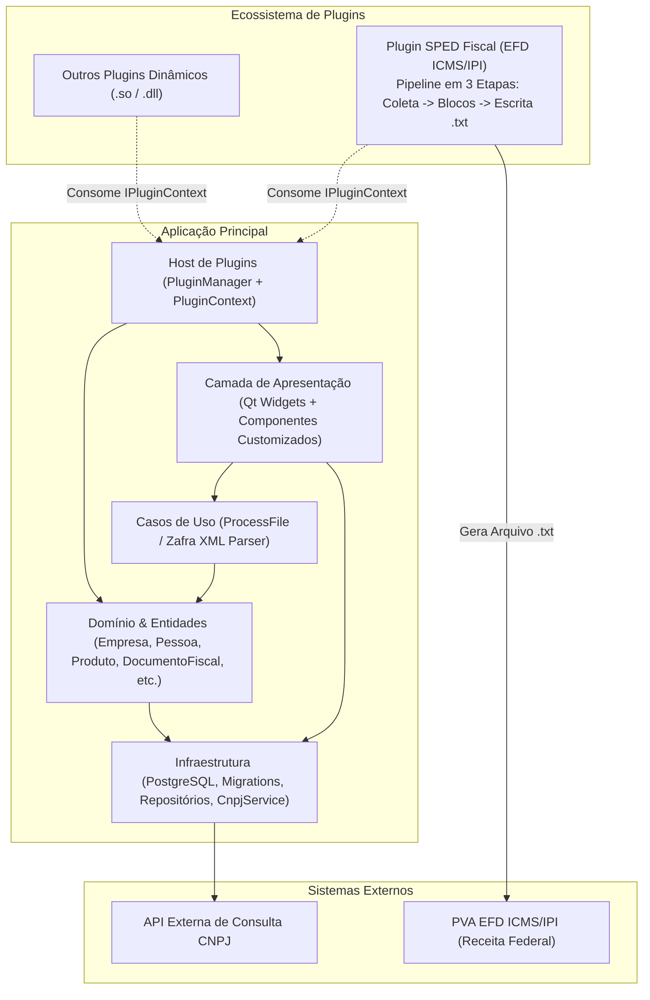

# Especificação de Requisitos do Sistema — Callisto DFE

> **Documento:** Especificação de Requisitos, Regras de Negócio e Histórias de Usuário
> **Projeto:** Callisto
> **Data de Emissão:** 24/10/2026

---

## Sumário

1. [Visão Geral do Sistema](#1-visão-geral-do-sistema)
2. [Atores do Sistema](#2-atores-do-sistema)
3. [Especificação por Módulo (Requisitos Funcionais, Regras de Negócio e Histórias de Usuário)](#3-especificação-por-módulo)
   - [Módulo 1: Inicialização, Configuração e Gestão de Empresas](#31-módulo-1-inicialização-configuração-e-gestão-de-empresas)
   - [Módulo 2: Gestão de Pessoas e Participantes](#32-módulo-2-gestão-de-pessoas-e-participantes)
   - [Módulo 3: Gestão de Produtos, Unidades de Medida e NCM](#33-módulo-3-gestão-de-produtos-unidades-de-medida-e-ncm)
   - [Módulo 4: Importação e Processamento de XMLs de Documentos Fiscais](#34-módulo-4-importação-e-processamento-de-xmls-de-documentos-fiscais)
   - [Módulo 5: Associação e Vínculo de Produtos de Terceiros](#35-módulo-5-associação-e-vínculo-de-produtos-de-terceiros)
   - [Módulo 6: Arquitetura de Plugins e Padronização Visual](#36-módulo-6-arquitetura-de-plugins-e-padronização-visual)
   - [Módulo 7: Geração do SPED Fiscal (EFD ICMS/IPI)](#37-módulo-7-geração-do-sped-fiscal-efd-icmsipi)
4. [Requisitos Não Funcionais (RNF)](#4-requisitos-não-funcionais-rnf)
5. [Matriz de Rastreabilidade](#5-matriz-de-rastreabilidade)

---

## 1. Visão Geral do Sistema

O **Callisto** é uma aplicação desktop desenvolvida em **C++17** com **Qt 6** e banco de dados **PostgreSQL**, voltada à gestão cadastral, ingestão e processamento em lote de Documentos Fiscais Eletrônicos (NF-e), conciliação de itens de fornecedores (de-para de produtos de terceiros) e geração de obrigações acessórias fiscais (como o **SPED Fiscal — EFD ICMS/IPI**) através de uma arquitetura modular baseada em plugins.

---

## 2. Atores do Sistema

### 2.1. Ator Primário (Humano)

| Ator | Descrição e Responsabilidades |
| :--- | :--- |
| **Usuário do Sistema** | Ator único que interage diretamente com a interface gráfica da aplicação. É responsável por manter os cadastros base (Empresas, Pessoas, Produtos), executar o processamento em lote de arquivos XML de notas fiscais, realizar o vínculo (de-para) de produtos de fornecedores e parametrizar/gerar o arquivo digital do SPED Fiscal (EFD ICMS/IPI). |

### 2.2. Atores Secundários (Sistemas Externos)

| Sistema Externo | Tipo de Integração | Descrição |
| :--- | :--- | :--- |
| **Serviço Externo de Consulta de CNPJ** | Requisição HTTP/REST (`CnpjService`) | Fornece automaticamente dados cadastrais de pessoas jurídicas (Razão Social, Nome Fantasia, Logradouro, Número, Bairro, CEP, UF e Município) a partir de um CNPJ informado pelo Usuário do Sistema. |
| **PVA SPED Fiscal (Receita Federal)** | Troca de Arquivo Texto (`.txt`) | Sistema validador oficial da Receita Federal do Brasil que consome e valida a estrutura, blocos, registros e totalizadores do arquivo EFD ICMS/IPI gerado pelo plugin do sistema. |

---

## 3. Especificação por Módulo

---

### 3.1. Módulo 1: Inicialização, Configuração e Gestão de Empresas

#### Requisitos Funcionais (RF)
- **RF01 — Inicialização com Splash Screen e Migrations Automáticas:** Ao iniciar, o sistema deve exibir uma tela de carregamento (*Splash Screen*) apresentando em tempo real o progresso das etapas de leitura do arquivo `config.json`, conexão com o banco PostgreSQL, execução de *migrations* pendentes, carregamento de plugins e inicialização de serviços.
- **RF02 — Obrigatoriedade de Empresa Inicial:** Ao abrir a janela principal (`MainWindow`), o sistema deve verificar se existe ao menos uma empresa cadastrada. Caso não exista, deve abrir automaticamente um diálogo modal de cadastro de empresa.
- **RF03 — Gestão Cadastral de Empresas (CRUD):** O sistema deve permitir listar, cadastrar, editar e excluir empresas, suportando Pessoa Física (CPF) e Pessoa Jurídica (CNPJ), Razão Social, Nome Fantasia, Inscrição Estadual e Endereço completo (CEP, Logradouro, Número, Complemento, Bairro, UF e Cidade).
- **RF04 — Preenchimento Automático via Consulta de CNPJ:** Ao concluir a digitação de um CNPJ válido no cadastro de empresa, o sistema deve consultar o serviço externo (`CnpjService`) e preencher automaticamente os campos cadastrais e de endereço retornados.

#### Regras de Negócio (RN)
- **RN01 — Bloqueio de Uso sem Empresa Ativa:** O sistema não pode operar sem uma empresa ativa selecionada no estado global (`GlobalState`). Se o usuário cancelar o modal inicial de cadastro quando não houver empresas no banco, a aplicação deve ser encerrada imediatamente.
- **RN02 — Validação de Campos Obrigatórios de Empresa:** O CPF/CNPJ e a Razão Social são de preenchimento obrigatório. As mensagens de validação devem utilizar as constantes parametrizadas do sistema (`Mensagens::Validacao`) e ser exibidas via notificação flutuante (`ToastNotification`).
- **RN03 — Alternância Dinâmica PF/PJ:** A seleção entre Pessoa Física e Jurídica no formulário deve alternar dinamicamente a visibilidade e a máscara do documento (`999.999.999-99` para CPF e `99.999.999/9999-99` para CNPJ).
- **RN04 — Ordem Cronológica de Migrations:** As *migrations* de banco de dados devem ser executadas em ordem estritamente cronológica pelo prefixo numérico do arquivo SQL, garantindo a integridade referencial das chaves estrangeiras.

#### Histórias de Usuário (US)

##### **US01 — Primeiro acesso e configuração obrigatória da empresa**
> **Como** Usuário do Sistema,
> **Quero** ser guiado a cadastrar minha empresa logo no primeiro acesso caso nenhuma exista no banco de dados,
> **Para** que o sistema tenha uma empresa ativa configurada para vincular cadastros, notas fiscais e geração de arquivos fiscais.

- **Critérios de Aceitação:**
  - [ ] Durante a abertura, a *Splash Screen* deve exibir cada etapa de inicialização (`processEvents`) sem congelar a renderização das mensagens.
  - [ ] Se houver empresas cadastradas no banco, a primeira empresa deve ser definida automaticamente no `GlobalState`.
  - [ ] Se não houver nenhuma empresa cadastrada, o modal `FormEmpresaDetalhe` deve ser aberto antes de liberar o uso da `MainWindow`.
  - [ ] Caso o modal seja fechado sem salvar nenhuma empresa, o aplicativo deve encerrar sua execução com segurança.

##### **US02 — Cadastro de empresa com busca automática por CNPJ**
> **Como** Usuário do Sistema,
> **Quero** digitar o CNPJ da empresa e ter a Razão Social, Nome Fantasia e Endereço preenchidos automaticamente,
> **Para** agilizar o cadastro e reduzir erros de digitação.

- **Critérios de Aceitação:**
  - [ ] Ao sair do campo CNPJ (`editingFinished`) com 14 dígitos numéricos, o sistema deve consultar a API de CNPJ.
  - [ ] Os campos de Razão Social, Nome Fantasia, CEP, Logradouro, Número, Bairro, UF e Cidade devem ser populados automaticamente quando encontrados.
  - [ ] Caso o usuário tente salvar sem CPF/CNPJ ou Razão Social, uma `ToastNotification` de alerta deve informar qual campo é obrigatório.

---

### 3.2. Módulo 2: Gestão de Pessoas e Participantes

#### Requisitos Funcionais (RF)
- **RF05 — Gestão Cadastral de Pessoas (CRUD):** O sistema deve permitir listar, cadastrar, editar e excluir participantes (clientes, fornecedores, transportadoras e contabilistas), contendo CPF/CNPJ, Razão Social/Nome, Nome Fantasia, Inscrição Estadual e Endereço vinculado à tabela de Cidades (código IBGE).
- **RF06 — Classificação de Papéis da Pessoa:** O cadastro de pessoa deve permitir marcar os papéis **Fornecedor** e **Contabilista** por meio de caixas de seleção (`InputCheckBox`).
- **RF07 — Dados Específicos de Contabilista:** Quando a opção "Contabilista" estiver marcada, o formulário deve habilitar a aba específica para preenchimento do **CRC** e **CPF do Contabilista**.
- **RF08 — Consulta Automática de CNPJ para Pessoas:** O cadastro de pessoas jurídicas deve consultar automaticamente os dados cadastrais ao finalizar o preenchimento do CNPJ.

#### Regras de Negócio (RN)
- **RN05 — Vínculo com Empresa Ativa:** Todo registro de pessoa cadastrado deve estar associado à empresa ativa no momento da operação.
- **RN06 — Visibilidade Condicional de Abas:** As abas complementares no detalhe da pessoa ("Fornecedor" e "Contabilista") só devem ficar visíveis ou ativas caso os respectivos indicadores estejam selecionados.
- **RN07 — Unicidade de Documento por Cadastro Automático:** Na importação de documentos fiscais, antes de criar um novo participante, o sistema deve verificar a existência prévia pelo CPF/CNPJ para evitar duplicidades.
- **RN08 — Marcação Automática de Fornecedor:** Participantes cadastrados automaticamente como emitentes de notas fiscais de terceiros devem receber o indicador `isFornecedor = "S"`.

#### Histórias de Usuário (US)

##### **US03 — Cadastro e classificação de participantes (Fornecedores e Contabilistas)**
> **Como** Usuário do Sistema,
> **Quero** cadastrar pessoas físicas e jurídicas definindo se atuam como fornecedores ou contabilistas,
> **Para** manter a base de participantes organizada para compras, notas fiscais e escrituração contábil.

- **Critérios de Aceitação:**
  - [ ] O formulário deve alternar entre CPF e CNPJ conforme o tipo de pessoa selecionado (`InputRadioGroup`).
  - [ ] Ao marcar o checkbox "Contabilista", a aba de dados do contabilista (CRC e CPF) deve ser exibida.
  - [ ] A listagem de pessoas deve exibir as colunas redimensionadas proporcionalmente, priorizando a coluna de Razão Social/Nome com modo `Stretch`.

---

### 3.3. Módulo 3: Gestão de Produtos, Unidades de Medida e NCM

#### Requisitos Funcionais (RF)
- **RF09 — Gestão Cadastral de Produtos (CRUD):** O sistema deve permitir listar, cadastrar, editar e excluir produtos com os campos: Descrição, Código Interno, Código de Barras (GTIN/EAN), Unidade de Medida, NCM e Tipo de Atividade/Item SPED (`00` a `10` e `99`).
- **RF10 — Busca Interativa em Tempo Real (`InputLookup`):** Os campos de seleção de **NCM** e **Unidade de Medida** devem utilizar o componente `InputLookup`, realizando buscas conforme o usuário digita (*search-as-you-type*) e exibindo um *popup* flutuante com os resultados.
- **RF11 — Pré-preenchimento de Produto a partir de Item de Nota:** O formulário `FormProdutoDetalhe` deve disponibilizar um método para abertura já preenchido com Descrição, Código de Barras, Unidade de Medida e NCM oriundos de um item de nota fiscal de terceiro.

#### Regras de Negócio (RN)
- **RN09 — Permanência de Foco no `InputLookup`:** Durante a digitação e após a atualização da lista de resultados no *popup* do `InputLookup`, o foco de digitação deve permanecer obrigatoriamente no campo de texto (`QLineEdit`). O foco só deve sair do input caso o usuário pressione a tecla **Seta para Baixo** (`Key_Down`) para navegar na lista ou clique em outro elemento da interface.
- **RN10 — Campos Obrigatórios de Produto:** A Descrição, a Unidade de Medida, o Tipo de Atividade e o NCM são obrigatórios para salvar um produto.
- **RN11 — Tratamento de `"SEM GTIN"` no Cadastro:** Se o código de barras recebido de uma nota fiscal for igual a `"SEM GTIN"` (independentemente de maiúsculas/minúsculas), o campo de código de barras do produto deve permanecer em branco.
- **RN12 — Classificação Padrão de Tipo de Item:** Quando não especificado, o tipo de atividade padrão sugerido para novos produtos comerciais deve ser `00 – Mercadoria para Revenda`.

#### Histórias de Usuário (US)

##### **US04 — Seleção ágil de NCM e Unidade de Medida com foco contínuo**
> **Como** Usuário do Sistema,
> **Quero** pesquisar NCM e Unidade de Medida enquanto digito sem perder o foco do teclado quando os resultados aparecerem,
> **Para** digitar códigos ou termos completos de forma fluida e só descer para a lista de sugestões quando desejar.

- **Critérios de Aceitação:**
  - [ ] Ao digitar no `InputLookup`, a lista suspensa deve exibir os resultados encontrados sem roubar o foco do `QLineEdit`.
  - [ ] O usuário pode continuar digitando ou apagando caracteres normalmente enquanto o *popup* está visível.
  - [ ] O foco só passa para a lista de sugestões quando o usuário pressiona a tecla Seta para Baixo ou clica em um item.

##### **US05 — Cadastro completo de produtos**
> **Como** Usuário do Sistema,
> **Quero** cadastrar produtos informando sua classificação fiscal (NCM, Unidade, Tipo de Item e GTIN),
> **Para** permitir o controle do catálogo interno e a correta geração do registro `0200` no SPED Fiscal.

- **Critérios de Aceitação:**
  - [ ] Todos os campos obrigatórios (Descrição, Unidade, NCM, Tipo de Atividade) devem ser validados com mensagens padronizadas antes da gravação.
  - [ ] Na listagem de produtos, a coluna de Descrição deve expandir automaticamente (`QHeaderView::Stretch`) para aproveitar a largura da tela.

---

### 3.4. Módulo 4: Importação e Processamento de XMLs de Documentos Fiscais

#### Requisitos Funcionais (RF)
- **RF12 — Seleção e Varredura de Diretório de XMLs:** A tela `FormProcessarXml` deve permitir ao usuário selecionar qualquer pasta do computador e optar por incluir ou não subpastas na busca de arquivos `.xml`.
- **RF13 — Processamento Assíncrono em Lote:** O processamento dos arquivos listados deve ocorrer em *background* utilizando um *pool* de threads (`QThreadPool`), mantendo a interface gráfica responsiva e permitindo o cancelamento seguro a qualquer momento.
- **RF14 — Acompanhamento em Tempo Real:** Durante a importação, a tela deve atualizar em tempo real uma barra de progresso, contadores de resumo (Total, Processados, Já Importados e Falhas) e o status individual de cada arquivo na tabela (`Pendente`, `Processando...`, `Sucesso`, `Já Importado`, `Erro`).
- **RF15 — Extração Completa da NF-e:** O caso de uso `ProcessFile` (integrado ao parser `Zafra`) deve extrair cabeçalho do documento (chave de acesso, modelo, série, número, data/hora de emissão, operação), emitente/destinatário, itens (`cProd`, `xProd`, `uCom`, `qCom`, `vUnCom`, `vProd`, `vDesc`, `NCM`, `CFOP`, `CEST`, `cEAN`) e tributos (`ICMS`, `PIS`, `COFINS`, `IPI`).
- **RF16 — Persistência Íntegra do XML Original:** Todo documento fiscal importado com sucesso deve ter o conteúdo texto original completo do seu XML salvo na tabela `documentos_fiscais_arquivos` vinculado ao `id_documento` com tipo `DOCUMENTO_FISCAL`.

#### Regras de Negócio (RN)
- **RN13 — Preservação dos Arquivos em Disco:** Os arquivos XML processados a partir da pasta selecionada pelo usuário devem ser apenas lidos, jamais movidos, alterados ou excluídos do diretório original.
- **RN14 — Prevenção de Duplicidade por Chave de Acesso:** Antes de gravar uma NF-e, o sistema deve verificar se a chave de acesso já existe no banco (`existeDocumento`) ou se já está sendo processada simultaneamente por outra thread (`ChaveEmProcessamentoGuard`). Caso positivo, o arquivo é marcado como `Já Importado` e não é duplicado.
- **RN15 — Identificação Automática de Emissão Própria vs. Terceiro:** O sistema deve comparar o CNPJ/CPF do emitente do XML com o CNPJ/CPF da Empresa Ativa (`GlobalState`):
  - Se forem iguais: `tipoEmissao = "propria"` (o participante salvo é o Destinatário).
  - Se forem diferentes: `tipoEmissao = "terceiro"` (o participante salvo é o Emitente/Fornecedor).
- **RN16 — Cadastro Automático em Notas de Emissão Própria:** Em notas de emissão própria, caso o produto (`cProd`), a unidade de medida (`uCom`) ou o NCM ainda não existam no banco, o sistema deve cadastrá-los automaticamente.
- **RN17 — Higienização do Código de Barras (`<cEAN>`):** Na leitura do item do XML, se a tag `<cEAN>` contiver o literal `"SEM GTIN"`, espaços ou estiver vazia, o campo `codigo_barras` do item deve ser armazenado vazio, evitando falsos positivos em associações automáticas.

#### Histórias de Usuário (US)

##### **US06 — Importação em lote de arquivos XML com feedback em tempo real**
> **Como** Usuário do Sistema,
> **Quero** selecionar uma pasta contendo centenas de arquivos XML e acompanhar o progresso de importação de cada nota na tela,
> **Para** importar documentos fiscais com rapidez, saber exatamente quais notas foram processadas, quais já existiam e se houve algum XML inválido.

- **Critérios de Aceitação:**
  - [ ] O usuário pode marcar "Incluir subpastas" para varrer diretórios recursivamente.
  - [ ] A interface não deve travar durante o processamento em lote.
  - [ ] Notas cuja chave de acesso já conste no banco devem receber o status `Já Importado` sem gerar erro ou duplicação.
  - [ ] O usuário pode interromper o lote clicando no botão "Cancelar".
  - [ ] O conteúdo XML completo de cada nota importada deve ser gravado em `documentos_fiscais_arquivos`.

---

### 3.5. Módulo 5: Associação e Vínculo de Produtos de Terceiros

#### Requisitos Funcionais (RF)
- **RF17 — Associação Automática na Importação:** Ao importar uma nota fiscal de terceiro, o sistema deve tentar associar automaticamente cada item ao cadastro interno de produtos.
- **RF18 — Painel Mestre-Detalhe de Vínculo de Produtos (`FormVincularProdutos`):** O sistema deve disponibilizar uma tela contendo:
  - **Grade Superior:** Lista de notas fiscais de terceiros com filtros (apenas notas com itens pendentes ou todas as notas) e resumo da quantidade de itens pendentes.
  - **Grade Inferior:** Lista dos itens da nota selecionada, exibindo código no fornecedor (`cProd`), descrição no XML, código de barras (`cEAN`), unidade, status do vínculo (`Vinculado` ou `Pendente`), produto interno associado e fator multiplicador.
- **RF19 — Vínculo Manual com Produto Existente (`DialogSelecionarProduto`):** Para itens pendentes, o usuário deve poder pesquisar um produto já cadastrado no sistema e definir a unidade de medida e o fator multiplicador de conversão.
- **RF20 — Cadastro Rápido de Novo Produto a partir do Vínculo:** Na tela `FormVincularProdutos`, o botão **"Cadastrar Novo Produto"** deve abrir o formulário padrão `FormProdutoDetalhe` já preenchido com os dados do item da nota (descrição, código de barras, unidade e NCM) e, após salvar o produto, criar imediatamente o vínculo na tabela `produtos_fornecedores`.

#### Regras de Negócio (RN)
- **RN18 — Chave de Mapeamento Fornecedor × Produto:** O vínculo entre o item da nota de terceiro e o produto interno não altera o registro original da nota; ele é persistido na tabela `produtos_fornecedores` através da chave única `(id_fornecedor, codigo_fornecedor)`.
- **RN19 — Hierarquia de Associação Automática:** Durante o processamento de uma nota de terceiro, para cada item:
  1. Verifica se já existe registro em `produtos_fornecedores` para `(id_fornecedor, cProd)`. Se existir, o item já é considerado vinculado.
  2. Se não existir e o item possuir `codigo_barras` válido (não vazio e diferente de `"SEM GTIN"`), busca um produto interno com o mesmo `codigo_barra`. Se encontrar, cria automaticamente o vínculo em `produtos_fornecedores` com multiplicador padrão `1.0`.
  3. Caso contrário, o item permanece com status **Pendente** para decisão manual do usuário.
- **RN20 — Reaproveitamento Automático em Notas Futuras:** Uma vez vinculado um `(id_fornecedor, codigo_fornecedor)`, todas as notas anteriores e futuras daquele mesmo fornecedor contendo o mesmo `cProd` passam a reconhecer o produto automaticamente.

#### Histórias de Usuário (US)

##### **US07 — Associação automática de produtos de fornecedores pelo código de barras**
> **Como** Usuário do Sistema,
> **Quero** que o sistema vincule automaticamente os itens das notas de compra quando o código de barras (EAN) coincidir com um produto já cadastrado,
> **Para** reduzir o trabalho manual de conciliação de notas de entrada.

- **Critérios de Aceitação:**
  - [ ] Ao importar um XML de terceiro cujo item tenha `<cEAN>` válido existente na tabela `produtos`, um registro em `produtos_fornecedores` deve ser criado automaticamente com fator `1.0`.
  - [ ] Itens com `<cEAN>` igual a `"SEM GTIN"` não devem sofrer associação automática por código de barras.

##### **US08 — Vínculo manual de item de terceiro a produto existente ou novo cadastro**
> **Como** Usuário do Sistema,
> **Quero** visualizar as notas de terceiros com itens pendentes e poder vincular cada item a um produto existente ou cadastrar o produto na hora usando o `FormProdutoDetalhe`,
> **Para** regularizar rapidamente todos os itens comprados de fornecedores.

- **Critérios de Aceitação:**
  - [ ] Ao selecionar uma nota na tabela superior de `FormVincularProdutos`, os itens correspondentes devem ser carregados na tabela inferior indicando visualmente se estão `Vinculado` ou `Pendente`.
  - [ ] Ao clicar em "Vincular Produto Existente", o usuário pode escolher um produto do catálogo e informar o multiplicador de conversão.
  - [ ] Ao clicar em "Cadastrar Novo Produto", o `FormProdutoDetalhe` deve abrir em diálogo modal já preenchido com Descrição, EAN, Unidade e NCM do item do XML; ao salvar, o vínculo em `produtos_fornecedores` deve ser gravado automaticamente e a listagem atualizada.

---

### 3.6. Módulo 6: Arquitetura de Plugins e Padronização Visual

#### Requisitos Funcionais (RF)
- **RF21 — Descoberta e Carregamento Dinâmico de Plugins:** O `PluginManager` deve carregar automaticamente bibliotecas dinâmicas (`.so` no Linux / `.dll` no Windows) localizadas na pasta `bin/plugins` que implementem as interfaces `IPlugin` e `IUIExtension`.
- **RF22 — Injeção de Contexto sem Exposição do Banco (`IPluginContext`):** O host deve injetar nos plugins uma instância de `IPluginContext` fornecendo:
  - Acesso à Empresa Ativa (`empresaAtual()`).
  - Acesso às interfaces dos Repositórios de domínio (`IEmpresaRepository`, `IDocumentoFiscalRepository`, `IPessoaRepository`, `IProdutoRepository`, `IProdutoFornecedorRepository`, `IUnidadeMedidaRepository`).
  - Serviço para abertura de abas integradas na `MainWindow` (`openTab`).
- **RF23 — Factory Methods de Componentes de UI no Contexto:** O `IPluginContext` deve disponibilizar métodos fábrica para que os plugins construam suas telas utilizando os componentes padronizados do core:
  - **Inputs:** `createInputText`, `createInputMasked`, `createInputComboBox`, `createInputCheckBox`.
  - **Containers e Layouts:** `createGroupBox`, `createHBoxLayout`, `createVBoxLayout`, `createGridLayout`.
  - **Espaçadores:** `createHorizontalSpacer`, `createVerticalSpacer`, `createHorizontalSpacing`, `createVerticalSpacing`.

#### Regras de Negócio (RN)
- **RN21 — Proibição de Acesso Direto ao `DatabaseManager` por Plugins:** Plugins externos não devem executar queries SQL diretas nem receber referência ao `DatabaseManager`; toda leitura ou escrita de dados do sistema deve ocorrer exclusivamente através dos contratos dos Repositórios expostos pelo `IPluginContext`.
- **RN22 — Padronização de Inputs Mascarados (`InputMasked`):** O método `text()` de `InputMasked` deve retornar apenas os dígitos numéricos limpos (sem pontos, traços, barras ou parênteses), garantindo que dados como CPF, CNPJ, CEP, Telefone e código IBGE sejam consumidos de forma higienizada pelas regras de negócio e arquivos fiscais.

#### Histórias de Usuário (US)

##### **US09 — Integração transparente de plugins na janela principal**
> **Como** Usuário do Sistema,
> **Quero** acessar funcionalidades adicionais instaladas via plugins diretamente no menu lateral da aplicação, abrindo em abas com o mesmo padrão visual do sistema,
> **Para** ter uma experiência unificada e consistente em todos os módulos.

- **Critérios de Aceitação:**
  - [ ] Todo plugin com extensão visual (`IUIExtension`) deve adicionar seu botão de ação na barra lateral da `MainWindow`.
  - [ ] Ao acionar o plugin, sua tela deve abrir como aba no `tabWidget` principal, construída com os componentes `Input*` e layouts fornecidos pelo `PluginContext`.

---

### 3.7. Módulo 7: Geração do SPED Fiscal (EFD ICMS/IPI)

#### Requisitos Funcionais (RF)
- **RF24 — Interface de Parametrização e Geração (`FormSpedFiscal`):** O plugin `sped_fiscal` deve exibir uma aba contendo:
  - Identificação da Empresa Ativa (Razão Social e CNPJ).
  - Seleção de Mês/Ano de referência (que preenche automaticamente o primeiro e último dia do mês e sugere o nome do arquivo `SPED_FISCAL_AAAA_MM.txt`), além de campos de Data Inicial, Data Final, Finalidade (`0 - Original` / `1 - Substituto`) e Perfil (`A` ou `B`).
  - Formulário completo de dados do Contabilista (Nome, CPF, CRC, CNPJ do Escritório, Logradouro, Número, Bairro, Código IBGE, CEP, Telefone e E-mail).
  - Seletor do caminho do arquivo `.txt` de destino, barra de progresso e painel de log detalhado em tempo real.
- **RF25 — Persistência Local dos Dados do Contabilista:** As informações preenchidas para o Contabilista (Registro `0100`) devem ser salvas automaticamente em arquivo de configuração JSON local (`contador_config.json`) e recarregadas ao abrir a tela.
- **RF26 — Pipeline de Geração em 3 Etapas Desacopladas:**
  1. **Etapa 1 — Coleta de Dados (`SpedDataCollector`):** Consulta os repositórios via `IPluginContext` no período informado e popula estruturas intermediárias em memória (`SpedEmpresaData`, `SpedContadorData`, `SpedParticipanteData`, `SpedUnidadeData`, `SpedItemData`, `SpedDocumentoFiscalData`, `SpedDocumentoItemData`), sem qualquer persistência em banco.
  2. **Etapa 2 — Mapeamento de Blocos e Registros (`SpedBlockBuilder`):** Transforma os modelos em memória nas classes tipadas de registros do SPED Fiscal:
     - **Bloco 0:** `0000` (Abertura), `0001`, `0005` (Dados complementares da empresa), `0100` (Contabilista), `0150` (Participantes movimentados), `0190` (Unidades de medida), `0200` (Produtos/Itens movimentados) e `0990` (Encerramento do Bloco 0).
     - **Bloco C:** `C001`, `C100` (Nota Fiscal), `C170` (Itens do documento), `C190` (Registro analítico consolidado por CST/CFOP/Alíquota de ICMS) e `C990` (Encerramento do Bloco C).
     - **Blocos sem Movimento:** Abertura (`IND_MOV = 1`) e encerramento dos blocos `D` (`D001`/`D990`), `E` (`E001`/`E990`), `G` (`G001`/`G990`), `H` (`H001`/`H990`) e `1` (`1001`/`1990`).
     - **Bloco 9:** `9001`, `9900`, `9990` e `9999`.
  3. **Etapa 3 — Serialização e Escrita do Arquivo (`SpedFileWriter`):** Formata cada registro com delimitadores pipe (`|REG|...|`), calcula dinamicamente os totalizadores `9900` (contagem por tipo de registro) e `9999` (total geral de linhas do arquivo) e grava o arquivo `.txt` em disco.

#### Regras de Negócio (RN)
- **RN23 — Exclusividade de Cadastros Movimentados no Bloco 0:** Os registros `0150` (Participantes), `0190` (Unidades) e `0200` (Produtos) devem conter apenas os cadastros efetivamente referenciados nos documentos fiscais do período apurado, sem duplicidade.
- **RN24 — Consolidação Analítica do Registro `C190`:** Para cada documento fiscal (`C100`), os itens devem ser agrupados pela combinação de `(CST_ICMS, CFOP, ALIQ_ICMS)` somando o valor da operação (`VL_OPR`), base de cálculo (`VL_BC_ICMS`), valor do ICMS (`VL_ICMS`), base ST (`VL_BC_ICMS_ST`), valor ST (`VL_ICMS_ST`) e valor de IPI (`VL_IPI`).
- **RN25 — Regras de Formatação do Leiaute EFD ICMS/IPI:**
  - Todas as linhas devem iniciar e terminar com o caractere pipe (`|`).
  - Datas devem ser formatadas como `ddMMyyyy` (8 dígitos, sem barras).
  - Valores decimais devem utilizar vírgula (`,`) como separador decimal e não possuir separador de milhar.
  - Textos de descrição devem ser higienizados removendo eventuais caracteres `|` ou quebras de linha.
- **RN26 — Cálculo exato dos Totalizadores (`0990`, `C990`, `9900`, `9990`, `9999`):** O totalizador de cada bloco deve refletir o número exato de linhas daquele bloco (incluindo abertura e fechamento), e o registro `9999` deve corresponder ao número total de linhas do arquivo `.txt`.

#### Histórias de Usuário (US)

##### **US10 — Configuração persistente dos dados do Contabilista**
> **Como** Usuário do Sistema,
> **Quero** preencher os dados do contador uma única vez na tela do SPED Fiscal e tê-los salvos automaticamente para as próximas gerações,
> **Para** não precisar redigitar CPF, CRC, CNPJ do escritório e endereço a cada fechamento mensal.

- **Critérios de Aceitação:**
  - [ ] Ao clicar em "Gerar SPED Fiscal", os dados do contabilista devem ser salvos em `contador_config.json`.
  - [ ] Ao reabrir a aba "SPED Fiscal", os campos do contabilista devem vir preenchidos com os últimos dados salvos.

##### **US11 — Geração do arquivo SPED Fiscal (.txt) por período**
> **Como** Usuário do Sistema,
> **Quero** selecionar o mês/ano de referência, a finalidade e o perfil de apresentação e gerar o arquivo `.txt` do SPED Fiscal em 3 etapas visíveis no log,
> **Para** importar o arquivo diretamente no programa validador (PVA) da Receita Federal.

- **Critérios de Aceitação:**
  - [ ] O sistema deve validar se há Empresa Ativa selecionada e se a Data Inicial não é superior à Data Final.
  - [ ] O painel de log deve registrar o progresso das 3 etapas (1: quantidade de notas, participantes, produtos e unidades coletados; 2: quantidade de registros mapeados; 3: total de linhas gravadas e caminho do arquivo).
  - [ ] O arquivo `.txt` gerado deve conter os Blocos 0, C, D, E, G, H, 1 e 9 estruturados com os totalizadores `9900` e `9999` consistentes.

---

## 4. Requisitos Não Funcionais (RNF)

| Código | Categoria | Requisito Não Funcional |
| :--- | :--- | :--- |
| **RNF01** | **Concorrência e Thread-Safety** | O processamento em lote de arquivos XML deve utilizar conexões de banco de dados (`QSqlDatabase`) independentes por thread no `QThreadPool`, evitando compartilhamento de conexão SQL entre threads simultâneas. |
| **RNF02** | **Sincronização de Escrita** | Operações concorrentes de auto-cadastro (Pessoas, Produtos, Unidades, NCM e verificação de Chave de Acesso) durante a importação em lote devem ser protegidas por `QMutex` (`ChaveEmProcessamentoGuard`) para evitar condições de corrida (*race conditions*). |
| **RNF03** | **Responsividade da Interface (UI)** | Nenhuma operação de leitura em lote de XMLs ou geração de arquivo SPED deve bloquear o loop de eventos principal do Qt; atualizações visuais devem ocorrer via sinais assíncronos (`Qt::QueuedConnection`) ou processamento controlado de eventos. |
| **RNF04** | **Padronização de Componentes Visuais** | Todos os formulários do core e de plugins devem utilizar a família de componentes `InputBase` (`InputText`, `InputMasked`, `InputComboBox`, `InputCheckBox`, `InputRadioGroup`, `InputLookup`), garantindo exibição uniforme de *labels* em negrito e mensagens de erro. |
| **RNF05** | **Ergonomia de Listagens** | Todas as tabelas e listagens do sistema (`QTableView` / `QTableWidget`) devem configurar `ResizeToContents` para colunas de código/status/valores e priorizar `QHeaderView::Stretch` para colunas descritivas (como Descrição, Razão Social ou Nome). |
| **RNF06** | **Centralização de Mensagens** | As mensagens de validação de formulários e feedbacks de CRUD devem ser centralizadas no arquivo `src/core/constants/Mensagens.h` através de constantes e funções parametrizadas. |
| **RNF07** | **Desacoplamento de Entidades Virtuais** | Projeções de consulta específicas de telas (como `NotaTerceiroResumo` e `NotaTerceiroItem`) devem residir em `src/core/entities/virtual/`, separadas das entidades de tabela, implementando o método estático `fromRecord(const QSqlRecord&)` para hidratação dos dados. |
| **RNF08** | **Isolamento Arquitetural de Plugins** | A comunicação entre o executável principal e plugins externos deve ocorrer estritamente via interfaces abstratas (`IPlugin`, `IUIExtension`, `IPluginContext`) com exportação de símbolos habilitada (`ENABLE_EXPORTS ON`). |
| **RNF09** | **Auditoria e Rastreabilidade de Logs** | O sistema deve registrar todas as operações relevantes, falhas de banco e eventos de ciclo de vida em arquivo de log (`application.log`) formatado com carimbo de data/hora, nível de severidade, arquivo-fonte e linha. |
| **RNF10** | **Portabilidade e Padrão da Linguagem** | O código-fonte deve seguir o padrão **C++17** (evitando identificadores conflitantes com palavras reservadas ou *alternative tokens* do C++, como `compl`) e ser compatível com **CMake 3.19+** e **Qt 6**. |

---

## 5. Matriz de Rastreabilidade

| Módulo | Requisitos Funcionais | Regras de Negócio | Histórias de Usuário | Principais Arquivos / Componentes no Projeto |
| :--- | :--- | :--- | :--- | :--- |
| **1. Inicialização & Empresas** | RF01, RF02, RF03, RF04 | RN01, RN02, RN03, RN04 | US01, US02 | `main.cpp`, `MigrationRunner`, `MainWindow`, `GlobalState`, `FormEmpresas`, `FormEmpresaDetalhe`, `EmpresaRepository`, `CnpjService` |
| **2. Pessoas & Participantes** | RF05, RF06, RF07, RF08 | RN05, RN06, RN07, RN08 | US03 | `FormPessoas`, `FormPessoaDetalhe`, `FormPessoaListagem`, `Pessoa`, `Endereco`, `PessoaRepository`, `CidadeRepository` |
| **3. Produtos, Unidades & NCM** | RF09, RF10, RF11 | RN09, RN10, RN11, RN12 | US04, US05 | `FormProdutos`, `FormProdutoDetalhe`, `InputLookup`, `Produto`, `UnidadeMedida`, `NCM`, `ProdutoRepository`, `Mensagens.h` |
| **4. Importação de XMLs (NF-e)** | RF12, RF13, RF14, RF15, RF16 | RN13, RN14, RN15, RN16, RN17 | US06 | `FormProcessarXml`, `ProcessFile`, `DocumentoFiscal`, `DocumentoFiscalItem`, `DocumentoFiscalItemTributo`, `DocumentoFiscalArquivo` |
| **5. Vínculo de Produtos de Terceiros** | RF17, RF18, RF19, RF20 | RN18, RN19, RN20 | US07, US08 | `FormVincularProdutos`, `DialogSelecionarProduto`, `ProdutoFornecedor`, `NotaTerceiroResumo`, `NotaTerceiroItem`, `ProdutoFornecedorRepository` |
| **6. Arquitetura de Plugins & UI** | RF21, RF22, RF23 | RN21, RN22 | US09 | `PluginManager`, `IPlugin`, `IUIExtension`, `IPluginContext`, `PluginContext`, `InputBase`, `InputText`, `InputMasked`, `InputComboBox` |
| **7. Plugin SPED Fiscal (EFD)** | RF24, RF25, RF26 | RN23, RN24, RN25, RN26 | US10, US11 | `SpedFiscalPlugin`, `FormSpedFiscal`, `SpedDataCollector`, `SpedBlockBuilder`, `SpedFileWriter`, `models/*`, `records/bloco*` |
