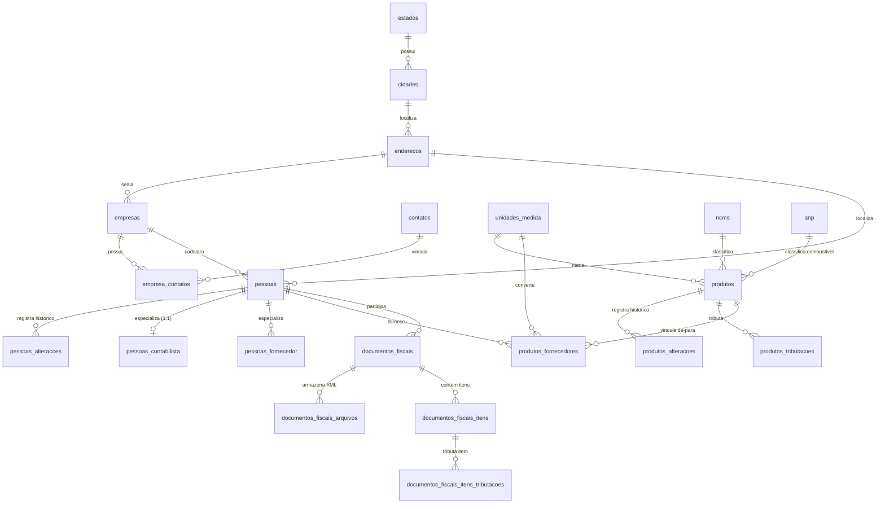
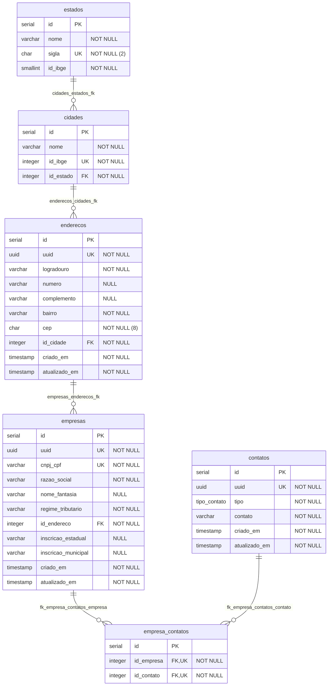
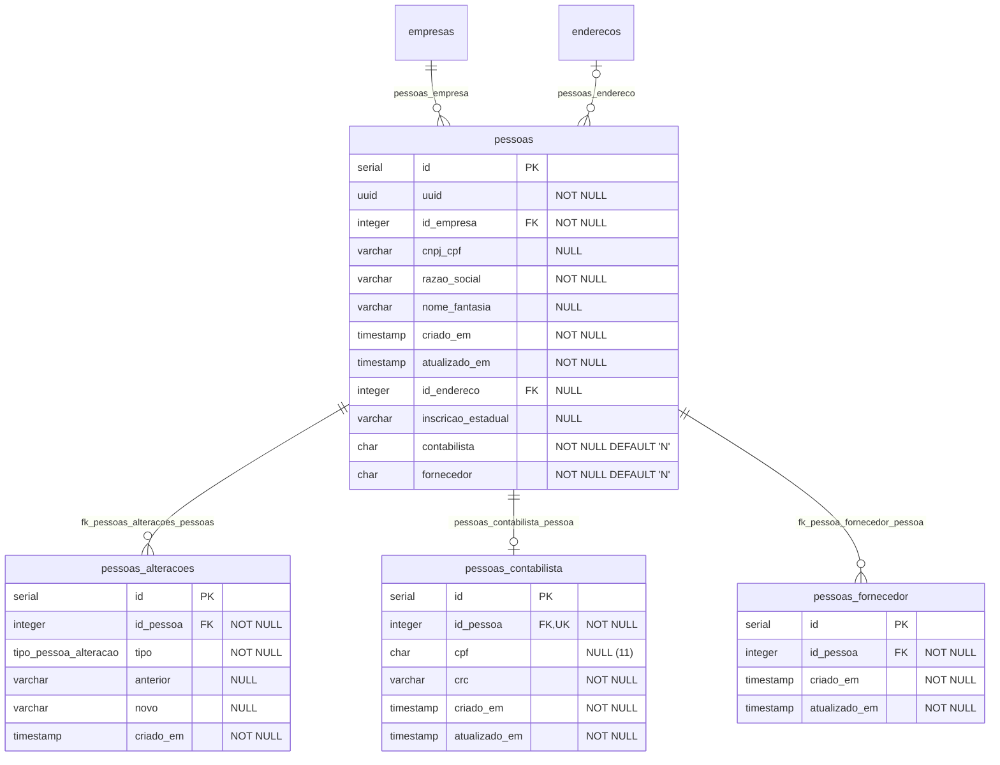
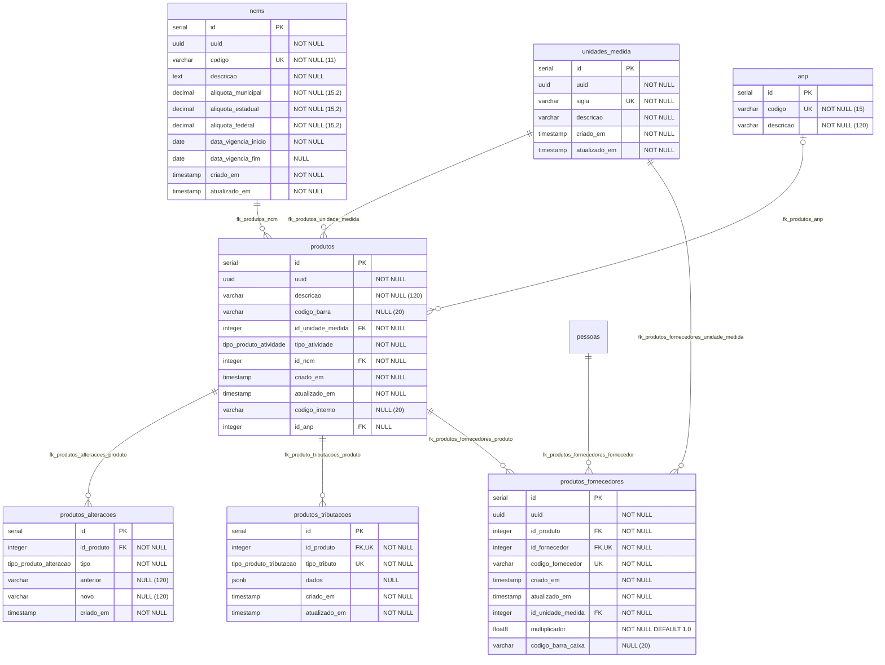
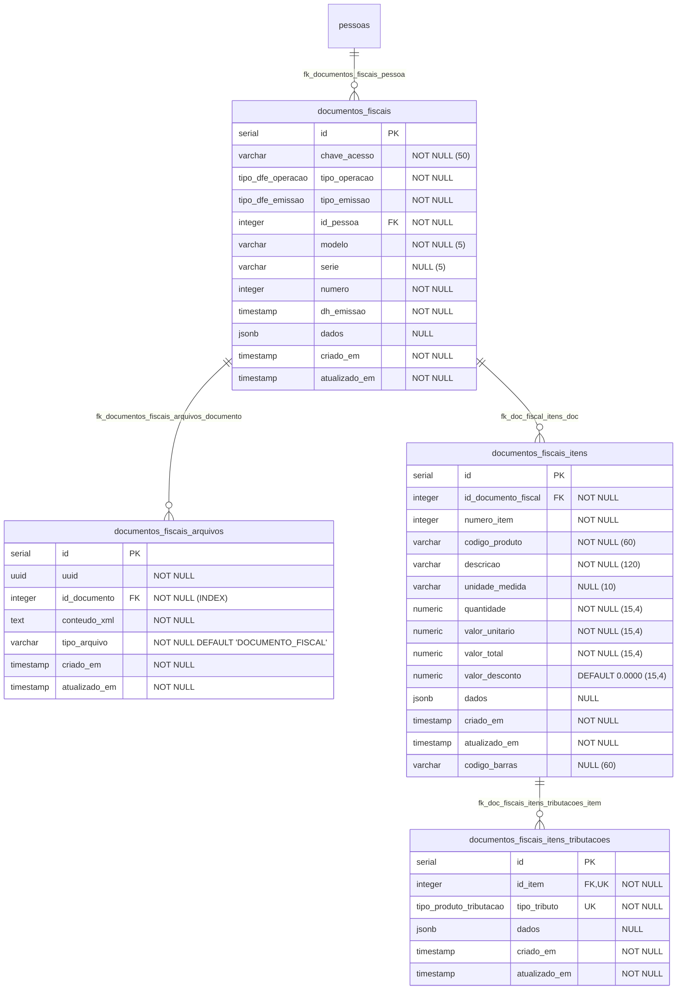

# Modelagem do Banco de Dados — Callisto DFE

> **Documento:** Modelagem Relacional e Dicionário de Dados (Consolidado a partir das Migrations)
> **Projeto:** Callisto DFE
> **SGBD:** PostgreSQL (`schema: public`)
> **Data de Emissão:** 30/10/2026

---

## Sumário

1. [Visão Geral e Diagrama ER Macro](#1-visão-geral-e-diagrama-er-macro)
2. [Tipos Customizados (ENUMs)](#2-tipos-customizados-enums)
3. [Contexto 1: Empresas, Endereços e Contatos](#3-contexto-1-empresas-endereços-e-contatos)
   - [3.1. Diagrama ER do Contexto](#31-diagrama-er-do-contexto)
   - [3.2. Dicionário de Dados](#32-dicionário-de-dados)
4. [Contexto 2: Participantes / Pessoas](#4-contexto-2-participantes--pessoas)
   - [4.1. Diagrama ER do Contexto](#41-diagrama-er-do-contexto)
   - [4.2. Dicionário de Dados](#42-dicionário-de-dados)
5. [Contexto 3: Produtos e Tabelas Fiscais](#5-contexto-3-produtos-e-tabelas-fiscais)
   - [5.1. Diagrama ER do Contexto](#51-diagrama-er-do-contexto)
   - [5.2. Dicionário de Dados](#52-dicionário-de-dados)
6. [Contexto 4: Documentos Fiscais](#6-contexto-4-documentos-fiscais)
   - [6.1. Diagrama ER do Contexto](#61-diagrama-er-do-contexto)
   - [6.2. Dicionário de Dados](#62-dicionário-de-dados)

---

## 1. Visão Geral e Diagrama ER Macro

O banco de dados do **Callisto DFE** é estruturado no esquema `public` do PostgreSQL e encontra-se organizado em **4 contextos de negócio**, totalizando **21 tabelas de domínio** e **7 tipos enumerados (`ENUM`)** (além da tabela técnica `migrations` mantida pelo `MigrationRunner`):

1. **Empresas, Endereços e Contatos:** Base geográfica (`estados`, `cidades`, `enderecos`), meios de comunicação (`contatos`, `empresa_contatos`) e cadastro das empresas declarantes/emitentes (`empresas`).
2. **Participantes / Pessoas:** Cadastro de participantes vinculados às empresas (`pessoas`), suas especializações (`pessoas_contabilista`, `pessoas_fornecedor`) e histórico de alterações cadastrais (`pessoas_alteracoes`).
3. **Produtos e Tabelas Fiscais:** Catálogo de produtos (`produtos`), tabelas auxiliares e regulatórias (`unidades_medida`, `ncms`, `anp`), regras de tributação (`produtos_tributacoes`), vínculo de-para com fornecedores (`produtos_fornecedores`) e histórico de alterações (`produtos_alteracoes`).
4. **Documentos Fiscais:** Cabeçalho dos documentos fiscais eletrônicos (`documentos_fiscais`), armazenamento dos arquivos XML (`documentos_fiscais_arquivos`), itens do documento (`documentos_fiscais_itens`) e tributações por item (`documentos_fiscais_itens_tributacoes`).

> [!NOTE]
> A modelagem abaixo reflete o **estado consolidado final** após a aplicação de todas as migrations da pasta `migrations/`, incluindo as migrations de ajuste estrutural de chaves primárias, estrangeiras e novas colunas (`20261013120000`, `20261013120100` e `20261013204000`).

---

## 2. Tipos Customizados (ENUMs)

Definidos nas migrations `20260818082100_create_types.sql` e `20260818083800_create_emissao_operacao_types.sql`:

| Nome do Tipo (`ENUM`) | Valores Permitidos | Tabelas que Utilizam | Descrição |
| :--- | :--- | :--- | :--- |
| `tipo_contato` | `'email'`, `'telefone'`, `'celular'` | `contatos.tipo` | Canal ou meio de contato cadastrado. |
| `tipo_pessoa_alteracao` | `'cnpj_cpf'`, `'nome'`, `'fantasia'`, `'id_endereco'`, `'inscricao_estadual'` | `pessoas_alteracoes.tipo` | Campo auditado na alteração cadastral do participante (Bloco 0175 do SPED). |
| `tipo_produto_alteracao` | `'descricao'`, `'codigo_barra'`, `'id_unidade_medida'`, `'tipo_atividade'`, `'id_ncm'`, `'codigo_interno'` | `produtos_alteracoes.tipo` | Campo auditado na alteração cadastral do produto (Bloco 0205 do SPED). |
| `tipo_produto_atividade` | `'00'`, `'01'`, `'02'`, `'03'`, `'04'`, `'05'`, `'06'`, `'07'`, `'08'`, `'09'`, `'10'`, `'99'` | `produtos.tipo_atividade` | Tipo do item segundo a tabela do SPED Fiscal (00 = Mercadoria para Revenda, 01 = Matéria-Prima, ..., 99 = Outras). |
| `tipo_produto_tributacao` | `'icms'`, `'ipi'`, `'pis'`, `'cofins'` | `produtos_tributacoes.tipo_tributo`, `documentos_fiscais_itens_tributacoes.tipo_tributo` | Tributo ao qual pertencem as regras/valores armazenados no campo `dados`. |
| `tipo_dfe_emissao` | `'propria'`, `'terceiro'` | `documentos_fiscais.tipo_emissao` | Indicador do emitente do documento fiscal (emissão própria ou por terceiros). |
| `tipo_dfe_operacao` | `'saida'`, `'entrada'` | `documentos_fiscais.tipo_operacao` | Tipo da operação fiscal (entrada ou saída). |

---

## 3. Contexto 1: Empresas, Endereços e Contatos

Agrupa as tabelas de localização geográfica (Unidades Federativas, Municípios IBGE e Endereços), os meios de contato e o cadastro das empresas ativas no sistema.

### 3.1. Diagrama ER do Contexto

### 3.2. Dicionário de Dados

#### Tabela: `public.estados`
Armazena as Unidades Federativas (UF) do Brasil e seus respectivos códigos IBGE.
- **Migration de criação:** `20260818082300_create_estados_table.sql` (carga inicial em `20260924083001_insert_estados.sql`)

| Coluna | Tipo SQL | Nulo? | Valor Padrão | Constraints | Descrição |
| :--- | :--- | :---: | :--- | :--- | :--- |
| `id` | `serial` (`integer`) | Não | `nextval(...)` | `PK (uf_pk)` | Identificador único do estado. |
| `nome` | `character varying(100)` | Não | — | — | Nome por extenso da Unidade Federativa. |
| `sigla` | `character(2)` | Não | — | `UNIQUE (uf_unique)` | Sigla da UF (ex.: `SP`, `PR`, `SC`). |
| `id_ibge` | `smallint` | Não | — | — | Código numérico da UF na tabela do IBGE. |

---

#### Tabela: `public.cidades`
Armazena os municípios brasileiros vinculados às Unidades Federativas.
- **Migration de criação:** `20260818082400_create_cidades_table.sql` (carga inicial em `20260927093001_insert_cidades.sql`)

| Coluna | Tipo SQL | Nulo? | Valor Padrão | Constraints | Descrição |
| :--- | :--- | :---: | :--- | :--- | :--- |
| `id` | `serial` (`integer`) | Não | `nextval(...)` | `PK (cidades_pk)` | Identificador único da cidade. |
| `nome` | `character varying(120)` | Não | — | — | Nome do município. |
| `id_ibge` | `integer` | Não | — | `UNIQUE (cidades_unique)` | Código do município de 7 dígitos na tabela do IBGE. |
| `id_estado` | `integer` | Não | — | `FK (cidades_estados_fk)` -> `estados(id)` (`ON UPDATE NO ACTION ON DELETE NO ACTION`) | Referência ao estado (UF) da cidade. |

---

#### Tabela: `public.enderecos`
Armazena endereços físicos reutilizados tanto por empresas quanto por participantes (`pessoas`).
- **Migration de criação:** `20260818082500_create_enderecos_table.sql`

| Coluna | Tipo SQL | Nulo? | Valor Padrão | Constraints | Descrição |
| :--- | :--- | :---: | :--- | :--- | :--- |
| `id` | `serial` (`integer`) | Não | `nextval(...)` | `PK (enderecos_pk)` | Identificador único do endereço. |
| `uuid` | `uuid` | Não | `gen_random_uuid()` | `UNIQUE (enderecos_unique)` | Identificador universal único. |
| `logradouro` | `character varying(120)` | Não | — | — | Nome da rua, avenida, rodovia, etc. |
| `numero` | `character varying(20)` | Sim | `NULL` | — | Número do imóvel (ou `S/N`). |
| `complemento` | `character varying(60)` | Sim | `NULL` | — | Complemento do endereço (sala, bloco, apto). |
| `bairro` | `character varying(60)` | Não | — | — | Bairro ou distrito. |
| `cep` | `character(8)` | Não | — | — | Código de Endereçamento Postal (apenas dígitos). |
| `id_cidade` | `integer` | Não | — | `FK (enderecos_cidades_fk)` -> `cidades(id)` (`ON UPDATE NO ACTION ON DELETE NO ACTION`) | Município do endereço. |
| `criado_em` | `timestamp without time zone` | Não | `CURRENT_TIMESTAMP` | — | Data/hora de criação do registro. |
| `atualizado_em` | `timestamp without time zone` | Não | `CURRENT_TIMESTAMP` | — | Data/hora da última atualização. |

---

#### Tabela: `public.contatos`
Armazena registros de contatos (e-mail, telefone ou celular).
- **Migration de criação:** `20260818082200_create_contatos_table.sql`

| Coluna | Tipo SQL | Nulo? | Valor Padrão | Constraints | Descrição |
| :--- | :--- | :---: | :--- | :--- | :--- |
| `id` | `serial` (`integer`) | Não | `nextval(...)` | `PK (contatos_pkey)` | Identificador único do contato. |
| `uuid` | `uuid` | Não | `gen_random_uuid()` | `UNIQUE (contatos_unique)` | Identificador universal único. |
| `tipo` | `tipo_contato` | Não | — | — | Tipo do contato (`'email'`, `'telefone'`, `'celular'`). |
| `contato` | `character varying(60)` | Não | — | — | Valor do contato (endereço de e-mail ou número telefônico). |
| `criado_em` | `timestamp without time zone` | Não | `CURRENT_TIMESTAMP` | — | Data/hora de criação do registro. |
| `atualizado_em` | `timestamp without time zone` | Não | `CURRENT_TIMESTAMP` | — | Data/hora da última atualização *(grafia original da migration)*. |

---

#### Tabela: `public.empresas`
Armazena o cadastro das empresas gerenciadas pelo sistema (declarantes/emitentes).
- **Migrations:** `20260818082600_create_empresas_table.sql` e `20261013204000_fix_database_pks_and_fks.sql`

| Coluna | Tipo SQL | Nulo? | Valor Padrão | Constraints | Descrição |
| :--- | :--- | :---: | :--- | :--- | :--- |
| `id` | `serial` (`integer`) | Não | `nextval(...)` | `PK (empresas_pk)` | Identificador único da empresa. |
| `uuid` | `uuid` | Não | `gen_random_uuid()` | `UNIQUE (empresas_unique)` | Identificador universal único. |
| `cnpj_cpf` | `character varying(14)` | Não | — | `UNIQUE (empresas_unique_1)` | CNPJ (14 dígitos) ou CPF (11 dígitos) sem máscara. |
| `razao_social` | `character varying(120)` | Não | — | — | Nome empresarial / Razão Social. |
| `nome_fantasia` | `character varying(120)` | Sim | `NULL` | — | Nome fantasia da empresa. |
| `regime_tributario` | `character varying(20)` | Não | — | — | Regime tributário da empresa. |
| `id_endereco` | `integer` | Não | — | `FK (empresas_enderecos_fk)` -> `enderecos(id)` (`ON UPDATE NO ACTION ON DELETE RESTRICT`) | Endereço sede da empresa. |
| `inscricao_estadual` | `character varying(16)` | Sim | `NULL` | — | Inscrição Estadual (IE) na UF. |
| `inscricao_municipal` | `character varying(16)` | Sim | `NULL` | — | Inscrição Municipal (IM) no município. |
| `criado_em` | `timestamp without time zone` | Não | `CURRENT_TIMESTAMP` | — | Data/hora de criação do registro. |
| `atualizado_em` | `timestamp without time zone` | Não | `CURRENT_TIMESTAMP` | — | Data/hora da última atualização. |

---

#### Tabela: `public.empresa_contatos`
Tabela associativa (N:N) que vincula empresas aos seus respectivos contatos.
- **Migrations:** `20260818083000_create_empresas_contatos_table.sql` e `20261013204000_fix_database_pks_and_fks.sql`

| Coluna | Tipo SQL | Nulo? | Valor Padrão | Constraints | Descrição |
| :--- | :--- | :---: | :--- | :--- | :--- |
| `id` | `serial` (`integer`) | Não | `nextval(...)` | `PK (empresa_contatos_pkey)` | Identificador único do vínculo. |
| `id_empresa` | `integer` | Não | — | `FK (fk_empresa_contatos_empresa)` -> `empresas(id)` (`ON UPDATE NO ACTION ON DELETE NO ACTION`), `UNIQUE (unq_empresa_contatos: id_empresa, id_contato)` | Referência à empresa. |
| `id_contato` | `integer` | Não | — | `FK (fk_empresa_contatos_contato)` -> `contatos(id)` (`ON UPDATE NO ACTION ON DELETE NO ACTION`), `UNIQUE (unq_empresa_contatos: id_empresa, id_contato)` | Referência ao contato. |

---

## 4. Contexto 2: Participantes / Pessoas

Agrupa o cadastro de participantes de operações fiscais (clientes, fornecedores, transportadoras e contabilistas), suas extensões de papel (contabilista e fornecedor) e o log de alterações cadastrais exigido pelo SPED Fiscal (Registro 0150 / 0175).

### 4.1. Diagrama ER do Contexto

### 4.2. Dicionário de Dados

#### Tabela: `public.pessoas`
Cadastro central de participantes (pessoas físicas e jurídicas) vinculados a uma empresa.
- **Migration de criação:** `20260818082900_create_pessoas_table.sql`

| Coluna | Tipo SQL | Nulo? | Valor Padrão | Constraints | Descrição |
| :--- | :--- | :---: | :--- | :--- | :--- |
| `id` | `serial` (`integer`) | Não | `nextval(...)` | `PK (pessoas_pkey)` | Identificador único da pessoa/participante. |
| `uuid` | `uuid` | Não | `gen_random_uuid()` | — | Identificador universal único. |
| `id_empresa` | `integer` | Não | — | `FK (pessoas_empresa)` -> `empresas(id)` (`ON UPDATE NO ACTION ON DELETE NO ACTION`) | Empresa à qual o cadastro do participante pertence. |
| `cnpj_cpf` | `character varying(14)` | Sim | `NULL` | — | CNPJ ou CPF do participante (apenas números). |
| `razao_social` | `character varying(120)` | Não | — | — | Nome ou Razão Social do participante. |
| `nome_fantasia` | `character varying(120)` | Sim | `NULL` | — | Nome fantasia do participante. |
| `criado_em` | `timestamp without time zone` | Não | `CURRENT_TIMESTAMP` | — | Data/hora de criação do registro. |
| `atualizado_em` | `timestamp without time zone` | Não | `CURRENT_TIMESTAMP` | — | Data/hora da última atualização. |
| `id_endereco` | `integer` | Sim | `NULL` | `FK (pessoas_endereco)` -> `enderecos(id)` (`ON UPDATE NO ACTION ON DELETE NO ACTION`) | Endereço do participante. |
| `inscricao_estadual` | `character varying(20)` | Sim | `NULL` | — | Inscrição Estadual do participante. |
| `contabilista` | `character(1)` | Não | `'N'` | — | Indicador se a pessoa atua como contabilista (`'S'` ou `'N'`). |
| `fornecedor` | `character(1)` | Não | `'N'` | — | Indicador se a pessoa atua como fornecedor (`'S'` ou `'N'`). |

---

#### Tabela: `public.pessoas_alteracoes`
Histórico de alterações cadastrais de participantes (utilizado para escrituração do Registro 0175 do SPED Fiscal).
- **Migrations:** `20260818082901_create_pessoas_alteracoes_table.sql` e `20261013204000_fix_database_pks_and_fks.sql`

| Coluna | Tipo SQL | Nulo? | Valor Padrão | Constraints | Descrição |
| :--- | :--- | :---: | :--- | :--- | :--- |
| `id` | `serial` (`integer`) | Não | `nextval(...)` | `PK (pessoas_alteracoes_pkey)` | Identificador único do registro de alteração. |
| `id_pessoa` | `integer` | Não | — | `FK (fk_pessoas_alteracoes_pessoas)` -> `pessoas(id)` (`ON UPDATE NO ACTION ON DELETE NO ACTION`) | Participante que sofreu a alteração. |
| `tipo` | `tipo_pessoa_alteracao` | Não | — | — | Campo alterado (`'cnpj_cpf'`, `'nome'`, `'fantasia'`, `'id_endereco'`, `'inscricao_estadual'`). |
| `anterior` | `character varying(100)` | Sim | `NULL` | — | Valor anterior à modificação. |
| `novo` | `character varying(100)` | Sim | `NULL` | — | Novo valor atribuído ao campo. |
| `criado_em` | `timestamp without time zone` | Não | `CURRENT_TIMESTAMP` | — | Data/hora em que a alteração ocorreu. |

---

#### Tabela: `public.pessoas_contabilista`
Dados específicos de participantes marcados como contabilistas (utilizado para o Registro 0100 do SPED Fiscal).
- **Migrations:** `20260818082903_create_pessoas_contabilista_table.sql` e `20261013204000_fix_database_pks_and_fks.sql`

| Coluna | Tipo SQL | Nulo? | Valor Padrão | Constraints | Descrição |
| :--- | :--- | :---: | :--- | :--- | :--- |
| `id` | `serial` (`integer`) | Não | `nextval(...)` | `PK (pessoas_contabilista_pkey)` | Identificador único do registro de contabilista. |
| `id_pessoa` | `integer` | Não | — | `FK (pessoas_contabilista_pessoa)` -> `pessoas(id)` (`ON UPDATE NO ACTION ON DELETE NO ACTION`), `UNIQUE (unq_pessoas_contabilista_pessoa)` | Referência 1:1 à tabela `pessoas`. |
| `cpf` | `character(11)` | Sim | `NULL` | — | CPF do contador responsável (quando aplicável). |
| `crc` | `character varying(20)` | Não | — | — | Número de inscrição no Conselho Regional de Contabilidade (CRC). |
| `criado_em` | `timestamp without time zone` | Não | `CURRENT_TIMESTAMP` | — | Data/hora de criação do registro. |
| `atualizado_em` | `timestamp without time zone` | Não | `CURRENT_TIMESTAMP` | — | Data/hora da última atualização. |

---

#### Tabela: `public.pessoas_fornecedor`
Especialização de participantes que atuam como fornecedores.
- **Migration de criação:** `20260818082905_create_pessoas_fornecedor_table.sql`

| Coluna | Tipo SQL | Nulo? | Valor Padrão | Constraints | Descrição |
| :--- | :--- | :---: | :--- | :--- | :--- |
| `id` | `serial` (`integer`) | Não | `nextval(...)` | `PK (pessoas_fornecedor_pkey)` | Identificador único do registro de fornecedor. |
| `id_pessoa` | `integer` | Não | — | `FK (fk_pessoa_fornecedor_pessoa)` -> `pessoas(id)` (`ON UPDATE NO ACTION ON DELETE NO ACTION`) | Referência ao participante na tabela `pessoas`. |
| `criado_em` | `timestamp without time zone` | Não | `CURRENT_TIMESTAMP` | — | Data/hora de criação do registro. |
| `atualizado_em` | `timestamp without time zone` | Não | `CURRENT_TIMESTAMP` | — | Data/hora da última atualização. |

---

## 5. Contexto 3: Produtos e Tabelas Fiscais

Agrupa o catálogo de produtos/itens internos, as tabelas regulatórias e de classificação fiscal (`unidades_medida`, `ncms`, `anp`), a configuração de tributações por produto, o histórico de alterações cadastrais e o vínculo de-para com produtos de fornecedores (`produtos_fornecedores`).

### 5.1. Diagrama ER do Contexto

### 5.2. Dicionário de Dados

#### Tabela: `public.unidades_medida`
Cadastro de unidades de medida comerciais e tributáveis (utilizadas nos Registros 0190 e 0200 do SPED Fiscal).
- **Migration de criação:** `20260818083200_create_unidades_medida_table.sql`

| Coluna | Tipo SQL | Nulo? | Valor Padrão | Constraints | Descrição |
| :--- | :--- | :---: | :--- | :--- | :--- |
| `id` | `serial` (`integer`) | Não | `nextval(...)` | `PK (unidades_medida_pkey)` | Identificador único da unidade de medida. |
| `uuid` | `uuid` | Não | `gen_random_uuid()` | — | Identificador universal único. |
| `sigla` | `character varying` | Não | — | `UNIQUE (unq_unidades_medida_sigla)` | Sigla da unidade (ex.: `UN`, `KG`, `CX`, `LT`). |
| `descricao` | `character varying` | Não | — | — | Descrição por extenso da unidade de medida. |
| `criado_em` | `timestamp without time zone` | Não | `CURRENT_TIMESTAMP` | — | Data/hora de criação do registro. |
| `atualizado_em` | `timestamp without time zone` | Não | `CURRENT_TIMESTAMP` | — | Data/hora da última atualização. |

---

#### Tabela: `public.ncms`
Tabela de Nomenclatura Comum do Mercosul (NCM) e alíquotas aproximadas de tributos (IBPT).
- **Migration de criação:** `20260818083300_create_ncms_table.sql` (carga inicial em `20261008093001_insert_ncms.sql`)

| Coluna | Tipo SQL | Nulo? | Valor Padrão | Constraints | Descrição |
| :--- | :--- | :---: | :--- | :--- | :--- |
| `id` | `serial` (`integer`) | Não | `nextval(...)` | `PK (ncms_pkey)` | Identificador único do NCM. |
| `uuid` | `uuid` | Não | `gen_random_uuid()` | — | Identificador universal único. |
| `codigo` | `character varying(11)` | Não | — | `UNIQUE (ncms_codigo_unique)` | Código NCM de 8 dígitos (com ou sem formatação). |
| `descricao` | `text` | Não | — | — | Descrição oficial da posição NCM. |
| `aliquota_municipal` | `decimal(15, 2)` | Não | — | — | Percentual de carga tributária municipal (IBPT). |
| `aliquota_estadual` | `decimal(15, 2)` | Não | — | — | Percentual de carga tributária estadual (IBPT). |
| `aliquota_federal` | `decimal(15, 2)` | Não | — | — | Percentual de carga tributária federal (IBPT). |
| `data_vigencia_inicio` | `date` | Não | — | — | Data de início de vigência do código NCM. |
| `data_vigencia_fim` | `date` | Sim | `NULL` | — | Data de fim de vigência (quando revogado/expirado). |
| `criado_em` | `timestamp without time zone` | Não | `CURRENT_TIMESTAMP` | — | Data/hora de criação do registro. |
| `atualizado_em` | `timestamp without time zone` | Não | `CURRENT_TIMESTAMP` | — | Data/hora da última atualização. |

---

#### Tabela: `public.anp`
Tabela de códigos de combustíveis e lubrificantes da Agência Nacional do Petróleo (ANP).
- **Migration de criação:** `20260818083100_create_anp_table.sql`

| Coluna | Tipo SQL | Nulo? | Valor Padrão | Constraints | Descrição |
| :--- | :--- | :---: | :--- | :--- | :--- |
| `id` | `serial` (`integer`) | Não | `nextval(...)` | `PK (anp_pkey)` | Identificador único do registro ANP. |
| `codigo` | `character varying(15)` | Não | — | `UNIQUE (unq_anp_codigo)` | Código regulatório do produto na ANP. |
| `descricao` | `character varying(120)` | Não | — | — | Descrição oficial do produto pela ANP. |

---

#### Tabela: `public.produtos`
Cadastro de produtos/mercadorias da empresa (base para o Registro 0200 do SPED Fiscal).
- **Migration de criação:** `20260818083400_create_produtos_table.sql`

| Coluna | Tipo SQL | Nulo? | Valor Padrão | Constraints | Descrição |
| :--- | :--- | :---: | :--- | :--- | :--- |
| `id` | `serial` (`integer`) | Não | `nextval(...)` | `PK (produtos_pkey)` | Identificador único do produto. |
| `uuid` | `uuid` | Não | `gen_random_uuid()` | — | Identificador universal único. |
| `descricao` | `character varying(120)` | Não | — | — | Descrição comercial/fiscal do produto. |
| `codigo_barra` | `character varying(20)` | Sim | `NULL` | — | Código de barras GTIN/EAN do produto. |
| `id_unidade_medida` | `integer` | Não | — | `FK (fk_produtos_unidade_medida)` -> `unidades_medida(id)` (`ON UPDATE NO ACTION ON DELETE NO ACTION`) | Unidade de medida padrão de controle de estoque/comercialização. |
| `tipo_atividade` | `tipo_produto_atividade` | Não | — | — | Classificação de tipo do item (`'00'` a `'10'`, `'99'`). |
| `id_ncm` | `integer` | Não | — | `FK (fk_produtos_ncm)` -> `ncms(id)` (`ON UPDATE NO ACTION ON DELETE NO ACTION`) | Classificação fiscal NCM do produto. |
| `criado_em` | `timestamp without time zone` | Não | `CURRENT_TIMESTAMP` | — | Data/hora de criação do registro. |
| `atualizado_em` | `timestamp without time zone` | Não | `CURRENT_TIMESTAMP` | — | Data/hora da última atualização. |
| `codigo_interno` | `character varying(20)` | Sim | `NULL` | — | Código interno (SKU) atribuído pela empresa. |
| `id_anp` | `integer` | Sim | `NULL` | `FK (fk_produtos_anp)` -> `anp(id)` (`ON UPDATE NO ACTION ON DELETE NO ACTION`) | Código ANP (exclusivo para combustíveis/lubrificantes). |

---

#### Tabela: `public.produtos_alteracoes`
Histórico de alterações cadastrais de produtos (base para o Registro 0205 do SPED Fiscal).
- **Migration de criação:** `20260818083401_create_produtos_alteracoes_table.sql`

| Coluna | Tipo SQL | Nulo? | Valor Padrão | Constraints | Descrição |
| :--- | :--- | :---: | :--- | :--- | :--- |
| `id` | `serial` (`integer`) | Não | `nextval(...)` | `PK (produtos_alteracoes_pkey)` | Identificador único do histórico de alteração. |
| `id_produto` | `integer` | Não | — | `FK (fk_produtos_alteracoes_produto)` -> `produtos(id)` (`ON UPDATE NO ACTION ON DELETE NO ACTION`) | Produto que sofreu a alteração. |
| `tipo` | `tipo_produto_alteracao` | Não | — | — | Campo alterado (`'descricao'`, `'codigo_barra'`, `'id_unidade_medida'`, `'tipo_atividade'`, `'id_ncm'`, `'codigo_interno'`). |
| `anterior` | `character varying(120)` | Sim | `NULL` | — | Valor anterior à modificação. |
| `novo` | `character varying(120)` | Sim | `NULL` | — | Novo valor atribuído ao campo. |
| `criado_em` | `timestamp without time zone` | Não | `CURRENT_TIMESTAMP` | — | Data/hora em que a alteração ocorreu. |

---

#### Tabela: `public.produtos_fornecedores`
Tabela de conciliação e vínculo "De-Para" entre o código de produto do fornecedor (presente no XML da NF-e de terceiros) e o produto interno cadastrado, incluindo fator de conversão de unidades (Registro 0220 do SPED Fiscal).
- **Migrations:** `20260818083500_create_produtos_fornecedores_tables.sql`, `20261013120100_adjust_produtos_fornecedores_table.sql` e `20261013204000_fix_database_pks_and_fks.sql`

| Coluna | Tipo SQL | Nulo? | Valor Padrão | Constraints | Descrição |
| :--- | :--- | :---: | :--- | :--- | :--- |
| `id` | `serial` (`integer`) | Não | `nextval(...)` | `PK (produtos_fornecedores_pkey)` | Identificador único do vínculo produto-fornecedor. |
| `uuid` | `uuid` | Não | `gen_random_uuid()` | — | Identificador universal único. |
| `id_produto` | `integer` | Não | — | `FK (fk_produtos_fornecedores_produto)` -> `produtos(id)` (`ON UPDATE NO ACTION ON DELETE NO ACTION`) | Produto interno correspondente. |
| `id_fornecedor` | `integer` | Não | — | `FK (fk_produtos_fornecedores_fornecedor)` -> `pessoas(id)` (`ON UPDATE NO ACTION ON DELETE CASCADE`), `UNIQUE (unq_produtos_fornecedores_fornecedor_codigo: id_fornecedor, codigo_fornecedor)` | Participante fornecedor (referência direta a `pessoas.id`). |
| `codigo_fornecedor` | `character varying` | Não | — | `UNIQUE (unq_produtos_fornecedores_fornecedor_codigo: id_fornecedor, codigo_fornecedor)` | Código do produto utilizado pelo fornecedor na NF-e (`cProd`). |
| `criado_em` | `timestamp without time zone` | Não | `CURRENT_TIMESTAMP` | — | Data/hora de criação do registro. |
| `atualizado_em` | `timestamp without time zone` | Não | `CURRENT_TIMESTAMP` | — | Data/hora da última atualização. |
| `id_unidade_medida` | `integer` | Não | — | `FK (fk_produtos_fornecedores_unidade_medida)` -> `unidades_medida(id)` (`ON UPDATE NO ACTION ON DELETE NO ACTION`) | Unidade de medida utilizada pelo fornecedor. |
| `multiplicador` | `double precision` | Não | `1.0` | — | Fator de conversão da unidade do fornecedor para a unidade interna. |
| `codigo_barra_caixa` | `character varying(20)` | Sim | `NULL` | — | Código de barras da embalagem/caixa do fornecedor. |

---

#### Tabela: `public.produtos_tributacoes`
Armazena as parametrizações tributárias padrão de cada produto por tipo de imposto (`icms`, `ipi`, `pis`, `cofins`).
- **Migrations:** `20260818083600_create_produtos_tributacoes_tables.sql` e `20261013204000_fix_database_pks_and_fks.sql`

| Coluna | Tipo SQL | Nulo? | Valor Padrão | Constraints | Descrição |
| :--- | :--- | :---: | :--- | :--- | :--- |
| `id` | `serial` (`integer`) | Não | `nextval(...)` | `PK (produtos_tributacoes_pkey)` | Identificador único da regra de tributação do produto. |
| `id_produto` | `integer` | Não | — | `FK (fk_produto_tributacoes_produto)` -> `produtos(id)` (`ON UPDATE NO ACTION ON DELETE NO ACTION`), `UNIQUE (unq_produtos_tributacao_tipo: id_produto, tipo_tributo)` | Produto ao qual a regra tributária se aplica. |
| `tipo_tributo` | `tipo_produto_tributacao` | Não | — | `UNIQUE (unq_produtos_tributacao_tipo: id_produto, tipo_tributo)` | Tipo de tributo (`'icms'`, `'ipi'`, `'pis'`, `'cofins'`). |
| `dados` | `jsonb` | Sim | `NULL` | — | Estrutura JSON contendo CST/CSOSN, alíquotas, reduções de base, etc. |
| `criado_em` | `timestamp without time zone` | Não | `CURRENT_TIMESTAMP` | — | Data/hora de criação do registro. |
| `atualizado_em` | `timestamp without time zone` | Não | `CURRENT_TIMESTAMP` | — | Data/hora da última atualização. |

---

## 6. Contexto 4: Documentos Fiscais

Agrupa o cabeçalho dos Documentos Fiscais Eletrônicos (NF-e / NFC-e), os arquivos XML brutos importados, os itens discriminados na nota e o detalhamento de tributos de cada item.

### 6.1. Diagrama ER do Contexto

### 6.2. Dicionário de Dados

#### Tabela: `public.documentos_fiscais`
Cabeçalho dos documentos fiscais importados (base para os Registros C100 e C190 do SPED Fiscal).
- **Migrations:** `20260818084000_create_documentos_fiscais_table.sql` e `20261013204000_fix_database_pks_and_fks.sql`

| Coluna | Tipo SQL | Nulo? | Valor Padrão | Constraints | Descrição |
| :--- | :--- | :---: | :--- | :--- | :--- |
| `id` | `serial` (`integer`) | Não | `nextval(...)` | `PK (documentos_fiscais_pkey)` | Identificador único do documento fiscal. |
| `chave_acesso` | `character varying(50)` | Não | — | — | Chave de acesso de 44 dígitos da NF-e/NFC-e. |
| `tipo_operacao` | `tipo_dfe_operacao` | Não | — | — | Operação fiscal (`'entrada'` ou `'saida'`). |
| `tipo_emissao` | `tipo_dfe_emissao` | Não | — | — | Responsável pela emissão (`'propria'` ou `'terceiro'`). |
| `id_pessoa` | `integer` | Não | — | `FK (fk_documentos_fiscais_pessoa)` -> `pessoas(id)` (`ON UPDATE NO ACTION ON DELETE RESTRICT`) | Participante remetente (nas compras) ou destinatário (nas vendas). |
| `modelo` | `character varying(5)` | Não | — | — | Código do modelo do documento fiscal (ex.: `'55'`, `'65'`). |
| `serie` | `character varying(5)` | Sim | `NULL` | — | Série do documento fiscal. |
| `numero` | `integer` | Não | — | — | Número sequencial do documento fiscal (`nNF`). |
| `dh_emissao` | `timestamp without time zone` | Não | — | — | Data e hora de emissão do documento fiscal (`dhEmi`). |
| `dados` | `jsonb` | Sim | `NULL` | — | Totalizadores e metadados fiscais da nota (`vNF`, `vProd`, `vBC`, `vICMS`, etc.). |
| `criado_em` | `timestamp without time zone` | Não | `CURRENT_TIMESTAMP` | — | Data/hora de importação do registro. |
| `atualizado_em` | `timestamp without time zone` | Não | `CURRENT_TIMESTAMP` | — | Data/hora da última atualização. |

---

#### Tabela: `public.documentos_fiscais_arquivos`
Armazena o conteúdo íntegro em formato XML dos documentos fiscais e eventuais arquivos correlatos.
- **Migration de criação:** `20260818084100_create_documentos_fiscais_arquivos_tables.sql`

| Coluna | Tipo SQL | Nulo? | Valor Padrão | Constraints | Descrição |
| :--- | :--- | :---: | :--- | :--- | :--- |
| `id` | `serial` (`integer`) | Não | `nextval(...)` | `PK (documentos_fiscais_arquivos_pkey)` | Identificador único do arquivo XML. |
| `uuid` | `uuid` | Não | `gen_random_uuid()` | — | Identificador universal único. |
| `id_documento` | `integer` | Não | — | `FK (fk_documentos_fiscais_arquivos_documento)` -> `documentos_fiscais(id)` (`ON UPDATE CASCADE ON DELETE CASCADE`), `INDEX (idx_doc_fiscais_arquivos_id_documento)` | Documento fiscal ao qual o arquivo pertence. |
| `conteudo_xml` | `text` | Não | — | — | Conteúdo bruto completo do arquivo XML. |
| `tipo_arquivo` | `character varying(30)` | Não | `'DOCUMENTO_FISCAL'` | — | Classificação do arquivo XML armazenado. |
| `criado_em` | `timestamp without time zone` | Não | `CURRENT_TIMESTAMP` | — | Data/hora de criação do registro. |
| `atualizado_em` | `timestamp without time zone` | Não | `CURRENT_TIMESTAMP` | — | Data/hora da última atualização. |

---

#### Tabela: `public.documentos_fiscais_itens`
Itens discriminados nos documentos fiscais (base para o Registro C170 do SPED Fiscal e para a tela de vínculo de produtos).
- **Migrations:** `20260916124500_create_documentos_fiscais_itens_tables.sql` e `20261013120000_add_codigo_barras_doc_fiscais_itens.sql`

| Coluna | Tipo SQL | Nulo? | Valor Padrão | Constraints | Descrição |
| :--- | :--- | :---: | :--- | :--- | :--- |
| `id` | `serial` (`integer`) | Não | `nextval(...)` | `PK (documentos_fiscais_itens_pkey)` | Identificador único do item do documento fiscal. |
| `id_documento_fiscal` | `integer` | Não | — | `FK (fk_doc_fiscal_itens_doc)` -> `documentos_fiscais(id)` (`ON UPDATE NO ACTION ON DELETE CASCADE`) | Documento fiscal pai ao qual o item pertence. |
| `numero_item` | `integer` | Não | — | — | Número sequencial do item na nota (`nItem`). |
| `codigo_produto` | `character varying(60)` | Não | — | — | Código do produto informado no XML (`cProd`). |
| `descricao` | `character varying(120)` | Não | — | — | Descrição do produto informada no XML (`xProd`). |
| `unidade_medida` | `character varying(10)` | Sim | `NULL` | — | Sigla da unidade comercial informada no XML (`uCom`). |
| `quantidade` | `numeric(15,4)` | Não | — | — | Quantidade comercializada (`qCom`). |
| `valor_unitario` | `numeric(15,4)` | Não | — | — | Valor unitário de comercialização (`vUnCom`). |
| `valor_total` | `numeric(15,4)` | Não | — | — | Valor total bruto do item (`vProd`). |
| `valor_desconto` | `numeric(15,4)` | Sim | `0.0000` | — | Valor do desconto incondicional no item (`vDesc`). |
| `dados` | `jsonb` | Sim | `NULL` | — | Dados fiscais complementares do item (`ncm`, `cfop`, `cest`, `cEAN`, `impostos`). |
| `criado_em` | `timestamp without time zone` | Não | `CURRENT_TIMESTAMP` | — | Data/hora de criação do registro. |
| `atualizado_em` | `timestamp without time zone` | Não | `CURRENT_TIMESTAMP` | — | Data/hora da última atualização. |
| `codigo_barras` | `character varying(60)` | Sim | `NULL` | — | Código de barras (`cEAN` / `cEANTrib`) extraído do XML. |

---

#### Tabela: `public.documentos_fiscais_itens_tributacoes`
Detalhamento estruturado por tipo de tributo (`icms`, `ipi`, `pis`, `cofins`) para cada item de documento fiscal.
- **Migration de criação:** `20260916124500_create_documentos_fiscais_itens_tables.sql`

| Coluna | Tipo SQL | Nulo? | Valor Padrão | Constraints | Descrição |
| :--- | :--- | :---: | :--- | :--- | :--- |
| `id` | `serial` (`integer`) | Não | `nextval(...)` | `PK (documentos_fiscais_itens_tributacoes_pkey)` | Identificador único da tributação do item. |
| `id_item` | `integer` | Não | — | `FK (fk_doc_fiscais_itens_tributacoes_item)` -> `documentos_fiscais_itens(id)` (`ON UPDATE NO ACTION ON DELETE CASCADE`), `UNIQUE (unq_doc_fiscais_itens_tributacao_tipo: id_item, tipo_tributo)` | Item do documento fiscal ao qual a tributação pertence. |
| `tipo_tributo` | `tipo_produto_tributacao` | Não | — | `UNIQUE (unq_doc_fiscais_itens_tributacao_tipo: id_item, tipo_tributo)` | Tributo detalhado (`'icms'`, `'ipi'`, `'pis'`, `'cofins'`). |
| `dados` | `jsonb` | Sim | `NULL` | — | Campos específicos do tributo no item (CST/CSOSN, base de cálculo, alíquota, valor). |
| `criado_em` | `timestamp without time zone` | Não | `CURRENT_TIMESTAMP` | — | Data/hora de criação do registro. |
| `atualizado_em` | `timestamp without time zone` | Não | `CURRENT_TIMESTAMP` | — | Data/hora da última atualização. |
